# Appliance Électroménager Cards für Home Assistant

<p align="center"><a href="https://github.com/sponsors/skyrotter">❤️ Auf GitHub unterstützen</a> · <a href="https://paypal.me/skyrotter">💙 Spenden mit PayPal.me</a><br><a href="https://buymeacoffee.com/skyrotter"></a></p>

[](https://hacs.xyz)
[](https://github.com/skyrotter/ha-appliance-electromenager-cards/actions/workflows/validate.yml)
[](https://github.com/skyrotter/ha-appliance-electromenager-cards/blob/main/LICENSE)

[🇬🇧 English](README.md) · [🇫🇷 Français](README.fr.md) · [🇮🇹 Italiano](README.it.md) · 🇩🇪 Deutsch · [🇪🇸 Español](README.es.md) · [🇵🇹 Português (Portugal)](README.pt-PT.md) · [🇧🇷 Português (Brasil)](README.pt-BR.md)

## ❤️ Das Projekt unterstützen

Dieses Projekt ist kostenlos und Open Source und entsteht in meiner Freizeit. Wenn es dein Dashboard schöner macht, hilft mir eine kleine Spende, neue Karten zu entwickeln und die bestehenden aktuell zu halten. Dir fehlt ein Gerät? [Schlag es in den Issues vor](https://github.com/skyrotter/ha-appliance-electromenager-cards/issues) – so haben es die Dieselheizung und der Whirlpool ins Projekt geschafft.

<p align="center">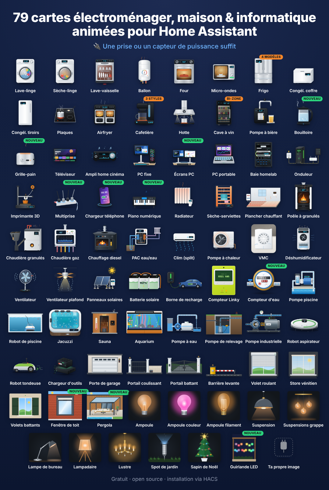</p>

**124 Lovelace-Karten für Haushaltsgeräte**, jede mit einer realistischen animierten Illustration: eine rotierende Waschmaschinentrommel, eine flackernde Pelletofen-Flamme, eine Dieselheizung mit blauer Brennerkrone, ein Whirlpool mit sprudelnden Düsen, ein Saugroboter, ein Linky-Zähler, ein Heimspeicher … Sie zeigen Status, Leistung, Energie und Kosten live an, folgen deinem Home-Assistant-Theme (hell/dunkel) und sprechen Englisch, Französisch, Deutsch, Norwegisch, Niederländisch, Rumänisch, Russisch, Serbisch, Italienisch, Spanisch, Tschechisch, Dänisch, Ungarisch und Polnisch.

Eine einfache smarte Steckdose mit Leistungsmessung genügt. Vernetzte Geräte können zusätzlich Programm, Restzeit, Fortschritt, Tür, Temperaturen … anzeigen.

**▶ [Online ausprobieren](https://skyrotter.github.io/ha-appliance-electromenager-cards/docs/demo.html)** (simulierte Daten, kein Home Assistant nötig) · [Video ansehen](https://github.com/skyrotter/ha-appliance-electromenager-cards/blob/main/docs/electromenager-51-cartes-facebook.mp4) · [Automatisierte Tests](https://skyrotter.github.io/ha-appliance-electromenager-cards/docs/tests.html)

## Galerie

Echte Darstellungen der Karten, nach Themen gruppiert (simulierte Daten).

<p align="center">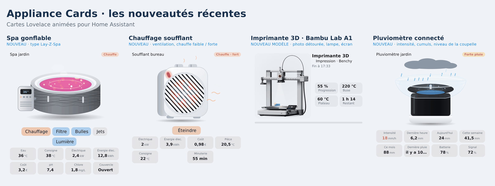</p>

<p align="center">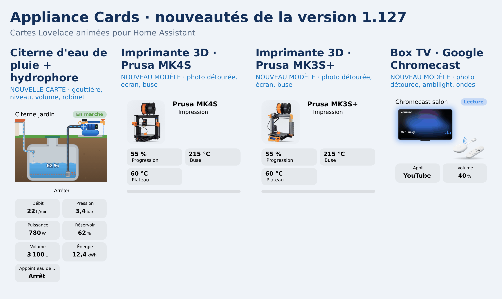</p>

<p align="center">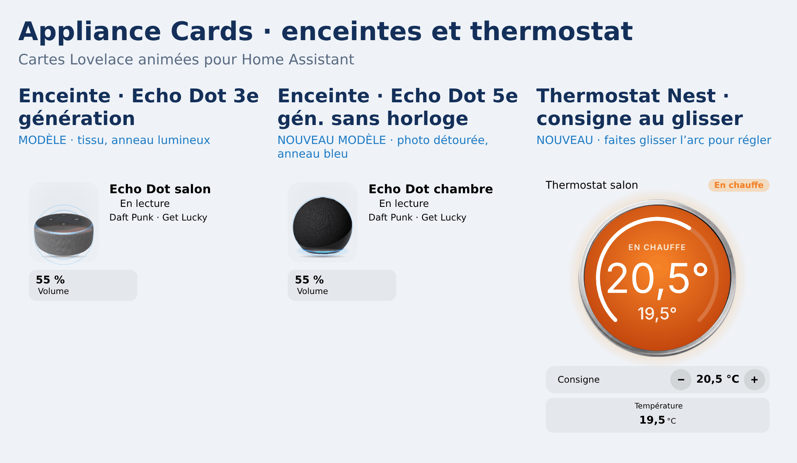</p>

<p align="center">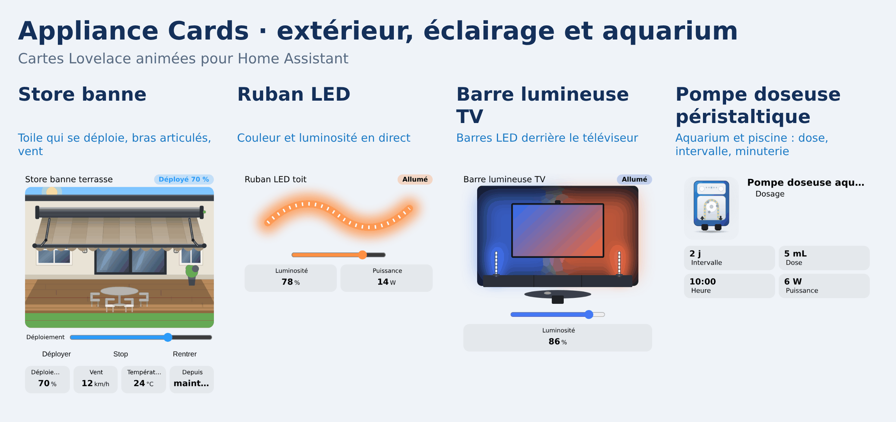</p>

<p align="center">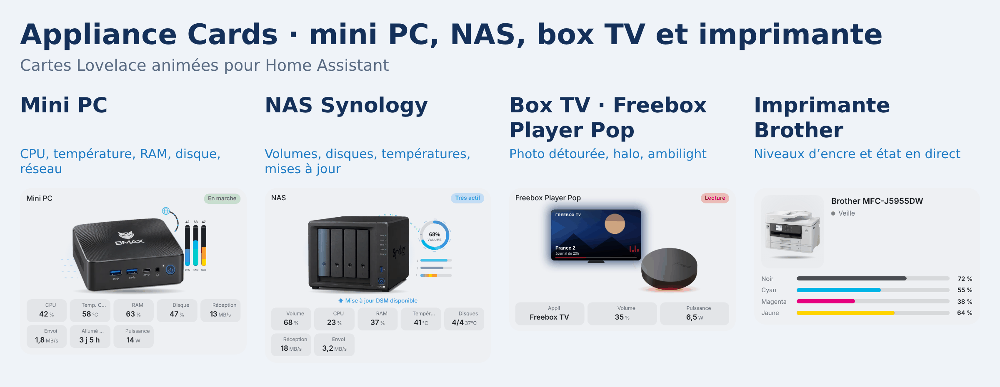</p>

<p align="center">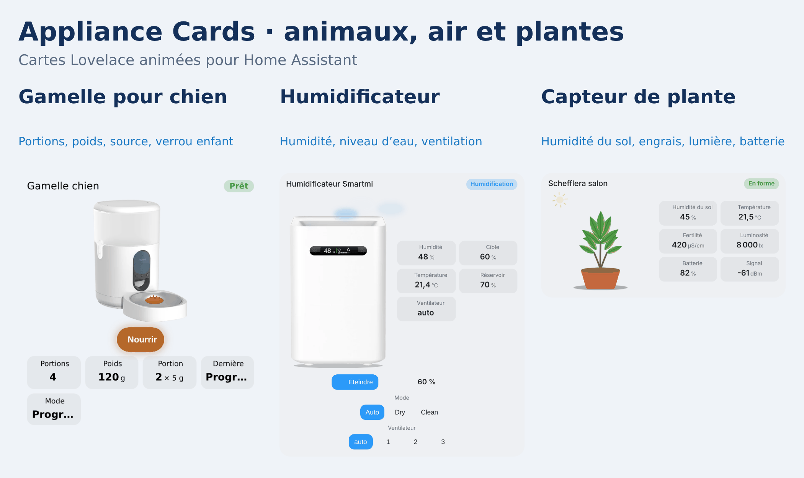</p>

<p align="center">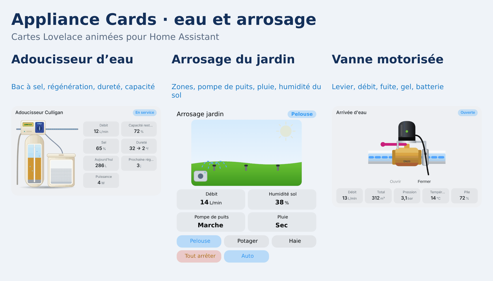</p>

<p align="center"></p>

<p align="center">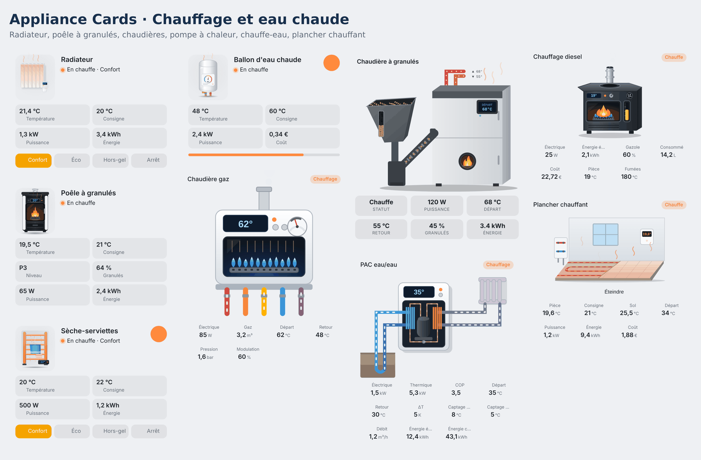</p>

<p align="center">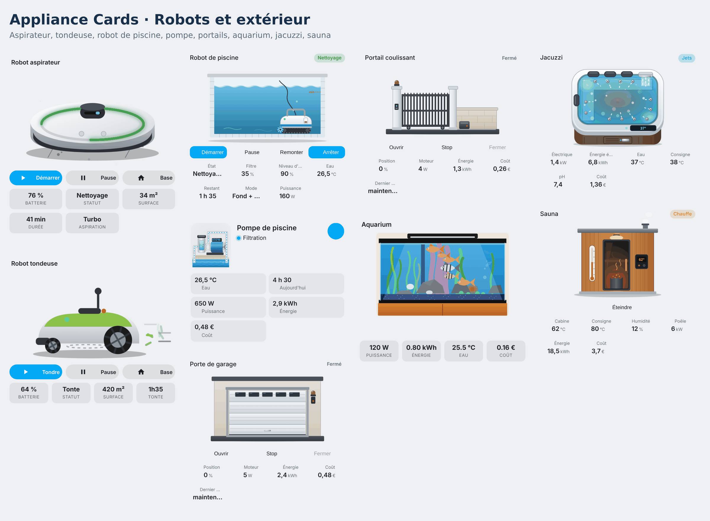</p>

<p align="center">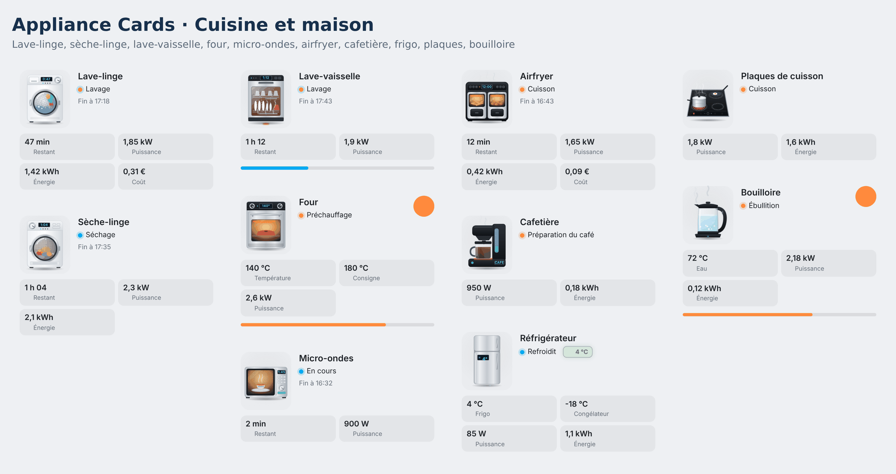</p>

## Installation

**HACS (empfohlen)**

Mit diesem Button öffnest du das Repository direkt in HACS:

[](https://my.home-assistant.io/redirect/hacs_repository/?owner=skyrotter&repository=ha-appliance-electromenager-cards&category=dashboard)

**Manuelle Installation über HACS**

1. Öffne HACS → **Dashboard** (Frontend) und suche nach **Animated Appliance & Energy Cards**.
2. Klicke auf **Herunterladen** und lade dann den Browser neu (Strg+F5).

Falls die Suche nichts findet: HACS → ⋮ → *Benutzerdefinierte Repositories* → füge `https://github.com/skyrotter/ha-appliance-electromenager-cards` mit der Kategorie **Dashboard** hinzu.

**Manuell**

1. Kopiere `dist/ha-appliance-electromenager-cards.js` nach `/config/www/`.
2. Einstellungen → Dashboards → ⋮ → Ressourcen → füge `/local/ha-appliance-electromenager-cards.js` hinzu (JavaScript-Modul).

## Schnellstart

Jede Karte hat einen visuellen Editor. Wenn du eine Karte über die Kartenauswahl hinzufügst, werden Entitäten anhand ihres Namens erkannt (`lave_linge`, `washer`, `fridge`, `ballon` …). In YAML:

```yaml
type: custom:appliance-washer-card
entity: input_boolean.washer_running   # optionale Status-Entität
power: sensor.washer_plug_power        # eine smarte Steckdose genügt
energy: sensor.washer_plug_energy_today
cost: sensor.washer_cost_today
```

Alle Optionen, die Berechnung des Status, Theming und die Sicherung des Ein/Aus-Schalters findest du in **[docs/configuration.md](https://github.com/skyrotter/ha-appliance-electromenager-cards/blob/main/docs/configuration.md)** (auf Englisch).

## Die Karten

Klicke auf eine Karte für ihre Optionen und Beispiele.

### Küche und Wäsche

| Karte | Typ |
|---|---|
| [Waschmaschine](https://github.com/skyrotter/ha-appliance-electromenager-cards/blob/main/docs/cards/washer-dryer-dishwasher.md) | `custom:appliance-washer-card` |
| [Trockner](https://github.com/skyrotter/ha-appliance-electromenager-cards/blob/main/docs/cards/washer-dryer-dishwasher.md) | `custom:appliance-dryer-card` |
| [Geschirrspüler](https://github.com/skyrotter/ha-appliance-electromenager-cards/blob/main/docs/cards/washer-dryer-dishwasher.md) | `custom:appliance-dishwasher-card` |
| [Backofen](https://github.com/skyrotter/ha-appliance-electromenager-cards/blob/main/docs/configuration.md#type-specific-options) | `custom:appliance-oven-card` |
| [Mikrowelle](https://github.com/skyrotter/ha-appliance-electromenager-cards/blob/main/docs/configuration.md#type-specific-options) | `custom:appliance-microwave-card` |
| [Kühlschrank (4 Layouts)](https://github.com/skyrotter/ha-appliance-electromenager-cards/blob/main/docs/cards/wine-cooler-fridge.md) | `custom:appliance-fridge-card` |
| [Gefriertruhe](https://github.com/skyrotter/ha-appliance-electromenager-cards/blob/main/docs/cards/freezers.md) | `custom:appliance-chest-freezer-card` |
| [Gefrierschrank mit Schubladen](https://github.com/skyrotter/ha-appliance-electromenager-cards/blob/main/docs/cards/freezers.md) | `custom:appliance-drawer-freezer-card` |
| [Elektro-Kochfeld](https://github.com/skyrotter/ha-appliance-electromenager-cards/blob/main/docs/cards/hob.md) | `custom:appliance-hob-card` |
| [Heißluftfritteuse (Doppelkorb)](https://github.com/skyrotter/ha-appliance-electromenager-cards/blob/main/docs/cards/air-fryer.md) | `custom:appliance-air-fryer-card` |
| [Kaffeemaschine (Filter, Kapsel, Espresso)](https://github.com/skyrotter/ha-appliance-electromenager-cards/blob/main/docs/cards/coffee-maker.md) | `custom:appliance-coffee-maker-card` |
| [Wasserkocher](https://github.com/skyrotter/ha-appliance-electromenager-cards/blob/main/docs/cards/kettle-toaster.md) | `custom:appliance-kettle-card` |
| [Toaster](https://github.com/skyrotter/ha-appliance-electromenager-cards/blob/main/docs/cards/kettle-toaster.md) | `custom:appliance-toaster-card` |
| [Dunstabzugshaube](https://github.com/skyrotter/ha-appliance-electromenager-cards/blob/main/docs/cards/tv-range-hood.md) | `custom:appliance-range-hood-card` |
| [Weinkühlschrank (eine oder zwei Zonen)](https://github.com/skyrotter/ha-appliance-electromenager-cards/blob/main/docs/cards/wine-cooler-fridge.md) | `custom:appliance-wine-cooler-card` |
| [Bierzapfanlage](https://github.com/skyrotter/ha-appliance-electromenager-cards/blob/main/docs/cards/beer-tap-av-receiver.md) | `custom:appliance-beer-tap-card` |

### Heizung, Warmwasser und Luft

| Karte | Typ |
|---|---|
| [Warmwasserspeicher (mit Solar-Router)](https://github.com/skyrotter/ha-appliance-electromenager-cards/blob/main/docs/cards/water-heater.md) | `custom:appliance-water-heater-card` |
| [Wärmepumpen-Warmwasserbereiter](https://github.com/skyrotter/ha-appliance-electromenager-cards/blob/main/docs/cards/thermo-heater.md) | `custom:appliance-thermo-heater-card` |
| [Heizlüfter (kleiner Elektro-Heizer)](https://github.com/skyrotter/ha-appliance-electromenager-cards/blob/main/docs/cards/fan-heater.md) | `custom:appliance-fan-heater-card` |
| [Fußbodenheizung (Wasser oder elektrisch)](https://github.com/skyrotter/ha-appliance-electromenager-cards/blob/main/docs/cards/underfloor-heating.md) | `custom:appliance-underfloor-heating-card` |
| [Elektroheizkörper](https://github.com/skyrotter/ha-appliance-electromenager-cards/blob/main/docs/cards/radiator.md) | `custom:appliance-radiator-card` |
| [Handtuchheizkörper](https://github.com/skyrotter/ha-appliance-electromenager-cards/blob/main/docs/cards/towel-rack-pc-laptop.md) | `custom:appliance-towel-dryer-card` |
| [Pelletofen](https://github.com/skyrotter/ha-appliance-electromenager-cards/blob/main/docs/cards/pellet-stove.md) | `custom:appliance-pellet-stove-card` |
| [Pelletkessel](https://github.com/skyrotter/ha-appliance-electromenager-cards/blob/main/docs/cards/pellet-boiler.md) | `custom:appliance-pellet-boiler-card` |
| [Gaskessel](https://github.com/skyrotter/ha-appliance-electromenager-cards/blob/main/docs/cards/gas-boiler.md) | `custom:appliance-gas-boiler-card` |
| [Dieselheizung](https://github.com/skyrotter/ha-appliance-electromenager-cards/blob/main/docs/cards/diesel-heater.md) | `custom:appliance-diesel-heater-card` |
| [Wasser-Wasser- / Erdwärmepumpe](https://github.com/skyrotter/ha-appliance-electromenager-cards/blob/main/docs/cards/water-heat-pump.md) | `custom:appliance-water-heat-pump-card` |
| [Klimaanlage, Split-Innengerät](https://github.com/skyrotter/ha-appliance-electromenager-cards/blob/main/docs/cards/air-conditioning.md) | `custom:appliance-ac-split-card` |
| [Wärmepumpe, Außengerät](https://github.com/skyrotter/ha-appliance-electromenager-cards/blob/main/docs/cards/air-conditioning.md) | `custom:appliance-heat-pump-card` |
| [Badlüfter / Wohnraumlüftung (VMC)](https://github.com/skyrotter/ha-appliance-electromenager-cards/blob/main/docs/cards/vmc.md) | `custom:appliance-vmc-card` |
| [Raumklima (Temperatur, Luftfeuchtigkeit, Verlauf, 12 Stile)](https://github.com/skyrotter/ha-appliance-electromenager-cards/blob/main/docs/cards/room-climate.md) | `custom:appliance-room-climate-card` |
| [Luftentfeuchter](https://github.com/skyrotter/ha-appliance-electromenager-cards/blob/main/docs/cards/dehumidifier.md) | `custom:appliance-dehumidifier-card` |
| [Luftreiniger](https://github.com/skyrotter/ha-appliance-electromenager-cards/blob/main/docs/cards/air-purifier.md) | `custom:appliance-air-purifier-card` |

### Energie, Pool, Spa und Aquarium

| Karte | Typ |
|---|---|
| [Solarmodule](https://github.com/skyrotter/ha-appliance-electromenager-cards/blob/main/docs/cards/solar.md) | `custom:appliance-solar-card` |
| [Heimspeicher](https://github.com/skyrotter/ha-appliance-electromenager-cards/blob/main/docs/cards/battery.md) | `custom:appliance-battery-card` |
| [E-Auto-Ladestation (Wallbox + Auto)](https://github.com/skyrotter/ha-appliance-electromenager-cards/blob/main/docs/cards/ev-charger.md) | `custom:appliance-ev-charger-card` |
| [Linky-Stromzähler](https://github.com/skyrotter/ha-appliance-electromenager-cards/blob/main/docs/cards/linky.md) | `custom:appliance-linky-card` |
| [Wasserzähler](https://github.com/skyrotter/ha-appliance-electromenager-cards/blob/main/docs/cards/water-meter.md) | `custom:appliance-water-meter-card` |
| [Wärmezähler (Fernwärme)](https://github.com/skyrotter/ha-appliance-electromenager-cards/blob/main/docs/cards/heat-meter.md) | `custom:appliance-heat-meter-card` |
| [Gaszähler](https://github.com/skyrotter/ha-appliance-electromenager-cards/blob/main/docs/cards/gas-meter.md) | `custom:appliance-gas-meter-card` |
| [Stromzähler (allgemein)](https://github.com/skyrotter/ha-appliance-electromenager-cards/blob/main/docs/cards/electric-meter.md) | `custom:appliance-electric-meter-card` |
| [Heizkörperthermostat (TRV)](https://github.com/skyrotter/ha-appliance-electromenager-cards/blob/main/docs/cards/trv.md) | `custom:appliance-trv-card` |
| [Poolpumpe](https://github.com/skyrotter/ha-appliance-electromenager-cards/blob/main/docs/cards/pool-pump.md) | `custom:appliance-pool-pump-card` |
| [Dosierpumpe (pH+ / pH-)](https://github.com/skyrotter/ha-appliance-electromenager-cards/blob/main/docs/cards/dosing-pump.md) | `custom:appliance-dosing-pump-card` |
| [Poolroboter](https://github.com/skyrotter/ha-appliance-electromenager-cards/blob/main/docs/cards/pool-robot.md) | `custom:appliance-pool-robot-card` |
| [Wasserpumpe (Garten, Brunnen, Regenwasser)](https://github.com/skyrotter/ha-appliance-electromenager-cards/blob/main/docs/cards/pumps.md) | `custom:appliance-water-pump-card` |
| [Industriepumpe](https://github.com/skyrotter/ha-appliance-electromenager-cards/blob/main/docs/cards/pumps.md) | `custom:appliance-industrial-pump-card` |
| [Schmutzwasser-/Tauchpumpe](https://github.com/skyrotter/ha-appliance-electromenager-cards/blob/main/docs/cards/pumps.md) | `custom:appliance-sump-pump-card` |
| [Whirlpool (Jacuzzi)](https://github.com/skyrotter/ha-appliance-electromenager-cards/blob/main/docs/cards/jacuzzi.md) | `custom:appliance-jacuzzi-card` |
| [Aquarium](https://github.com/skyrotter/ha-appliance-electromenager-cards/blob/main/docs/cards/aquarium.md) | `custom:appliance-aquarium-card` |

### Tore, Garage und Sauna

| Karte | Typ |
|---|---|
| [Schranke](https://github.com/skyrotter/ha-appliance-electromenager-cards/blob/main/docs/cards/access.md) | `custom:appliance-barrier-card` |
| [Schiebetor](https://github.com/skyrotter/ha-appliance-electromenager-cards/blob/main/docs/cards/access.md) | `custom:appliance-sliding-gate-card` |
| [Drehtor](https://github.com/skyrotter/ha-appliance-electromenager-cards/blob/main/docs/cards/access.md) | `custom:appliance-swing-gate-card` |
| [Garagentor](https://github.com/skyrotter/ha-appliance-electromenager-cards/blob/main/docs/cards/access.md) | `custom:appliance-garage-door-card` |
| [Briefkasten (Post und Pakete)](https://github.com/skyrotter/ha-appliance-electromenager-cards/blob/main/docs/cards/mailbox.md) | `custom:appliance-mailbox-card` |
| [Rauchmelder (Rauch, CO, 2 Modelle)](https://github.com/skyrotter/ha-appliance-electromenager-cards/blob/main/docs/cards/smoke-detector.md) | `custom:appliance-smoke-detector-card` |
| [Smartes Türschloss (Nuki, 2 Modelle)](https://github.com/skyrotter/ha-appliance-electromenager-cards/blob/main/docs/cards/smart-lock.md) | `custom:appliance-smart-lock-card` |
| [Wassermelder](https://github.com/skyrotter/ha-appliance-electromenager-cards/blob/main/docs/cards/leak-detector.md) | `custom:appliance-leak-detector-card` |
| [Regenmesser (Intensität, Summen)](https://github.com/skyrotter/ha-appliance-electromenager-cards/blob/main/docs/cards/rain-gauge.md) | `custom:appliance-rain-gauge-card` |
| [Pflanzenmonitor (Mi Flora: Feuchte, Licht, Nährstoffe)](https://github.com/skyrotter/ha-appliance-electromenager-cards/blob/main/docs/cards/plant-monitor.md) | `custom:appliance-plant-monitor-card` |
| [Luftbefeuchter (Smartmi-Foto oder Zeichnung)](https://github.com/skyrotter/ha-appliance-electromenager-cards/blob/main/docs/cards/humidifier.md) | `custom:appliance-humidifier-card` |
| [Aufblasbarer Whirlpool (Lay-Z-Spa)](https://github.com/skyrotter/ha-appliance-electromenager-cards/blob/main/docs/cards/inflatable-spa.md) | `custom:appliance-inflatable-spa-card` |
| [Sauna](https://github.com/skyrotter/ha-appliance-electromenager-cards/blob/main/docs/cards/sauna.md) | `custom:appliance-sauna-card` |

### Beleuchtung

| Karte | Typ |
|---|---|
| [Glühbirne](https://github.com/skyrotter/ha-appliance-electromenager-cards/blob/main/docs/cards/lights.md) | `custom:appliance-light-bulb-card` |
| [Farbige Glühbirne](https://github.com/skyrotter/ha-appliance-electromenager-cards/blob/main/docs/cards/lights.md) | `custom:appliance-color-bulb-card` |
| [Filament-Glühbirne](https://github.com/skyrotter/ha-appliance-electromenager-cards/blob/main/docs/cards/lights.md) | `custom:appliance-filament-bulb-card` |
| [Pendelleuchte](https://github.com/skyrotter/ha-appliance-electromenager-cards/blob/main/docs/cards/lights.md) | `custom:appliance-pendant-light-card` |
| [Pendelleuchten-Gruppe](https://github.com/skyrotter/ha-appliance-electromenager-cards/blob/main/docs/cards/lights.md) | `custom:appliance-pendant-cluster-card` |
| [Schreibtischlampe](https://github.com/skyrotter/ha-appliance-electromenager-cards/blob/main/docs/cards/lights.md) | `custom:appliance-desk-lamp-card` |
| [Stehlampe](https://github.com/skyrotter/ha-appliance-electromenager-cards/blob/main/docs/cards/lights.md) | `custom:appliance-floor-lamp-card` |
| [Kronleuchter](https://github.com/skyrotter/ha-appliance-electromenager-cards/blob/main/docs/cards/lights.md) | `custom:appliance-chandelier-card` |
| [Gartenstrahler](https://github.com/skyrotter/ha-appliance-electromenager-cards/blob/main/docs/cards/lights.md) | `custom:appliance-garden-spotlight-card` |
| [Einbaustrahler](https://github.com/skyrotter/ha-appliance-electromenager-cards/blob/main/docs/cards/lights.md) | `custom:appliance-ceiling-spot-card` |
| [Weihnachtsbaum](https://github.com/skyrotter/ha-appliance-electromenager-cards/blob/main/docs/cards/lights.md) | `custom:appliance-christmas-tree-card` |
| [LED-Lichterkette](https://github.com/skyrotter/ha-appliance-electromenager-cards/blob/main/docs/cards/plugs-piano-garland.md) | `custom:appliance-garland-card` |

### Rollläden und Jalousien

| Karte | Typ |
|---|---|
| [Rollladen](https://github.com/skyrotter/ha-appliance-electromenager-cards/blob/main/docs/cards/shutters.md) | `custom:appliance-roller-shutter-card` |
| [Schiebevorhänge](https://github.com/skyrotter/ha-appliance-electromenager-cards/blob/main/docs/cards/sliding-curtain.md) | `custom:appliance-sliding-curtain-card` |
| [Jalousie](https://github.com/skyrotter/ha-appliance-electromenager-cards/blob/main/docs/cards/shutters.md) | `custom:appliance-venetian-blind-card` |
| [Fensterläden](https://github.com/skyrotter/ha-appliance-electromenager-cards/blob/main/docs/cards/shutters.md) | `custom:appliance-swing-shutter-card` |
| [Bioklimatische Pergola](https://github.com/skyrotter/ha-appliance-electromenager-cards/blob/main/docs/cards/shutters.md) | `custom:appliance-pergola-card` |
| [Dachfenster (Velux)](https://github.com/skyrotter/ha-appliance-electromenager-cards/blob/main/docs/cards/shutters.md) | `custom:appliance-roof-window-card` |
| [Markise](https://github.com/skyrotter/ha-appliance-electromenager-cards/blob/main/docs/cards/shutters.md) | `custom:appliance-awning-card` |

### Unterhaltung und IT

| Karte | Typ |
|---|---|
| [Flachbildfernseher](https://github.com/skyrotter/ha-appliance-electromenager-cards/blob/main/docs/cards/tv-range-hood.md) | `custom:appliance-tv-card` |
| [Heimkino-Verstärker (AV-Receiver)](https://github.com/skyrotter/ha-appliance-electromenager-cards/blob/main/docs/cards/beer-tap-av-receiver.md) | `custom:appliance-av-receiver-card` |
| [Smart Speaker (Echo, Nest, Sonos, Devialet, HomePod)](https://github.com/skyrotter/ha-appliance-electromenager-cards/blob/main/docs/cards/smart-speaker.md) | `custom:appliance-smart-speaker-card` |
| [PlayStation 5](https://github.com/skyrotter/ha-appliance-electromenager-cards/blob/main/docs/cards/ps5.md) | `custom:appliance-ps5-card` |
| [Crosstrainer](https://github.com/skyrotter/ha-appliance-electromenager-cards/blob/main/docs/cards/fitness.md) | `custom:appliance-elliptical-card` |
| [Heimtrainer](https://github.com/skyrotter/ha-appliance-electromenager-cards/blob/main/docs/cards/fitness.md) | `custom:appliance-exercise-bike-card` |
| [Rudergerät](https://github.com/skyrotter/ha-appliance-electromenager-cards/blob/main/docs/cards/fitness.md) | `custom:appliance-rowing-machine-card` |
| [Thermomix (TM6 / TM7)](https://github.com/skyrotter/ha-appliance-electromenager-cards/blob/main/docs/cards/thermomix.md) | `custom:appliance-thermomix-card` |
| [Serverschrank (Homelab)](https://github.com/skyrotter/ha-appliance-electromenager-cards/blob/main/docs/cards/towel-rack-pc-laptop.md) | `custom:appliance-server-rack-card` |
| [USV (NUT)](https://github.com/skyrotter/ha-appliance-electromenager-cards/blob/main/docs/cards/ups.md) | `custom:appliance-ups-card` |
| [Mini-PC (Foto BMAX B9 Max)](https://github.com/skyrotter/ha-appliance-electromenager-cards/blob/main/docs/cards/mini-pc.md) | `custom:appliance-mini-pc-card` |
| [NAS (Foto Synology DS423+)](https://github.com/skyrotter/ha-appliance-electromenager-cards/blob/main/docs/cards/nas.md) | `custom:appliance-nas-card` |
| [TV-Box (Freebox Player Pop, Xiaomi TV Box S, NVIDIA Shield)](https://github.com/skyrotter/ha-appliance-electromenager-cards/blob/main/docs/cards/tv-box.md) | `custom:appliance-tv-box-card` |
| [Internet-Box (Freebox Pop, SFR Box)](https://github.com/skyrotter/ha-appliance-electromenager-cards/blob/main/docs/cards/internet-box.md) | `custom:appliance-internet-box-card` |
| [Mobiles Klimagerät](https://github.com/skyrotter/ha-appliance-electromenager-cards/blob/main/docs/cards/portable-ac.md) | `custom:appliance-portable-ac-card` |
| [Futterautomat (Aqara C1)](https://github.com/skyrotter/ha-appliance-electromenager-cards/blob/main/docs/cards/pet-feeder.md) | `custom:appliance-pet-feeder-card` |
| [Desktop-PC](https://github.com/skyrotter/ha-appliance-electromenager-cards/blob/main/docs/cards/towel-rack-pc-laptop.md) | `custom:appliance-desktop-pc-card` |
| [Monitore (1 bis 3)](https://github.com/skyrotter/ha-appliance-electromenager-cards/blob/main/docs/cards/towel-rack-pc-laptop.md) | `custom:appliance-monitor-card` |
| [Laptop](https://github.com/skyrotter/ha-appliance-electromenager-cards/blob/main/docs/cards/towel-rack-pc-laptop.md) | `custom:appliance-laptop-card` |
| [Steckdosenleiste](https://github.com/skyrotter/ha-appliance-electromenager-cards/blob/main/docs/cards/plugs-piano-garland.md) | `custom:appliance-power-strip-card` |
| [Smarte Steckdose](https://github.com/skyrotter/ha-appliance-electromenager-cards/blob/main/docs/cards/plugs-piano-garland.md) | `custom:appliance-smart-plug-card` |
| [Drucker / Scanner](https://github.com/skyrotter/ha-appliance-electromenager-cards/blob/main/docs/cards/printer.md) | `custom:appliance-printer-card` |
| [Handy-Ladegerät](https://github.com/skyrotter/ha-appliance-electromenager-cards/blob/main/docs/cards/plugs-piano-garland.md) | `custom:appliance-phone-charger-card` |
| [Digitalpiano](https://github.com/skyrotter/ha-appliance-electromenager-cards/blob/main/docs/cards/plugs-piano-garland.md) | `custom:appliance-piano-card` |
| [3D-Drucker](https://github.com/skyrotter/ha-appliance-electromenager-cards/blob/main/docs/cards/printer-3d.md) | `custom:appliance-printer-3d-card` |

### Roboter, Ventilatoren und mehr

| Karte | Typ |
|---|---|
| [Saugroboter](https://github.com/skyrotter/ha-appliance-electromenager-cards/blob/main/docs/cards/robots.md) | `custom:appliance-robot-vacuum-solo-card` |
| [Nass-/Trockensauger](https://github.com/skyrotter/ha-appliance-electromenager-cards/blob/main/docs/cards/wet-vacuum.md) | `custom:appliance-wet-vacuum-card` |
| [Mähroboter](https://github.com/skyrotter/ha-appliance-electromenager-cards/blob/main/docs/cards/robots.md) | `custom:appliance-robot-mower-solo-card` |
| [Ventilator](https://github.com/skyrotter/ha-appliance-electromenager-cards/blob/main/docs/cards/fan.md) | `custom:appliance-fan-card` |
| [Deckenventilator](https://github.com/skyrotter/ha-appliance-electromenager-cards/blob/main/docs/cards/ceiling-fan.md) | `custom:appliance-ceiling-fan-card` |
| [Akku-Ladegerät für Werkzeug](https://github.com/skyrotter/ha-appliance-electromenager-cards/blob/main/docs/cards/tool-charger.md) | `custom:appliance-tool-charger-card` |
| [Smarte Waage (Foto Withings)](https://github.com/skyrotter/ha-appliance-electromenager-cards/blob/main/docs/cards/scale.md) | `custom:appliance-scale-card` |
| [Katzenklappe (Chip, Tiere drinnen / draußen)](https://github.com/skyrotter/ha-appliance-electromenager-cards/blob/main/docs/cards/cat-flap.md) | `custom:appliance-cat-flap-card` |
| [Trinkbrunnen für Haustiere](https://github.com/skyrotter/ha-appliance-electromenager-cards/blob/main/docs/cards/pet-fountain.md) | `custom:appliance-pet-fountain-card` |
| [Allgemeines Gerät (eigenes Bild)](https://github.com/skyrotter/ha-appliance-electromenager-cards/blob/main/docs/cards/generic.md) | `custom:appliance-generic-card` |

## Dokumentation

- [Konfiguration](https://github.com/skyrotter/ha-appliance-electromenager-cards/blob/main/docs/configuration.md): allgemeine Optionen, Berechnung des Status, Modi, Theming, Sicherung des Ein/Aus-Schalters (Englisch).
- [Zykluserkennung für Waschmaschinen, Trockner und Geschirrspüler](https://github.com/skyrotter/ha-appliance-electromenager-cards/blob/main/docs/cards/washer-dryer-dishwasher.md): die empfohlene Automatisierung mit einer smarten Steckdose (Englisch).
- [Entwicklung und Übersetzungen](https://github.com/skyrotter/ha-appliance-electromenager-cards/blob/main/docs/development.md): Build, Hinzufügen einer Karte oder einer Sprache (Englisch).
- [Descriptions en français](https://github.com/skyrotter/ha-appliance-electromenager-cards/blob/main/docs/cards-fr.md)

## Mitwirken

Den vollständigen Leitfaden findest du in [CONTRIBUTING.md](https://github.com/skyrotter/ha-appliance-electromenager-cards/blob/main/CONTRIBUTING.md). Fehlerberichte und Kartenwünsche sind in den [Issues](https://github.com/skyrotter/ha-appliance-electromenager-cards/issues) willkommen. `dist/` wird generiert: Bearbeite `src/`, führe `node build.js` aus und committe beides (siehe [Entwicklung](https://github.com/skyrotter/ha-appliance-electromenager-cards/blob/main/docs/development.md)).

## Lizenz

[MIT](https://github.com/skyrotter/ha-appliance-electromenager-cards/blob/main/LICENSE)
