# Appliance Électroménager Cards para Home Assistant

<p align="center"><a href="https://github.com/sponsors/skyrotter">❤️ Patrocina en GitHub</a> · <a href="https://paypal.me/skyrotter">💙 Dona con PayPal.me</a><br><a href="https://buymeacoffee.com/skyrotter"></a></p>

[](https://hacs.xyz)
[](https://github.com/skyrotter/ha-appliance-electromenager-cards/actions/workflows/validate.yml)
[](https://github.com/skyrotter/ha-appliance-electromenager-cards/blob/main/LICENSE)

[🇬🇧 English](README.md) · [🇫🇷 Français](README.fr.md) · [🇮🇹 Italiano](README.it.md) · [🇩🇪 Deutsch](README.de.md) · 🇪🇸 Español · [🇵🇹 Português (Portugal)](README.pt-PT.md) · [🇧🇷 Português (Brasil)](README.pt-BR.md)

## ❤️ Apoya el proyecto

Este proyecto es gratuito y de código abierto, desarrollado en mi tiempo libre. Si hace que tu panel de control se vea mejor, una pequeña donación me ayuda a añadir nuevas tarjetas y a mantener las existentes al día. ¿Te falta algún electrodoméstico? [Propónlo en las incidencias](https://github.com/skyrotter/ha-appliance-electromenager-cards/issues), así llegaron al proyecto el calefactor diésel y el jacuzzi.

<p align="center">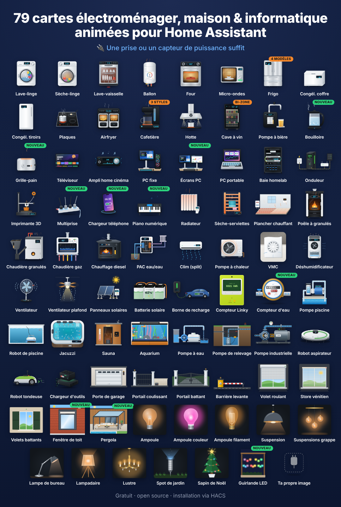</p>

**124 tarjetas Lovelace para electrodomésticos**, cada una con una ilustración animada realista: el tambor de una lavadora girando, la llama parpadeante de una estufa de pellets, un calefactor diésel con su corona azul de combustión, un jacuzzi con sus chorros burbujeantes, un robot aspirador, un contador Linky, una batería doméstica... Muestran el estado en directo, la potencia, la energía y el coste, siguen el tema de Home Assistant (claro/oscuro) y hablan inglés, francés, alemán, noruego, neerlandés, rumano, ruso, serbio, italiano, español, checo, danés, húngaro y polaco.

Basta con un simple enchufe inteligente con sensor de potencia. Los electrodomésticos conectados pueden añadir programa, tiempo restante, progreso, puerta, temperaturas...

**▶ [Pruébalo online](https://skyrotter.github.io/ha-appliance-electromenager-cards/docs/demo.html)** (datos simulados, no hace falta Home Assistant) · [Ver el vídeo](https://github.com/skyrotter/ha-appliance-electromenager-cards/blob/main/docs/electromenager-51-cartes-facebook.mp4) · [Pruebas automatizadas](https://skyrotter.github.io/ha-appliance-electromenager-cards/docs/tests.html)

## Galería

Renderizados en vivo de las tarjetas, agrupadas por temática (datos simulados).

<p align="center">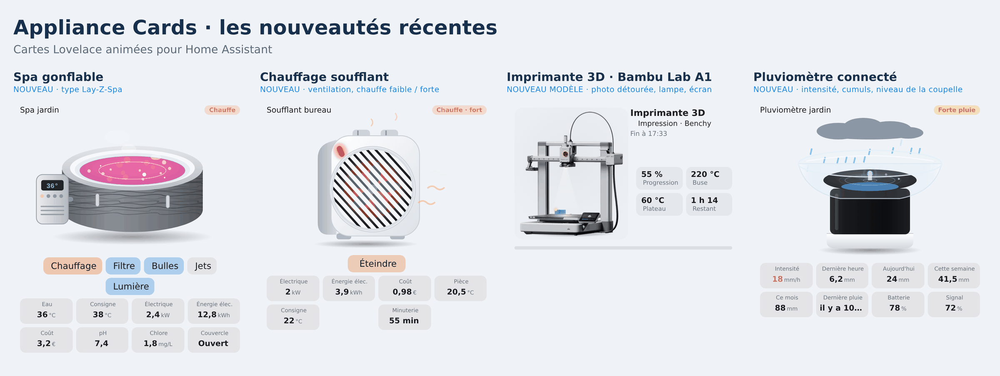</p>

<p align="center">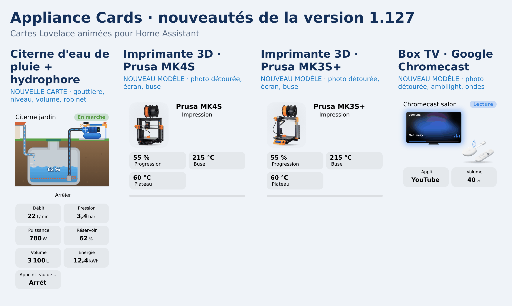</p>

<p align="center">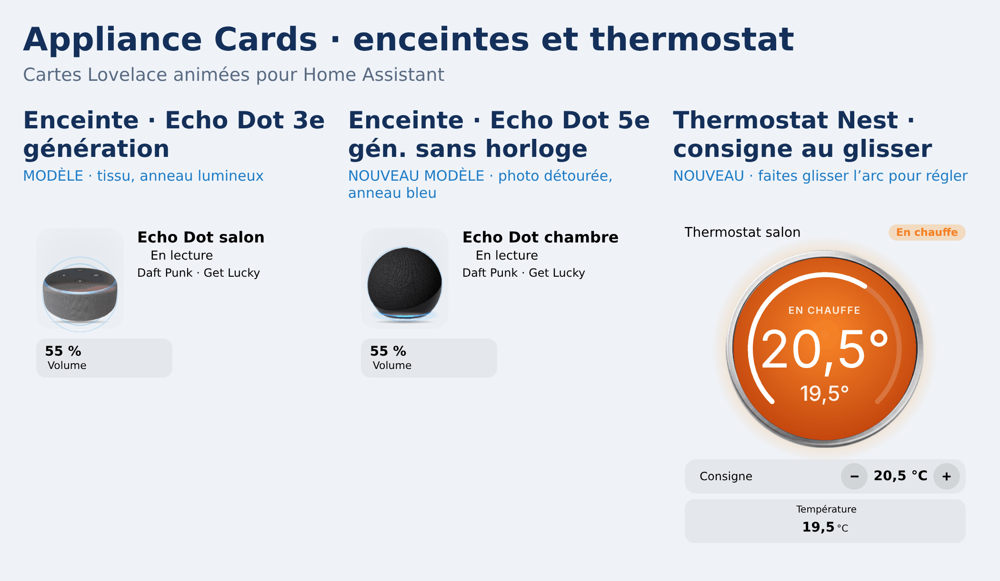</p>

<p align="center">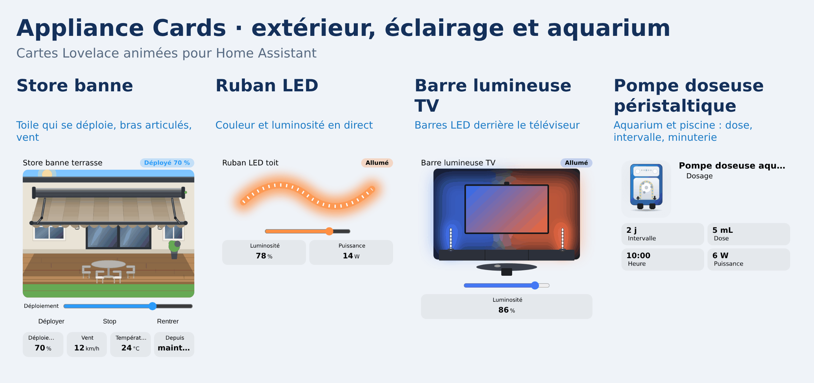</p>

<p align="center">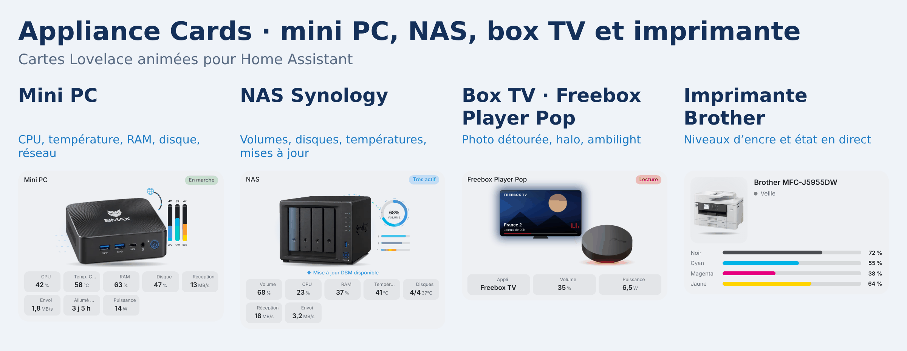</p>

<p align="center">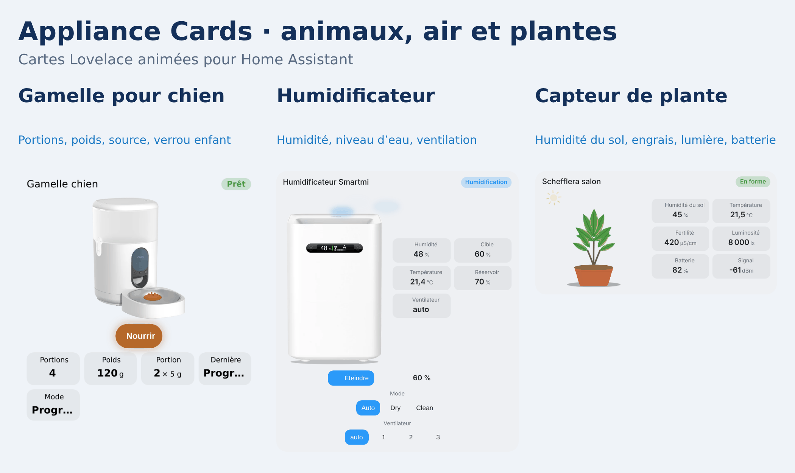</p>

<p align="center">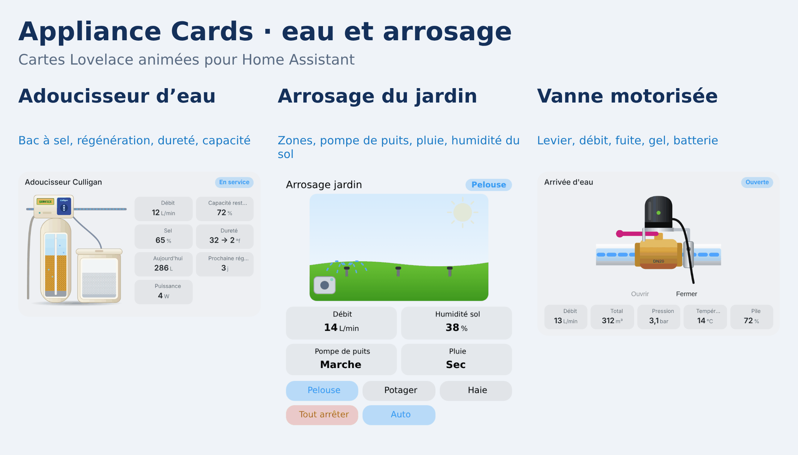</p>

<p align="center"></p>

<p align="center">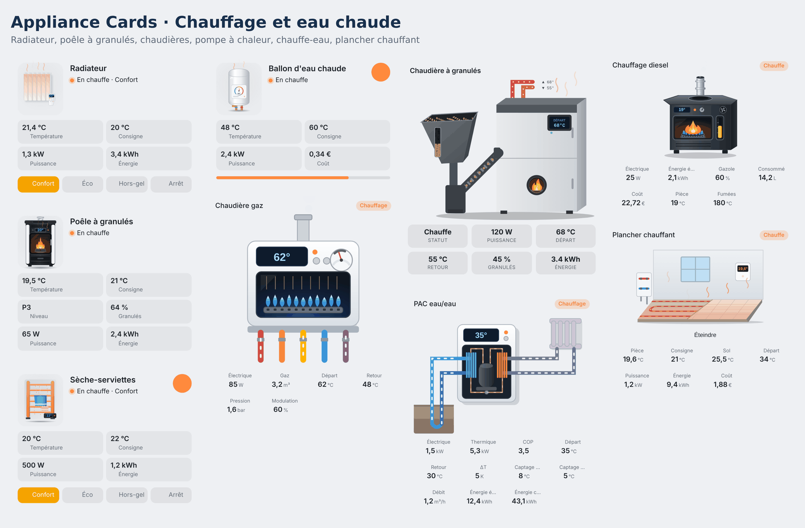</p>

<p align="center">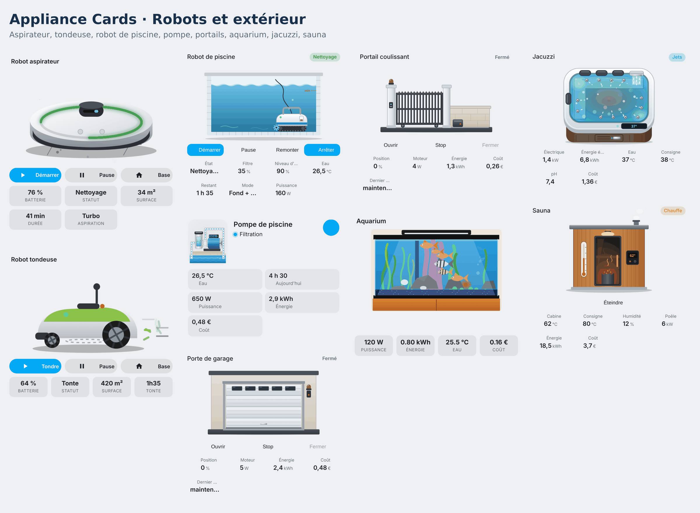</p>

<p align="center">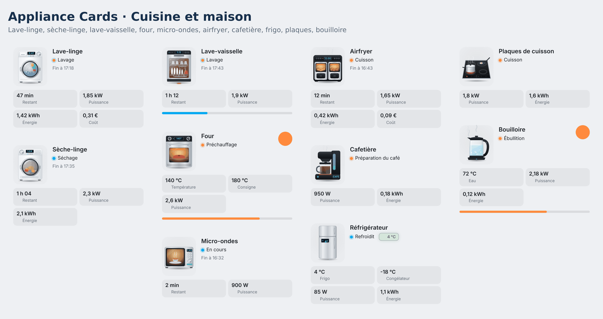</p>

## Instalación

**HACS (recomendado)**

Pulsa este botón para abrir el repositorio directamente en HACS:

[](https://my.home-assistant.io/redirect/hacs_repository/?owner=skyrotter&repository=ha-appliance-electromenager-cards&category=dashboard)

**Instalación manual mediante HACS**

1. Abre HACS → **Panel de control** (Frontend) y busca **Animated Appliance & Energy Cards**.
2. Pulsa **Descargar** y recarga el navegador (Ctrl+F5).

Si la búsqueda aún no lo encuentra: HACS → ⋮ → *Repositorios personalizados* → añade `https://github.com/skyrotter/ha-appliance-electromenager-cards` con la categoría **Panel de control**.

**Manual**

1. Copia `dist/ha-appliance-electromenager-cards.js` en `/config/www/`.
2. Ajustes → Paneles de control → ⋮ → Recursos → añade `/local/ha-appliance-electromenager-cards.js` (módulo JavaScript).

## Inicio rápido

Todas las tarjetas tienen un editor visual. Al añadir una desde el selector de tarjetas, las entidades se detectan por nombre (`lave_linge`, `washer`, `fridge`, `ballon`…). En YAML:

```yaml
type: custom:appliance-washer-card
entity: input_boolean.washer_running   # entidad de estado opcional
power: sensor.washer_plug_power        # basta con un enchufe inteligente
energy: sensor.washer_plug_energy_today
cost: sensor.washer_cost_today
```

Todas las opciones, cómo se calcula el estado, la personalización de tema y la seguridad del botón de encendido están en **[docs/configuration.md](https://github.com/skyrotter/ha-appliance-electromenager-cards/blob/main/docs/configuration.md)** (en inglés).

## Las tarjetas

Pulsa una tarjeta para ver sus opciones y ejemplos (documentación en inglés).

### Cocina y lavandería

| Tarjeta | Tipo |
|---|---|
| [Lavadora](https://github.com/skyrotter/ha-appliance-electromenager-cards/blob/main/docs/cards/washer-dryer-dishwasher.md) | `custom:appliance-washer-card` |
| [Secadora](https://github.com/skyrotter/ha-appliance-electromenager-cards/blob/main/docs/cards/washer-dryer-dishwasher.md) | `custom:appliance-dryer-card` |
| [Lavavajillas](https://github.com/skyrotter/ha-appliance-electromenager-cards/blob/main/docs/cards/washer-dryer-dishwasher.md) | `custom:appliance-dishwasher-card` |
| [Horno](https://github.com/skyrotter/ha-appliance-electromenager-cards/blob/main/docs/configuration.md#type-specific-options) | `custom:appliance-oven-card` |
| [Microondas](https://github.com/skyrotter/ha-appliance-electromenager-cards/blob/main/docs/configuration.md#type-specific-options) | `custom:appliance-microwave-card` |
| [Frigorífico (4 diseños)](https://github.com/skyrotter/ha-appliance-electromenager-cards/blob/main/docs/cards/wine-cooler-fridge.md) | `custom:appliance-fridge-card` |
| [Congelador arcón](https://github.com/skyrotter/ha-appliance-electromenager-cards/blob/main/docs/cards/freezers.md) | `custom:appliance-chest-freezer-card` |
| [Congelador vertical de cajones](https://github.com/skyrotter/ha-appliance-electromenager-cards/blob/main/docs/cards/freezers.md) | `custom:appliance-drawer-freezer-card` |
| [Encimera eléctrica](https://github.com/skyrotter/ha-appliance-electromenager-cards/blob/main/docs/cards/hob.md) | `custom:appliance-hob-card` |
| [Freidora de aire (doble cesta)](https://github.com/skyrotter/ha-appliance-electromenager-cards/blob/main/docs/cards/air-fryer.md) | `custom:appliance-air-fryer-card` |
| [Cafetera (goteo, cápsulas, espresso)](https://github.com/skyrotter/ha-appliance-electromenager-cards/blob/main/docs/cards/coffee-maker.md) | `custom:appliance-coffee-maker-card` |
| [Hervidor de agua](https://github.com/skyrotter/ha-appliance-electromenager-cards/blob/main/docs/cards/kettle-toaster.md) | `custom:appliance-kettle-card` |
| [Tostadora](https://github.com/skyrotter/ha-appliance-electromenager-cards/blob/main/docs/cards/kettle-toaster.md) | `custom:appliance-toaster-card` |
| [Campana extractora](https://github.com/skyrotter/ha-appliance-electromenager-cards/blob/main/docs/cards/tv-range-hood.md) | `custom:appliance-range-hood-card` |
| [Vinoteca (una o dos zonas)](https://github.com/skyrotter/ha-appliance-electromenager-cards/blob/main/docs/cards/wine-cooler-fridge.md) | `custom:appliance-wine-cooler-card` |
| [Barril de cerveza](https://github.com/skyrotter/ha-appliance-electromenager-cards/blob/main/docs/cards/beer-tap-av-receiver.md) | `custom:appliance-beer-tap-card` |

### Calefacción, agua caliente y aire

| Tarjeta | Tipo |
|---|---|
| [Termo eléctrico (con enrutador solar)](https://github.com/skyrotter/ha-appliance-electromenager-cards/blob/main/docs/cards/water-heater.md) | `custom:appliance-water-heater-card` |
| [Termo termodinámico](https://github.com/skyrotter/ha-appliance-electromenager-cards/blob/main/docs/cards/thermo-heater.md) | `custom:appliance-thermo-heater-card` |
| [Calefactor de aire (eléctrico pequeño)](https://github.com/skyrotter/ha-appliance-electromenager-cards/blob/main/docs/cards/fan-heater.md) | `custom:appliance-fan-heater-card` |
| [Suelo radiante (agua o eléctrico)](https://github.com/skyrotter/ha-appliance-electromenager-cards/blob/main/docs/cards/underfloor-heating.md) | `custom:appliance-underfloor-heating-card` |
| [Radiador eléctrico](https://github.com/skyrotter/ha-appliance-electromenager-cards/blob/main/docs/cards/radiator.md) | `custom:appliance-radiator-card` |
| [Toallero eléctrico](https://github.com/skyrotter/ha-appliance-electromenager-cards/blob/main/docs/cards/towel-rack-pc-laptop.md) | `custom:appliance-towel-dryer-card` |
| [Estufa de pellets](https://github.com/skyrotter/ha-appliance-electromenager-cards/blob/main/docs/cards/pellet-stove.md) | `custom:appliance-pellet-stove-card` |
| [Caldera de pellets](https://github.com/skyrotter/ha-appliance-electromenager-cards/blob/main/docs/cards/pellet-boiler.md) | `custom:appliance-pellet-boiler-card` |
| [Caldera de gas](https://github.com/skyrotter/ha-appliance-electromenager-cards/blob/main/docs/cards/gas-boiler.md) | `custom:appliance-gas-boiler-card` |
| [Calefactor diésel](https://github.com/skyrotter/ha-appliance-electromenager-cards/blob/main/docs/cards/diesel-heater.md) | `custom:appliance-diesel-heater-card` |
| [Bomba de calor agua-agua / geotérmica](https://github.com/skyrotter/ha-appliance-electromenager-cards/blob/main/docs/cards/water-heat-pump.md) | `custom:appliance-water-heat-pump-card` |
| [Aire acondicionado, split interior](https://github.com/skyrotter/ha-appliance-electromenager-cards/blob/main/docs/cards/air-conditioning.md) | `custom:appliance-ac-split-card` |
| [Bomba de calor, unidad exterior](https://github.com/skyrotter/ha-appliance-electromenager-cards/blob/main/docs/cards/air-conditioning.md) | `custom:appliance-heat-pump-card` |
| [Extractor de baño (VMC)](https://github.com/skyrotter/ha-appliance-electromenager-cards/blob/main/docs/cards/vmc.md) | `custom:appliance-vmc-card` |
| [Clima de la habitación (temperatura, humedad, histórico, 12 estilos)](https://github.com/skyrotter/ha-appliance-electromenager-cards/blob/main/docs/cards/room-climate.md) | `custom:appliance-room-climate-card` |
| [Deshumidificador](https://github.com/skyrotter/ha-appliance-electromenager-cards/blob/main/docs/cards/dehumidifier.md) | `custom:appliance-dehumidifier-card` |
| [Purificador de aire](https://github.com/skyrotter/ha-appliance-electromenager-cards/blob/main/docs/cards/air-purifier.md) | `custom:appliance-air-purifier-card` |

### Energía, piscina, spa y acuario

| Tarjeta | Tipo |
|---|---|
| [Paneles solares](https://github.com/skyrotter/ha-appliance-electromenager-cards/blob/main/docs/cards/solar.md) | `custom:appliance-solar-card` |
| [Batería doméstica](https://github.com/skyrotter/ha-appliance-electromenager-cards/blob/main/docs/cards/battery.md) | `custom:appliance-battery-card` |
| [Cargador de coche eléctrico (wallbox + coche)](https://github.com/skyrotter/ha-appliance-electromenager-cards/blob/main/docs/cards/ev-charger.md) | `custom:appliance-ev-charger-card` |
| [Contador eléctrico Linky](https://github.com/skyrotter/ha-appliance-electromenager-cards/blob/main/docs/cards/linky.md) | `custom:appliance-linky-card` |
| [Contador de agua](https://github.com/skyrotter/ha-appliance-electromenager-cards/blob/main/docs/cards/water-meter.md) | `custom:appliance-water-meter-card` |
| [Contador de calor (calefacción urbana)](https://github.com/skyrotter/ha-appliance-electromenager-cards/blob/main/docs/cards/heat-meter.md) | `custom:appliance-heat-meter-card` |
| [Contador de gas](https://github.com/skyrotter/ha-appliance-electromenager-cards/blob/main/docs/cards/gas-meter.md) | `custom:appliance-gas-meter-card` |
| [Contador eléctrico (genérico)](https://github.com/skyrotter/ha-appliance-electromenager-cards/blob/main/docs/cards/electric-meter.md) | `custom:appliance-electric-meter-card` |
| [Válvula de radiador (TRV)](https://github.com/skyrotter/ha-appliance-electromenager-cards/blob/main/docs/cards/trv.md) | `custom:appliance-trv-card` |
| [Bomba de piscina](https://github.com/skyrotter/ha-appliance-electromenager-cards/blob/main/docs/cards/pool-pump.md) | `custom:appliance-pool-pump-card` |
| [Bomba dosificadora (pH+ / pH-)](https://github.com/skyrotter/ha-appliance-electromenager-cards/blob/main/docs/cards/dosing-pump.md) | `custom:appliance-dosing-pump-card` |
| [Robot limpiafondos de piscina](https://github.com/skyrotter/ha-appliance-electromenager-cards/blob/main/docs/cards/pool-robot.md) | `custom:appliance-pool-robot-card` |
| [Bomba de agua (jardín, pozo, agua de lluvia)](https://github.com/skyrotter/ha-appliance-electromenager-cards/blob/main/docs/cards/pumps.md) | `custom:appliance-water-pump-card` |
| [Bomba industrial](https://github.com/skyrotter/ha-appliance-electromenager-cards/blob/main/docs/cards/pumps.md) | `custom:appliance-industrial-pump-card` |
| [Bomba de achique](https://github.com/skyrotter/ha-appliance-electromenager-cards/blob/main/docs/cards/pumps.md) | `custom:appliance-sump-pump-card` |
| [Jacuzzi (spa de hidromasaje)](https://github.com/skyrotter/ha-appliance-electromenager-cards/blob/main/docs/cards/jacuzzi.md) | `custom:appliance-jacuzzi-card` |
| [Acuario](https://github.com/skyrotter/ha-appliance-electromenager-cards/blob/main/docs/cards/aquarium.md) | `custom:appliance-aquarium-card` |

### Puertas, garaje y sauna

| Tarjeta | Tipo |
|---|---|
| [Barrera](https://github.com/skyrotter/ha-appliance-electromenager-cards/blob/main/docs/cards/access.md) | `custom:appliance-barrier-card` |
| [Puerta corredera](https://github.com/skyrotter/ha-appliance-electromenager-cards/blob/main/docs/cards/access.md) | `custom:appliance-sliding-gate-card` |
| [Puerta batiente](https://github.com/skyrotter/ha-appliance-electromenager-cards/blob/main/docs/cards/access.md) | `custom:appliance-swing-gate-card` |
| [Puerta de garaje](https://github.com/skyrotter/ha-appliance-electromenager-cards/blob/main/docs/cards/access.md) | `custom:appliance-garage-door-card` |
| [Buzón (correo y paquetes)](https://github.com/skyrotter/ha-appliance-electromenager-cards/blob/main/docs/cards/mailbox.md) | `custom:appliance-mailbox-card` |
| [Detector de humo (humo, CO, 2 modelos)](https://github.com/skyrotter/ha-appliance-electromenager-cards/blob/main/docs/cards/smoke-detector.md) | `custom:appliance-smoke-detector-card` |
| [Cerradura inteligente (Nuki, 2 modelos)](https://github.com/skyrotter/ha-appliance-electromenager-cards/blob/main/docs/cards/smart-lock.md) | `custom:appliance-smart-lock-card` |
| [Detector de fugas de agua](https://github.com/skyrotter/ha-appliance-electromenager-cards/blob/main/docs/cards/leak-detector.md) | `custom:appliance-leak-detector-card` |
| [Pluviómetro (intensidad, totales)](https://github.com/skyrotter/ha-appliance-electromenager-cards/blob/main/docs/cards/rain-gauge.md) | `custom:appliance-rain-gauge-card` |
| [Monitor de plantas (Mi Flora: humedad, luz, fertilidad)](https://github.com/skyrotter/ha-appliance-electromenager-cards/blob/main/docs/cards/plant-monitor.md) | `custom:appliance-plant-monitor-card` |
| [Humidificador (foto Smartmi o dibujo)](https://github.com/skyrotter/ha-appliance-electromenager-cards/blob/main/docs/cards/humidifier.md) | `custom:appliance-humidifier-card` |
| [Spa hinchable (estilo Lay-Z-Spa)](https://github.com/skyrotter/ha-appliance-electromenager-cards/blob/main/docs/cards/inflatable-spa.md) | `custom:appliance-inflatable-spa-card` |
| [Sauna](https://github.com/skyrotter/ha-appliance-electromenager-cards/blob/main/docs/cards/sauna.md) | `custom:appliance-sauna-card` |

### Iluminación

| Tarjeta | Tipo |
|---|---|
| [Bombilla](https://github.com/skyrotter/ha-appliance-electromenager-cards/blob/main/docs/cards/lights.md) | `custom:appliance-light-bulb-card` |
| [Bombilla de color](https://github.com/skyrotter/ha-appliance-electromenager-cards/blob/main/docs/cards/lights.md) | `custom:appliance-color-bulb-card` |
| [Bombilla de filamento](https://github.com/skyrotter/ha-appliance-electromenager-cards/blob/main/docs/cards/lights.md) | `custom:appliance-filament-bulb-card` |
| [Lámpara colgante](https://github.com/skyrotter/ha-appliance-electromenager-cards/blob/main/docs/cards/lights.md) | `custom:appliance-pendant-light-card` |
| [Grupo de lámparas colgantes](https://github.com/skyrotter/ha-appliance-electromenager-cards/blob/main/docs/cards/lights.md) | `custom:appliance-pendant-cluster-card` |
| [Lámpara de escritorio](https://github.com/skyrotter/ha-appliance-electromenager-cards/blob/main/docs/cards/lights.md) | `custom:appliance-desk-lamp-card` |
| [Lámpara de pie](https://github.com/skyrotter/ha-appliance-electromenager-cards/blob/main/docs/cards/lights.md) | `custom:appliance-floor-lamp-card` |
| [Araña de luces](https://github.com/skyrotter/ha-appliance-electromenager-cards/blob/main/docs/cards/lights.md) | `custom:appliance-chandelier-card` |
| [Foco de jardín](https://github.com/skyrotter/ha-appliance-electromenager-cards/blob/main/docs/cards/lights.md) | `custom:appliance-garden-spotlight-card` |
| [Focos empotrados](https://github.com/skyrotter/ha-appliance-electromenager-cards/blob/main/docs/cards/lights.md) | `custom:appliance-ceiling-spot-card` |
| [Árbol de Navidad](https://github.com/skyrotter/ha-appliance-electromenager-cards/blob/main/docs/cards/lights.md) | `custom:appliance-christmas-tree-card` |
| [Guirnalda de luces LED](https://github.com/skyrotter/ha-appliance-electromenager-cards/blob/main/docs/cards/plugs-piano-garland.md) | `custom:appliance-garland-card` |

### Persianas y toldos

| Tarjeta | Tipo |
|---|---|
| [Persiana enrollable](https://github.com/skyrotter/ha-appliance-electromenager-cards/blob/main/docs/cards/shutters.md) | `custom:appliance-roller-shutter-card` |
| [Cortinas correderas](https://github.com/skyrotter/ha-appliance-electromenager-cards/blob/main/docs/cards/sliding-curtain.md) | `custom:appliance-sliding-curtain-card` |
| [Persiana veneciana](https://github.com/skyrotter/ha-appliance-electromenager-cards/blob/main/docs/cards/shutters.md) | `custom:appliance-venetian-blind-card` |
| [Contraventanas batientes](https://github.com/skyrotter/ha-appliance-electromenager-cards/blob/main/docs/cards/shutters.md) | `custom:appliance-swing-shutter-card` |
| [Pérgola bioclimática](https://github.com/skyrotter/ha-appliance-electromenager-cards/blob/main/docs/cards/shutters.md) | `custom:appliance-pergola-card` |
| [Ventana de tejado (Velux)](https://github.com/skyrotter/ha-appliance-electromenager-cards/blob/main/docs/cards/shutters.md) | `custom:appliance-roof-window-card` |
| [Toldo retráctil](https://github.com/skyrotter/ha-appliance-electromenager-cards/blob/main/docs/cards/shutters.md) | `custom:appliance-awning-card` |

### Entretenimiento e informática

| Tarjeta | Tipo |
|---|---|
| [Televisor plano](https://github.com/skyrotter/ha-appliance-electromenager-cards/blob/main/docs/cards/tv-range-hood.md) | `custom:appliance-tv-card` |
| [Amplificador de cine en casa (receptor AV)](https://github.com/skyrotter/ha-appliance-electromenager-cards/blob/main/docs/cards/beer-tap-av-receiver.md) | `custom:appliance-av-receiver-card` |
| [Altavoz inteligente (Echo, Nest, Sonos, Devialet, HomePod)](https://github.com/skyrotter/ha-appliance-electromenager-cards/blob/main/docs/cards/smart-speaker.md) | `custom:appliance-smart-speaker-card` |
| [PlayStation 5](https://github.com/skyrotter/ha-appliance-electromenager-cards/blob/main/docs/cards/ps5.md) | `custom:appliance-ps5-card` |
| [Elíptica](https://github.com/skyrotter/ha-appliance-electromenager-cards/blob/main/docs/cards/fitness.md) | `custom:appliance-elliptical-card` |
| [Bicicleta estática](https://github.com/skyrotter/ha-appliance-electromenager-cards/blob/main/docs/cards/fitness.md) | `custom:appliance-exercise-bike-card` |
| [Máquina de remo](https://github.com/skyrotter/ha-appliance-electromenager-cards/blob/main/docs/cards/fitness.md) | `custom:appliance-rowing-machine-card` |
| [Thermomix (TM6 / TM7)](https://github.com/skyrotter/ha-appliance-electromenager-cards/blob/main/docs/cards/thermomix.md) | `custom:appliance-thermomix-card` |
| [Cookeo (robot de cocina)](https://github.com/skyrotter/ha-appliance-electromenager-cards/blob/main/docs/cards/cookeo.md) | `custom:appliance-cookeo-card` |
| [Rack de servidores (homelab)](https://github.com/skyrotter/ha-appliance-electromenager-cards/blob/main/docs/cards/towel-rack-pc-laptop.md) | `custom:appliance-server-rack-card` |
| [SAI (NUT)](https://github.com/skyrotter/ha-appliance-electromenager-cards/blob/main/docs/cards/ups.md) | `custom:appliance-ups-card` |
| [Mini PC (foto BMAX B9 Max)](https://github.com/skyrotter/ha-appliance-electromenager-cards/blob/main/docs/cards/mini-pc.md) | `custom:appliance-mini-pc-card` |
| [NAS (foto Synology DS423+)](https://github.com/skyrotter/ha-appliance-electromenager-cards/blob/main/docs/cards/nas.md) | `custom:appliance-nas-card` |
| [Decodificador TV (Freebox Player Pop, Xiaomi TV Box S, NVIDIA Shield)](https://github.com/skyrotter/ha-appliance-electromenager-cards/blob/main/docs/cards/tv-box.md) | `custom:appliance-tv-box-card` |
| [Router de operador (Freebox Pop, SFR Box)](https://github.com/skyrotter/ha-appliance-electromenager-cards/blob/main/docs/cards/internet-box.md) | `custom:appliance-internet-box-card` |
| [Aire acondicionado portátil](https://github.com/skyrotter/ha-appliance-electromenager-cards/blob/main/docs/cards/portable-ac.md) | `custom:appliance-portable-ac-card` |
| [Dispensador de comida (Aqara C1)](https://github.com/skyrotter/ha-appliance-electromenager-cards/blob/main/docs/cards/pet-feeder.md) | `custom:appliance-pet-feeder-card` |
| [PC de sobremesa](https://github.com/skyrotter/ha-appliance-electromenager-cards/blob/main/docs/cards/towel-rack-pc-laptop.md) | `custom:appliance-desktop-pc-card` |
| [Monitores (1 a 3)](https://github.com/skyrotter/ha-appliance-electromenager-cards/blob/main/docs/cards/towel-rack-pc-laptop.md) | `custom:appliance-monitor-card` |
| [Portátil](https://github.com/skyrotter/ha-appliance-electromenager-cards/blob/main/docs/cards/towel-rack-pc-laptop.md) | `custom:appliance-laptop-card` |
| [Regleta de enchufes](https://github.com/skyrotter/ha-appliance-electromenager-cards/blob/main/docs/cards/plugs-piano-garland.md) | `custom:appliance-power-strip-card` |
| [Enchufe inteligente](https://github.com/skyrotter/ha-appliance-electromenager-cards/blob/main/docs/cards/plugs-piano-garland.md) | `custom:appliance-smart-plug-card` |
| [Impresora / escáner](https://github.com/skyrotter/ha-appliance-electromenager-cards/blob/main/docs/cards/printer.md) | `custom:appliance-printer-card` |
| [Cargador de móvil](https://github.com/skyrotter/ha-appliance-electromenager-cards/blob/main/docs/cards/plugs-piano-garland.md) | `custom:appliance-phone-charger-card` |
| [Piano digital](https://github.com/skyrotter/ha-appliance-electromenager-cards/blob/main/docs/cards/plugs-piano-garland.md) | `custom:appliance-piano-card` |
| [Impresora 3D](https://github.com/skyrotter/ha-appliance-electromenager-cards/blob/main/docs/cards/printer-3d.md) | `custom:appliance-printer-3d-card` |

### Robots, ventiladores y más

| Tarjeta | Tipo |
|---|---|
| [Robot aspirador](https://github.com/skyrotter/ha-appliance-electromenager-cards/blob/main/docs/cards/robots.md) | `custom:appliance-robot-vacuum-solo-card` |
| [Friegasuelos (aspira y friega)](https://github.com/skyrotter/ha-appliance-electromenager-cards/blob/main/docs/cards/wet-vacuum.md) | `custom:appliance-wet-vacuum-card` |
| [Robot cortacésped](https://github.com/skyrotter/ha-appliance-electromenager-cards/blob/main/docs/cards/robots.md) | `custom:appliance-robot-mower-solo-card` |
| [Ventilador](https://github.com/skyrotter/ha-appliance-electromenager-cards/blob/main/docs/cards/fan.md) | `custom:appliance-fan-card` |
| [Ventilador de techo](https://github.com/skyrotter/ha-appliance-electromenager-cards/blob/main/docs/cards/ceiling-fan.md) | `custom:appliance-ceiling-fan-card` |
| [Cargador de baterías de herramientas](https://github.com/skyrotter/ha-appliance-electromenager-cards/blob/main/docs/cards/tool-charger.md) | `custom:appliance-tool-charger-card` |
| [Báscula inteligente (foto Withings)](https://github.com/skyrotter/ha-appliance-electromenager-cards/blob/main/docs/cards/scale.md) | `custom:appliance-scale-card` |
| [Grifo inteligente (válvula de jardín Zigbee)](https://github.com/skyrotter/ha-appliance-electromenager-cards/blob/main/docs/cards/smart-tap.md) | `custom:appliance-smart-tap-card` |
| [Válvula de agua motorizada (actuador de bola)](https://github.com/skyrotter/ha-appliance-electromenager-cards/blob/main/docs/cards/water-valve.md) | `custom:appliance-water-valve-card` |
| [Descalcificador de agua (depósito de resina y de salmuera)](https://github.com/skyrotter/ha-appliance-electromenager-cards/blob/main/docs/cards/water-softener.md) | `custom:appliance-water-softener-card` |
| [Gatera (microchip, entradas / salidas de mascotas)](https://github.com/skyrotter/ha-appliance-electromenager-cards/blob/main/docs/cards/cat-flap.md) | `custom:appliance-cat-flap-card` |
| [Fuente de agua para mascotas](https://github.com/skyrotter/ha-appliance-electromenager-cards/blob/main/docs/cards/pet-fountain.md) | `custom:appliance-pet-fountain-card` |
| [Electrodoméstico genérico (tu propia imagen)](https://github.com/skyrotter/ha-appliance-electromenager-cards/blob/main/docs/cards/generic.md) | `custom:appliance-generic-card` |

## Documentación

- [Configuración](https://github.com/skyrotter/ha-appliance-electromenager-cards/blob/main/docs/configuration.md): opciones comunes, cómo se calcula el estado, modos, personalización de tema, seguridad del botón de encendido (en inglés).
- [Detección de ciclos para lavadoras, secadoras y lavavajillas](https://github.com/skyrotter/ha-appliance-electromenager-cards/blob/main/docs/cards/washer-dryer-dishwasher.md): la automatización recomendada con un enchufe inteligente (en inglés).
- [Desarrollo y traducciones](https://github.com/skyrotter/ha-appliance-electromenager-cards/blob/main/docs/development.md): compilación, cómo añadir una tarjeta o un idioma (en inglés).
- [Descriptions en français](https://github.com/skyrotter/ha-appliance-electromenager-cards/blob/main/docs/cards-fr.md)

## Contribuir

Consulta [CONTRIBUTING.md](https://github.com/skyrotter/ha-appliance-electromenager-cards/blob/main/CONTRIBUTING.md) para la guía completa (en inglés). Los informes de errores y las peticiones de tarjetas son bienvenidos en las [incidencias](https://github.com/skyrotter/ha-appliance-electromenager-cards/issues). `dist/` se genera automáticamente: edita `src/`, ejecuta `node build.js` y haz commit de ambos (ver [desarrollo](https://github.com/skyrotter/ha-appliance-electromenager-cards/blob/main/docs/development.md)).

## Licencia

[MIT](https://github.com/skyrotter/ha-appliance-electromenager-cards/blob/main/LICENSE)
