# Appliance Électroménager Cards for Home Assistant

<p align="center"><a href="https://github.com/sponsors/skyrotter">❤️ Sponsor sur GitHub</a> · <a href="https://paypal.me/skyrotter">💙 Don via PayPal.me</a><br><a href="https://buymeacoffee.com/skyrotter"></a></p>

[](https://hacs.xyz)
[](https://github.com/skyrotter/ha-appliance-electromenager-cards/actions/workflows/validate.yml)
[](https://github.com/skyrotter/ha-appliance-electromenager-cards/blob/main/LICENSE)

[🇬🇧 English](README.md) · 🇫🇷 Français · [🇮🇹 Italiano](README.it.md) · [🇩🇪 Deutsch](README.de.md) · [🇪🇸 Español](README.es.md) · [🇵🇹 Português (Portugal)](README.pt-PT.md) · [🇧🇷 Português (Brasil)](README.pt-BR.md)

## ❤️ Soutenir le projet

Ce projet est gratuit et open source, développé sur mon temps libre. Si les cartes embellissent ton tableau de bord, un petit don m'aide à ajouter de nouvelles cartes et à maintenir les existantes. Il manque un appareil ? [Propose-le dans les issues](https://github.com/skyrotter/ha-appliance-electromenager-cards/issues) : c'est comme ça que le chauffage diesel et le jacuzzi sont arrivés.

<p align="center">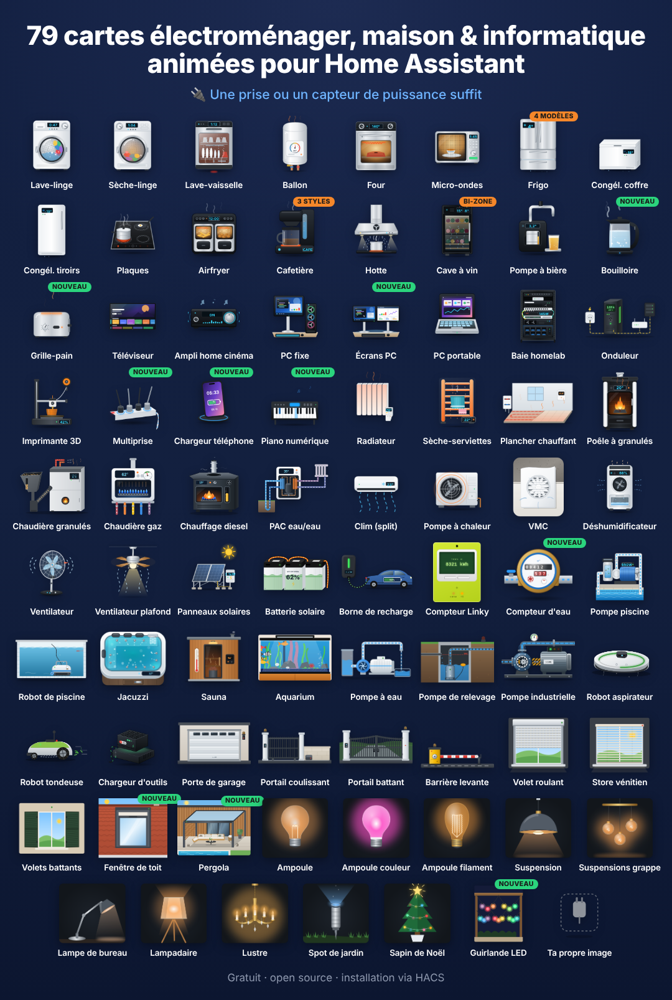</p>

**124 cartes Lovelace pour l'électroménager**, chacune avec une illustration animée réaliste : tambour de lave-linge, flamme de poêle à granulés, chauffage diesel et sa couronne bleue, jacuzzi et ses jets, robot aspirateur, compteur Linky, batterie domestique… Elles affichent l'état en direct, la puissance, l'énergie et le coût, suivent le thème de Home Assistant (clair/sombre) et parlent français, anglais, allemand, norvégien, néerlandais, roumain, russe, serbe, italien, espagnol, tchèque, danois, hongrois et polonais.

Une simple prise connectée avec un capteur de puissance suffit. Les appareils connectés peuvent ajouter le programme, le temps restant, la progression, la porte, les températures…

**▶ [Essayer en ligne](https://skyrotter.github.io/ha-appliance-electromenager-cards/docs/demo.html)** (données simulées, sans Home Assistant) · [Voir la vidéo](https://github.com/skyrotter/ha-appliance-electromenager-cards/blob/main/docs/electromenager-51-cartes-facebook.mp4) · [Tests automatiques](https://skyrotter.github.io/ha-appliance-electromenager-cards/docs/tests.html)

## Galerie

Rendus réels des cartes, regroupés par thème (données simulées).

<p align="center">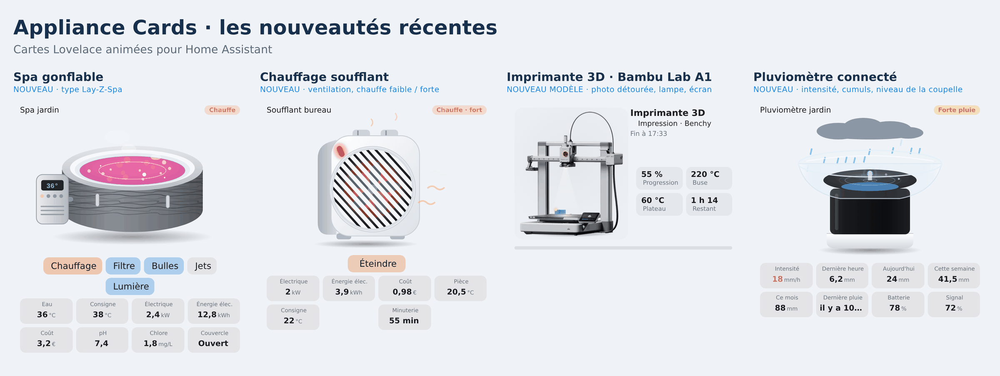</p>

<p align="center">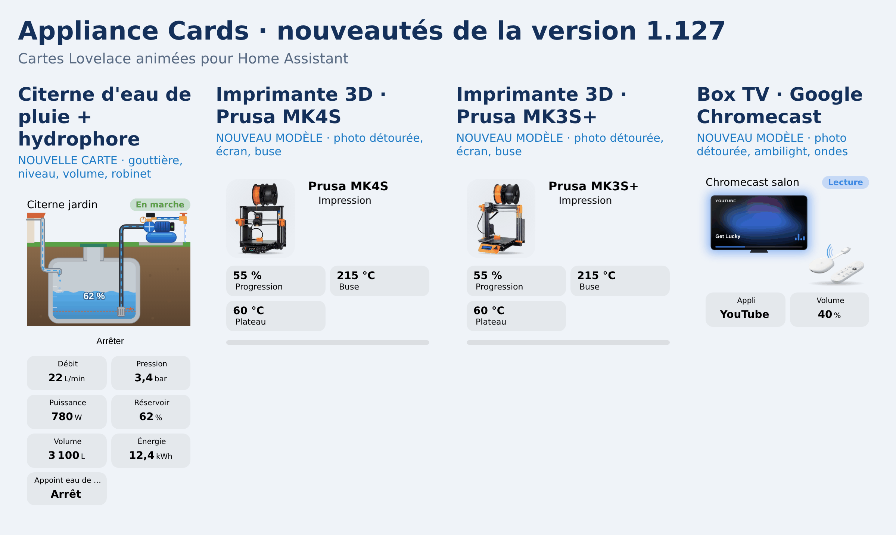</p>

<p align="center">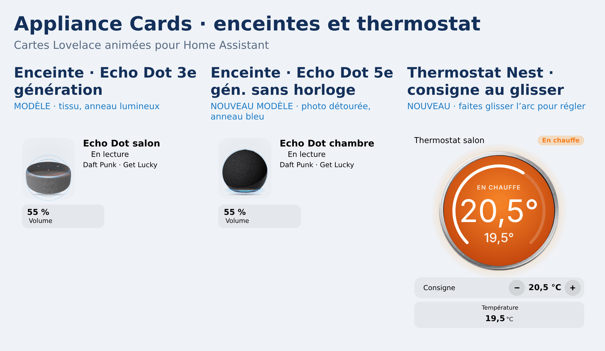</p>

<p align="center">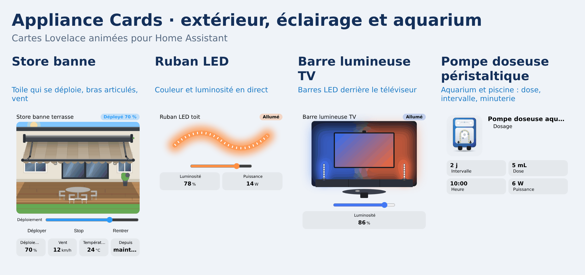</p>

<p align="center">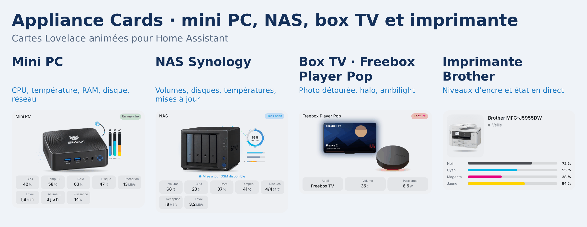</p>

<p align="center">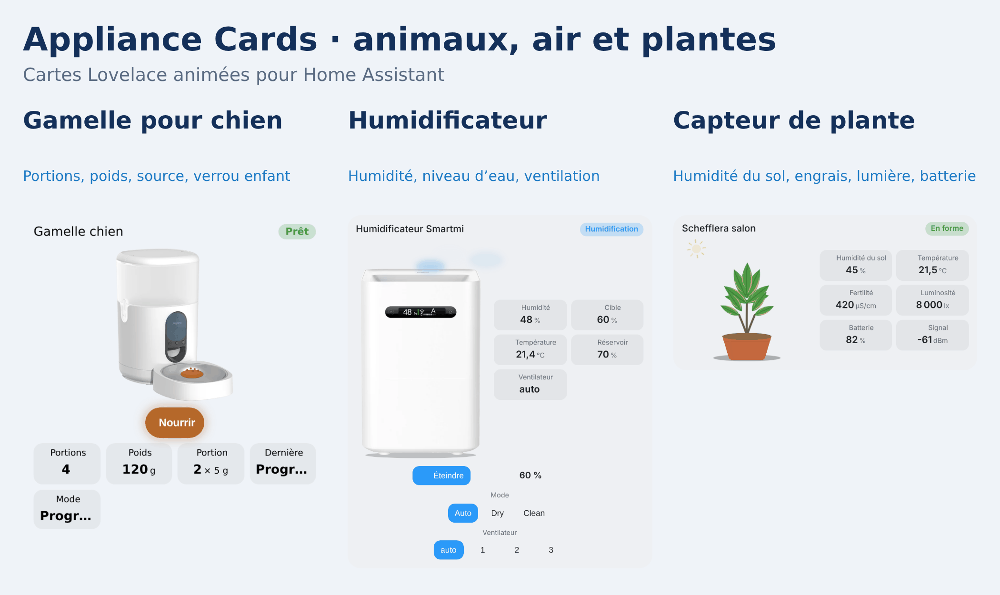</p>

<p align="center">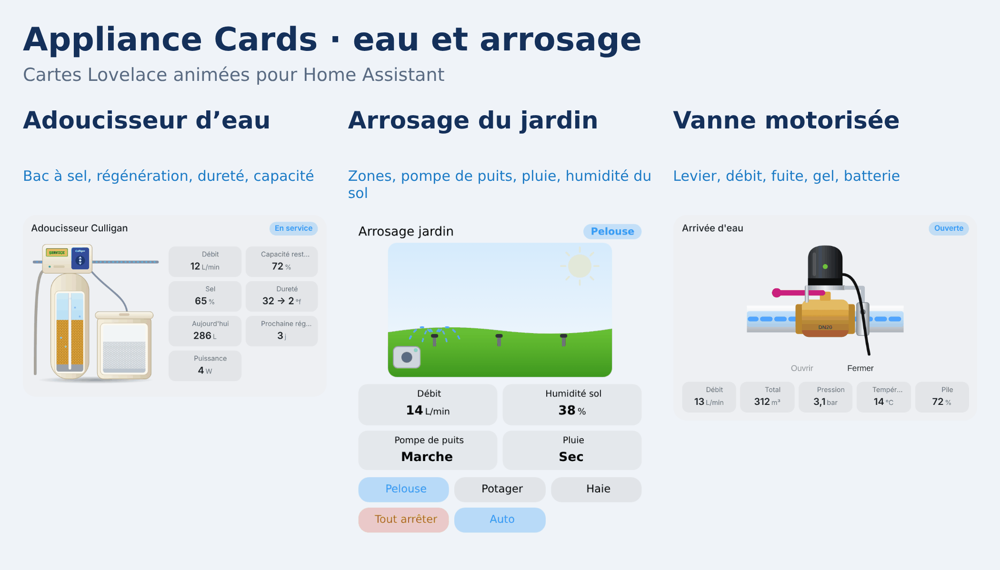</p>

<p align="center">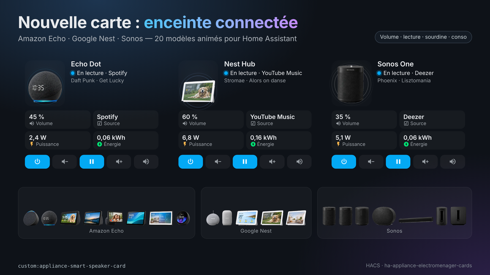</p>

<p align="center">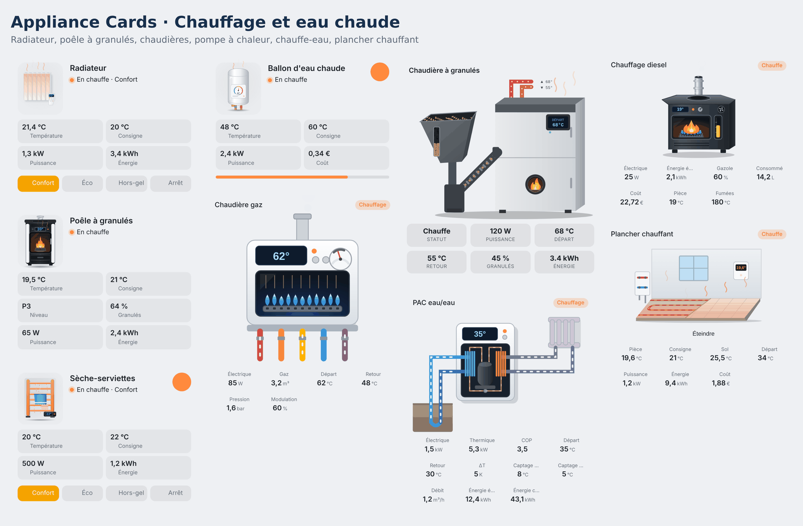</p>

<p align="center">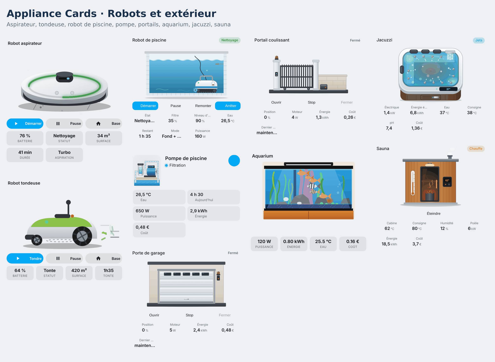</p>

<p align="center">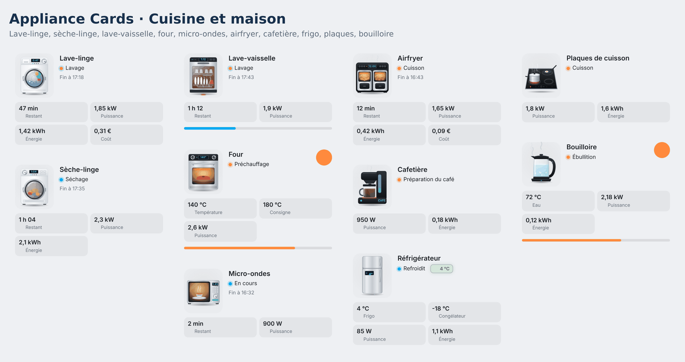</p>

## Installation

**HACS (recommandé)**

1. Ouvre HACS → **Dashboard** (Frontend) et cherche **Appliance Cards**.
2. Clique sur **Télécharger**, puis recharge le navigateur (Ctrl+F5).

Si la recherche ne la trouve pas encore : HACS → ⋮ → *Dépôts personnalisés* → ajoute `https://github.com/skyrotter/ha-appliance-electromenager-cards` avec la catégorie **Dashboard**.

**Manuelle**

1. Copie `dist/ha-appliance-electromenager-cards.js` dans `/config/www/`.
2. Paramètres → Tableaux de bord → ⋮ → Ressources → ajoute `/local/ha-appliance-electromenager-cards.js` (module JavaScript).

## Démarrage rapide

Chaque carte a un éditeur visuel. À l'ajout depuis le sélecteur de cartes, les entités sont détectées par leur nom (`lave_linge`, `washer`, `frigo`, `ballon`…). En YAML :

```yaml
type: custom:appliance-washer-card
entity: input_boolean.washer_running   # entité d'état, facultative
power: sensor.washer_plug_power        # une prise connectée suffit
energy: sensor.washer_plug_energy_today
cost: sensor.washer_cost_today
```

Toutes les options, le calcul de l'état, les thèmes et la sécurité du bouton marche/arrêt sont dans **[docs/configuration.md](https://github.com/skyrotter/ha-appliance-electromenager-cards/blob/main/docs/configuration.md)** (en anglais).

## Les cartes

Clique sur une carte pour ses options et ses exemples (pages en anglais).

### Cuisine et linge

| Carte | Type |
|---|---|
| [Lave-linge](https://github.com/skyrotter/ha-appliance-electromenager-cards/blob/main/docs/cards/washer-dryer-dishwasher.md) | `custom:appliance-washer-card` |
| [Sèche-linge](https://github.com/skyrotter/ha-appliance-electromenager-cards/blob/main/docs/cards/washer-dryer-dishwasher.md) | `custom:appliance-dryer-card` |
| [Lave-vaisselle](https://github.com/skyrotter/ha-appliance-electromenager-cards/blob/main/docs/cards/washer-dryer-dishwasher.md) | `custom:appliance-dishwasher-card` |
| [Four](https://github.com/skyrotter/ha-appliance-electromenager-cards/blob/main/docs/configuration.md#type-specific-options) | `custom:appliance-oven-card` |
| [Micro-ondes](https://github.com/skyrotter/ha-appliance-electromenager-cards/blob/main/docs/configuration.md#type-specific-options) | `custom:appliance-microwave-card` |
| [Réfrigérateur (4 modèles)](https://github.com/skyrotter/ha-appliance-electromenager-cards/blob/main/docs/cards/wine-cooler-fridge.md) | `custom:appliance-fridge-card` |
| [Congélateur coffre](https://github.com/skyrotter/ha-appliance-electromenager-cards/blob/main/docs/cards/freezers.md) | `custom:appliance-chest-freezer-card` |
| [Congélateur à tiroirs](https://github.com/skyrotter/ha-appliance-electromenager-cards/blob/main/docs/cards/freezers.md) | `custom:appliance-drawer-freezer-card` |
| [Plaques de cuisson](https://github.com/skyrotter/ha-appliance-electromenager-cards/blob/main/docs/cards/hob.md) | `custom:appliance-hob-card` |
| [Airfryer (double bac)](https://github.com/skyrotter/ha-appliance-electromenager-cards/blob/main/docs/cards/air-fryer.md) | `custom:appliance-air-fryer-card` |
| [Cafetière (filtre, dosette, expresso)](https://github.com/skyrotter/ha-appliance-electromenager-cards/blob/main/docs/cards/coffee-maker.md) | `custom:appliance-coffee-maker-card` |
| [Bouilloire](https://github.com/skyrotter/ha-appliance-electromenager-cards/blob/main/docs/cards/kettle-toaster.md) | `custom:appliance-kettle-card` |
| [Grille-pain](https://github.com/skyrotter/ha-appliance-electromenager-cards/blob/main/docs/cards/kettle-toaster.md) | `custom:appliance-toaster-card` |
| [Hotte aspirante](https://github.com/skyrotter/ha-appliance-electromenager-cards/blob/main/docs/cards/tv-range-hood.md) | `custom:appliance-range-hood-card` |
| [Cave à vin (une ou deux zones)](https://github.com/skyrotter/ha-appliance-electromenager-cards/blob/main/docs/cards/wine-cooler-fridge.md) | `custom:appliance-wine-cooler-card` |
| [Pompe à bière](https://github.com/skyrotter/ha-appliance-electromenager-cards/blob/main/docs/cards/beer-tap-av-receiver.md) | `custom:appliance-beer-tap-card` |

### Chauffage, eau chaude et air

| Carte | Type |
|---|---|
| [Ballon d'eau chaude (avec routeur solaire)](https://github.com/skyrotter/ha-appliance-electromenager-cards/blob/main/docs/cards/water-heater.md) | `custom:appliance-water-heater-card` |
| [Chauffe-eau thermodynamique](https://github.com/skyrotter/ha-appliance-electromenager-cards/blob/main/docs/cards/thermo-heater.md) | `custom:appliance-thermo-heater-card` |
| [Chauffage soufflant (petit électrique)](https://github.com/skyrotter/ha-appliance-electromenager-cards/blob/main/docs/cards/fan-heater.md) | `custom:appliance-fan-heater-card` |
| [Plancher chauffant (hydraulique ou électrique)](https://github.com/skyrotter/ha-appliance-electromenager-cards/blob/main/docs/cards/underfloor-heating.md) | `custom:appliance-underfloor-heating-card` |
| [Radiateur électrique](https://github.com/skyrotter/ha-appliance-electromenager-cards/blob/main/docs/cards/radiator.md) | `custom:appliance-radiator-card` |
| [Sèche-serviettes](https://github.com/skyrotter/ha-appliance-electromenager-cards/blob/main/docs/cards/towel-rack-pc-laptop.md) | `custom:appliance-towel-dryer-card` |
| [Poêle à granulés](https://github.com/skyrotter/ha-appliance-electromenager-cards/blob/main/docs/cards/pellet-stove.md) | `custom:appliance-pellet-stove-card` |
| [Chaudière à granulés](https://github.com/skyrotter/ha-appliance-electromenager-cards/blob/main/docs/cards/pellet-boiler.md) | `custom:appliance-pellet-boiler-card` |
| [Chaudière gaz](https://github.com/skyrotter/ha-appliance-electromenager-cards/blob/main/docs/cards/gas-boiler.md) | `custom:appliance-gas-boiler-card` |
| [Chauffage diesel](https://github.com/skyrotter/ha-appliance-electromenager-cards/blob/main/docs/cards/diesel-heater.md) | `custom:appliance-diesel-heater-card` |
| [PAC eau/eau (géothermie)](https://github.com/skyrotter/ha-appliance-electromenager-cards/blob/main/docs/cards/water-heat-pump.md) | `custom:appliance-water-heat-pump-card` |
| [Climatiseur, split intérieur](https://github.com/skyrotter/ha-appliance-electromenager-cards/blob/main/docs/cards/air-conditioning.md) | `custom:appliance-ac-split-card` |
| [Pompe à chaleur, unité extérieure](https://github.com/skyrotter/ha-appliance-electromenager-cards/blob/main/docs/cards/air-conditioning.md) | `custom:appliance-heat-pump-card` |
| [VMC de salle de bain](https://github.com/skyrotter/ha-appliance-electromenager-cards/blob/main/docs/cards/vmc.md) | `custom:appliance-vmc-card` |
| [Climat de la pièce (température, humidité, historique, 12 styles)](https://github.com/skyrotter/ha-appliance-electromenager-cards/blob/main/docs/cards/room-climate.md) | `custom:appliance-room-climate-card` |
| [Déshumidificateur](https://github.com/skyrotter/ha-appliance-electromenager-cards/blob/main/docs/cards/dehumidifier.md) | `custom:appliance-dehumidifier-card` |
| [Purificateur d'air](https://github.com/skyrotter/ha-appliance-electromenager-cards/blob/main/docs/cards/air-purifier.md) | `custom:appliance-air-purifier-card` |

### Énergie, piscine, spa et aquarium

| Carte | Type |
|---|---|
| [Panneaux solaires](https://github.com/skyrotter/ha-appliance-electromenager-cards/blob/main/docs/cards/solar.md) | `custom:appliance-solar-card` |
| [Batterie domestique](https://github.com/skyrotter/ha-appliance-electromenager-cards/blob/main/docs/cards/battery.md) | `custom:appliance-battery-card` |
| [Borne de recharge (wallbox + voiture)](https://github.com/skyrotter/ha-appliance-electromenager-cards/blob/main/docs/cards/ev-charger.md) | `custom:appliance-ev-charger-card` |
| [Compteur Linky](https://github.com/skyrotter/ha-appliance-electromenager-cards/blob/main/docs/cards/linky.md) | `custom:appliance-linky-card` |
| [Compteur d'eau](https://github.com/skyrotter/ha-appliance-electromenager-cards/blob/main/docs/cards/water-meter.md) | `custom:appliance-water-meter-card` |
| [Compteur de chaleur (chauffage urbain)](https://github.com/skyrotter/ha-appliance-electromenager-cards/blob/main/docs/cards/heat-meter.md) | `custom:appliance-heat-meter-card` |
| [Compteur de gaz](https://github.com/skyrotter/ha-appliance-electromenager-cards/blob/main/docs/cards/gas-meter.md) | `custom:appliance-gas-meter-card` |
| [Compteur électrique (générique)](https://github.com/skyrotter/ha-appliance-electromenager-cards/blob/main/docs/cards/electric-meter.md) | `custom:appliance-electric-meter-card` |
| [Tête thermostatique (radiateur à eau)](https://github.com/skyrotter/ha-appliance-electromenager-cards/blob/main/docs/cards/trv.md) | `custom:appliance-trv-card` |
| [Pompe de piscine](https://github.com/skyrotter/ha-appliance-electromenager-cards/blob/main/docs/cards/pool-pump.md) | `custom:appliance-pool-pump-card` |
| [Pompe doseuse (pH+ / pH-)](https://github.com/skyrotter/ha-appliance-electromenager-cards/blob/main/docs/cards/dosing-pump.md) | `custom:appliance-dosing-pump-card` |
| [Robot nettoyeur de piscine](https://github.com/skyrotter/ha-appliance-electromenager-cards/blob/main/docs/cards/pool-robot.md) | `custom:appliance-pool-robot-card` |
| [Pompe à eau (arrosage, puits, cuve)](https://github.com/skyrotter/ha-appliance-electromenager-cards/blob/main/docs/cards/pumps.md) | `custom:appliance-water-pump-card` |
| [Pompe industrielle](https://github.com/skyrotter/ha-appliance-electromenager-cards/blob/main/docs/cards/pumps.md) | `custom:appliance-industrial-pump-card` |
| [Pompe de relevage](https://github.com/skyrotter/ha-appliance-electromenager-cards/blob/main/docs/cards/pumps.md) | `custom:appliance-sump-pump-card` |
| [Citerne d'eau de pluie + hydrophore](https://github.com/skyrotter/ha-appliance-electromenager-cards/blob/main/docs/cards/pumps.md) | `custom:appliance-rainwater-tank-card` |
| [Jacuzzi](https://github.com/skyrotter/ha-appliance-electromenager-cards/blob/main/docs/cards/jacuzzi.md) | `custom:appliance-jacuzzi-card` |
| [Aquarium](https://github.com/skyrotter/ha-appliance-electromenager-cards/blob/main/docs/cards/aquarium.md) | `custom:appliance-aquarium-card` |
| [Aquarium récifal (eau de mer : rampes LED, coraux, paramètres de l'eau)](https://github.com/skyrotter/ha-appliance-electromenager-cards/blob/main/docs/cards/reef-aquarium.md) | `custom:appliance-reef-aquarium-card` |

### Portails, garage et sauna

| Carte | Type |
|---|---|
| [Barrière levante](https://github.com/skyrotter/ha-appliance-electromenager-cards/blob/main/docs/cards/access.md) | `custom:appliance-barrier-card` |
| [Portail coulissant](https://github.com/skyrotter/ha-appliance-electromenager-cards/blob/main/docs/cards/access.md) | `custom:appliance-sliding-gate-card` |
| [Portail battant (ouverture vers l'intérieur)](https://github.com/skyrotter/ha-appliance-electromenager-cards/blob/main/docs/cards/access.md) | `custom:appliance-swing-gate-card` |
| [Porte de garage](https://github.com/skyrotter/ha-appliance-electromenager-cards/blob/main/docs/cards/access.md) | `custom:appliance-garage-door-card` |
| [Boîte aux lettres (courrier et colis)](https://github.com/skyrotter/ha-appliance-electromenager-cards/blob/main/docs/cards/mailbox.md) | `custom:appliance-mailbox-card` |
| [Détecteur de fumée (fumée, CO, 2 modèles)](https://github.com/skyrotter/ha-appliance-electromenager-cards/blob/main/docs/cards/smoke-detector.md) | `custom:appliance-smoke-detector-card` |
| [Serrure connectée (Nuki, 2 modèles)](https://github.com/skyrotter/ha-appliance-electromenager-cards/blob/main/docs/cards/smart-lock.md) | `custom:appliance-smart-lock-card` |
| [Détecteur de fuite d'eau](https://github.com/skyrotter/ha-appliance-electromenager-cards/blob/main/docs/cards/leak-detector.md) | `custom:appliance-leak-detector-card` |
| [Arrosage (zones, pompe, pluie)](https://github.com/skyrotter/ha-appliance-electromenager-cards/blob/main/docs/cards/irrigation.md) | `custom:appliance-irrigation-card` |
| [Ruban LED (couleur, luminosité, effet)](https://github.com/skyrotter/ha-appliance-electromenager-cards/blob/main/docs/cards/led-strip.md) | `custom:appliance-led-strip-card` |
| [Pluviomètre (intensité, cumuls)](https://github.com/skyrotter/ha-appliance-electromenager-cards/blob/main/docs/cards/rain-gauge.md) | `custom:appliance-rain-gauge-card` |
| [Moniteur de plante (Mi Flora : humidité, lumière, fertilité)](https://github.com/skyrotter/ha-appliance-electromenager-cards/blob/main/docs/cards/plant-monitor.md) | `custom:appliance-plant-monitor-card` |
| [Humidificateur (photo Smartmi ou dessin)](https://github.com/skyrotter/ha-appliance-electromenager-cards/blob/main/docs/cards/humidifier.md) | `custom:appliance-humidifier-card` |
| [Spa gonflable (type Lay-Z-Spa)](https://github.com/skyrotter/ha-appliance-electromenager-cards/blob/main/docs/cards/inflatable-spa.md) | `custom:appliance-inflatable-spa-card` |
| [Sauna](https://github.com/skyrotter/ha-appliance-electromenager-cards/blob/main/docs/cards/sauna.md) | `custom:appliance-sauna-card` |

### Éclairage

| Carte | Type |
|---|---|
| [Ampoule](https://github.com/skyrotter/ha-appliance-electromenager-cards/blob/main/docs/cards/lights.md) | `custom:appliance-light-bulb-card` |
| [Ampoule couleur](https://github.com/skyrotter/ha-appliance-electromenager-cards/blob/main/docs/cards/lights.md) | `custom:appliance-color-bulb-card` |
| [Ampoule à filament](https://github.com/skyrotter/ha-appliance-electromenager-cards/blob/main/docs/cards/lights.md) | `custom:appliance-filament-bulb-card` |
| [Suspension](https://github.com/skyrotter/ha-appliance-electromenager-cards/blob/main/docs/cards/lights.md) | `custom:appliance-pendant-light-card` |
| [Suspensions en grappe](https://github.com/skyrotter/ha-appliance-electromenager-cards/blob/main/docs/cards/lights.md) | `custom:appliance-pendant-cluster-card` |
| [Lampe de bureau](https://github.com/skyrotter/ha-appliance-electromenager-cards/blob/main/docs/cards/lights.md) | `custom:appliance-desk-lamp-card` |
| [Lampadaire](https://github.com/skyrotter/ha-appliance-electromenager-cards/blob/main/docs/cards/lights.md) | `custom:appliance-floor-lamp-card` |
| [Lustre](https://github.com/skyrotter/ha-appliance-electromenager-cards/blob/main/docs/cards/lights.md) | `custom:appliance-chandelier-card` |
| [Spot de jardin](https://github.com/skyrotter/ha-appliance-electromenager-cards/blob/main/docs/cards/lights.md) | `custom:appliance-garden-spotlight-card` |
| [Spots encastrés](https://github.com/skyrotter/ha-appliance-electromenager-cards/blob/main/docs/cards/lights.md) | `custom:appliance-ceiling-spot-card` |
| [Sapin de Noël](https://github.com/skyrotter/ha-appliance-electromenager-cards/blob/main/docs/cards/lights.md) | `custom:appliance-christmas-tree-card` |
| [Guirlande LED](https://github.com/skyrotter/ha-appliance-electromenager-cards/blob/main/docs/cards/plugs-piano-garland.md) | `custom:appliance-garland-card` |

### Volets et stores

| Carte | Type |
|---|---|
| [Volet roulant](https://github.com/skyrotter/ha-appliance-electromenager-cards/blob/main/docs/cards/shutters.md) | `custom:appliance-roller-shutter-card` |
| [Rideaux coulissants](https://github.com/skyrotter/ha-appliance-electromenager-cards/blob/main/docs/cards/sliding-curtain.md) | `custom:appliance-sliding-curtain-card` |
| [Store vénitien](https://github.com/skyrotter/ha-appliance-electromenager-cards/blob/main/docs/cards/shutters.md) | `custom:appliance-venetian-blind-card` |
| [Volets battants](https://github.com/skyrotter/ha-appliance-electromenager-cards/blob/main/docs/cards/shutters.md) | `custom:appliance-swing-shutter-card` |
| [Pergola bioclimatique](https://github.com/skyrotter/ha-appliance-electromenager-cards/blob/main/docs/cards/shutters.md) | `custom:appliance-pergola-card` |
| [Fenêtre de toit (Velux)](https://github.com/skyrotter/ha-appliance-electromenager-cards/blob/main/docs/cards/shutters.md) | `custom:appliance-roof-window-card` |
| [Store banne](https://github.com/skyrotter/ha-appliance-electromenager-cards/blob/main/docs/cards/shutters.md) | `custom:appliance-awning-card` |

### Loisirs et informatique

| Carte | Type |
|---|---|
| [Téléviseur](https://github.com/skyrotter/ha-appliance-electromenager-cards/blob/main/docs/cards/tv-range-hood.md) | `custom:appliance-tv-card` |
| [Ampli home cinéma](https://github.com/skyrotter/ha-appliance-electromenager-cards/blob/main/docs/cards/beer-tap-av-receiver.md) | `custom:appliance-av-receiver-card` |
| [Enceinte connectée (Echo, Nest, Sonos, Devialet, HomePod)](https://github.com/skyrotter/ha-appliance-electromenager-cards/blob/main/docs/cards/smart-speaker.md) | `custom:appliance-smart-speaker-card` |
| [PlayStation 5](https://github.com/skyrotter/ha-appliance-electromenager-cards/blob/main/docs/cards/ps5.md) | `custom:appliance-ps5-card` |
| [Vélo elliptique](https://github.com/skyrotter/ha-appliance-electromenager-cards/blob/main/docs/cards/fitness.md) | `custom:appliance-elliptical-card` |
| [Vélo d'appartement](https://github.com/skyrotter/ha-appliance-electromenager-cards/blob/main/docs/cards/fitness.md) | `custom:appliance-exercise-bike-card` |
| [Rameur](https://github.com/skyrotter/ha-appliance-electromenager-cards/blob/main/docs/cards/fitness.md) | `custom:appliance-rowing-machine-card` |
| [Thermomix (TM6 / TM7)](https://github.com/skyrotter/ha-appliance-electromenager-cards/blob/main/docs/cards/thermomix.md) | `custom:appliance-thermomix-card` |
| [Cookeo (multicuiseur)](https://github.com/skyrotter/ha-appliance-electromenager-cards/blob/main/docs/cards/cookeo.md) | `custom:appliance-cookeo-card` |
| [Baie informatique (homelab)](https://github.com/skyrotter/ha-appliance-electromenager-cards/blob/main/docs/cards/towel-rack-pc-laptop.md) | `custom:appliance-server-rack-card` |
| [Onduleur (NUT)](https://github.com/skyrotter/ha-appliance-electromenager-cards/blob/main/docs/cards/ups.md) | `custom:appliance-ups-card` |
| [Mini PC (photo BMAX B9 Max)](https://github.com/skyrotter/ha-appliance-electromenager-cards/blob/main/docs/cards/mini-pc.md) | `custom:appliance-mini-pc-card` |
| [NAS (photo Synology DS423+)](https://github.com/skyrotter/ha-appliance-electromenager-cards/blob/main/docs/cards/nas.md) | `custom:appliance-nas-card` |
| [Box TV (Freebox Player Pop, Xiaomi TV Box S, NVIDIA Shield)](https://github.com/skyrotter/ha-appliance-electromenager-cards/blob/main/docs/cards/tv-box.md) | `custom:appliance-tv-box-card` |
| [Box internet (Freebox Pop, SFR Box)](https://github.com/skyrotter/ha-appliance-electromenager-cards/blob/main/docs/cards/internet-box.md) | `custom:appliance-internet-box-card` |
| [Climatiseur mobile](https://github.com/skyrotter/ha-appliance-electromenager-cards/blob/main/docs/cards/portable-ac.md) | `custom:appliance-portable-ac-card` |
| [Distributeur de croquettes (Aqara C1)](https://github.com/skyrotter/ha-appliance-electromenager-cards/blob/main/docs/cards/pet-feeder.md) | `custom:appliance-pet-feeder-card` |
| [PC fixe](https://github.com/skyrotter/ha-appliance-electromenager-cards/blob/main/docs/cards/towel-rack-pc-laptop.md) | `custom:appliance-desktop-pc-card` |
| [Écrans PC (1 à 3)](https://github.com/skyrotter/ha-appliance-electromenager-cards/blob/main/docs/cards/towel-rack-pc-laptop.md) | `custom:appliance-monitor-card` |
| [PC portable](https://github.com/skyrotter/ha-appliance-electromenager-cards/blob/main/docs/cards/towel-rack-pc-laptop.md) | `custom:appliance-laptop-card` |
| [Multiprise](https://github.com/skyrotter/ha-appliance-electromenager-cards/blob/main/docs/cards/plugs-piano-garland.md) | `custom:appliance-power-strip-card` |
| [Prise connectée](https://github.com/skyrotter/ha-appliance-electromenager-cards/blob/main/docs/cards/plugs-piano-garland.md) | `custom:appliance-smart-plug-card` |
| [Imprimante / scanner](https://github.com/skyrotter/ha-appliance-electromenager-cards/blob/main/docs/cards/printer.md) | `custom:appliance-printer-card` |
| [Chargeur de téléphone](https://github.com/skyrotter/ha-appliance-electromenager-cards/blob/main/docs/cards/plugs-piano-garland.md) | `custom:appliance-phone-charger-card` |
| [Piano numérique](https://github.com/skyrotter/ha-appliance-electromenager-cards/blob/main/docs/cards/plugs-piano-garland.md) | `custom:appliance-piano-card` |
| [Imprimante 3D](https://github.com/skyrotter/ha-appliance-electromenager-cards/blob/main/docs/cards/printer-3d.md) | `custom:appliance-printer-3d-card` |

### Robots, ventilateurs et autres

| Carte | Type |
|---|---|
| [Robot aspirateur](https://github.com/skyrotter/ha-appliance-electromenager-cards/blob/main/docs/cards/robots.md) | `custom:appliance-robot-vacuum-solo-card` |
| [Aspirateur laveur](https://github.com/skyrotter/ha-appliance-electromenager-cards/blob/main/docs/cards/wet-vacuum.md) | `custom:appliance-wet-vacuum-card` |
| [Robot tondeuse](https://github.com/skyrotter/ha-appliance-electromenager-cards/blob/main/docs/cards/robots.md) | `custom:appliance-robot-mower-solo-card` |
| [Ventilateur](https://github.com/skyrotter/ha-appliance-electromenager-cards/blob/main/docs/cards/fan.md) | `custom:appliance-fan-card` |
| [Ventilateur de plafond](https://github.com/skyrotter/ha-appliance-electromenager-cards/blob/main/docs/cards/ceiling-fan.md) | `custom:appliance-ceiling-fan-card` |
| [Chargeur de batterie d'outils](https://github.com/skyrotter/ha-appliance-electromenager-cards/blob/main/docs/cards/tool-charger.md) | `custom:appliance-tool-charger-card` |
| [Balance connectée (photo Withings)](https://github.com/skyrotter/ha-appliance-electromenager-cards/blob/main/docs/cards/scale.md) | `custom:appliance-scale-card` |
| [Robinet connecté (arrosage Zigbee)](https://github.com/skyrotter/ha-appliance-electromenager-cards/blob/main/docs/cards/smart-tap.md) | `custom:appliance-smart-tap-card` |
| [Vanne motorisée (actionneur sur vanne à boule)](https://github.com/skyrotter/ha-appliance-electromenager-cards/blob/main/docs/cards/water-valve.md) | `custom:appliance-water-valve-card` |
| [Adoucisseur d'eau (Culligan ou générique : cuve à résine, bac à sel)](https://github.com/skyrotter/ha-appliance-electromenager-cards/blob/main/docs/cards/water-softener.md) | `custom:appliance-water-softener-card` |
| [Caméra de surveillance (détections, mode nuit, votre photo)](https://github.com/skyrotter/ha-appliance-electromenager-cards/blob/main/docs/cards/camera.md) | `custom:appliance-camera-card` |
| [Enregistreur NVR (voyants animés, disque, CPU)](https://github.com/skyrotter/ha-appliance-electromenager-cards/blob/main/docs/cards/camera.md) | `custom:appliance-nvr-card` |
| [Switch PoE (SSCPOE / Steamemo GPS208, GPS204V, GPS105S)](https://github.com/skyrotter/ha-appliance-electromenager-cards/blob/main/docs/cards/poe-switch.md) | `custom:appliance-poe-switch-card` |
| [Raspberry Pi 4 (CPU, température, RAM, disque, réseau, sous-tension)](https://github.com/skyrotter/ha-appliance-electromenager-cards/blob/main/docs/cards/raspberry-pi.md) | `custom:appliance-raspberry-pi-card` |
| [Filtre à eau sous évier (1 à 3 cartouches)](https://github.com/skyrotter/ha-appliance-electromenager-cards/blob/main/docs/cards/water-filter.md) | `custom:appliance-water-filter-card` |
| [Chatière connectée (puce, animaux dedans / dehors)](https://github.com/skyrotter/ha-appliance-electromenager-cards/blob/main/docs/cards/cat-flap.md) | `custom:appliance-cat-flap-card` |
| [Fontaine à eau pour animaux](https://github.com/skyrotter/ha-appliance-electromenager-cards/blob/main/docs/cards/pet-fountain.md) | `custom:appliance-pet-fountain-card` |
| [Appareil générique (ta propre image)](https://github.com/skyrotter/ha-appliance-electromenager-cards/blob/main/docs/cards/generic.md) | `custom:appliance-generic-card` |

## Documentation

- [Configuration](https://github.com/skyrotter/ha-appliance-electromenager-cards/blob/main/docs/configuration.md) : options communes, calcul de l'état, modes, thèmes, sécurité du bouton (en anglais).
- [Détection de cycle pour lave-linge, sèche-linge et lave-vaisselle](https://github.com/skyrotter/ha-appliance-electromenager-cards/blob/main/docs/cards/washer-dryer-dishwasher.md) : l'automatisation recommandée avec une prise connectée.
- [Développement et traductions](https://github.com/skyrotter/ha-appliance-electromenager-cards/blob/main/docs/development.md) : build, ajout d'une carte ou d'une langue.
- [Descriptions détaillées de chaque carte en français](https://github.com/skyrotter/ha-appliance-electromenager-cards/blob/main/docs/cards-fr.md)

## Contribuer

Voir [CONTRIBUTING.md](https://github.com/skyrotter/ha-appliance-electromenager-cards/blob/main/CONTRIBUTING.md) pour le guide complet (en anglais). Les signalements de bugs et les demandes de cartes sont les bienvenus dans les [issues](https://github.com/skyrotter/ha-appliance-electromenager-cards/issues). `dist/` est généré : modifie `src/`, lance `node build.js` et commite les deux (voir [développement](https://github.com/skyrotter/ha-appliance-electromenager-cards/blob/main/docs/development.md)).

## License

[MIT](https://github.com/skyrotter/ha-appliance-electromenager-cards/blob/main/LICENSE)
