# Appliance Électroménager Cards for Home Assistant

<p align="center"><a href="https://github.com/sponsors/skyrotter">❤️ Sponsor on GitHub</a> · <a href="https://paypal.me/skyrotter">💙 Donate with PayPal.me</a><br><a href="https://buymeacoffee.com/skyrotter"></a></p>

[](https://hacs.xyz)
[](https://github.com/skyrotter/ha-appliance-electromenager-cards/actions/workflows/validate.yml)
[](https://github.com/skyrotter/ha-appliance-electromenager-cards/blob/main/LICENSE)

🇬🇧 English · [🇫🇷 Français](README.fr.md) · [🇮🇹 Italiano](README.it.md) · [🇩🇪 Deutsch](README.de.md) · [🇪🇸 Español](README.es.md) · [🇵🇹 Português (Portugal)](README.pt-PT.md) · [🇧🇷 Português (Brasil)](README.pt-BR.md)

## ❤️ Support the project

This project is free and open source, built in my spare time. If it makes your dashboard nicer, a small donation helps me add new cards and keep the existing ones up to date. Missing an appliance? [Suggest it in the issues](https://github.com/skyrotter/ha-appliance-electromenager-cards/issues), that is how the diesel heater and the hot tub got here.

<p align="center">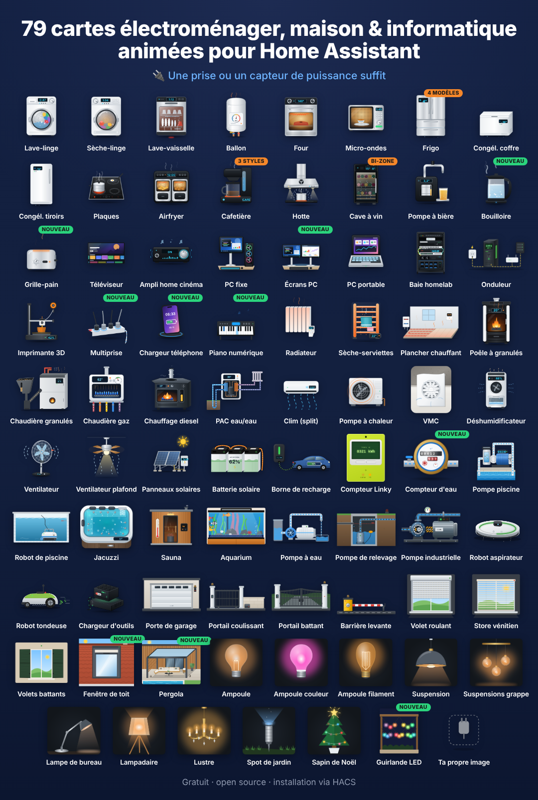</p>

**124 Lovelace cards for household appliances**, each with a realistic animated illustration: a tumbling washer drum, a flickering pellet-stove flame, a diesel heater with its blue burner crown, a hot tub with bubbling jets, a robot vacuum, a Linky meter, a home battery… They show the live status, power, energy and cost, follow your Home Assistant theme (light/dark) and speak English, French, German, Norwegian, Dutch, Romanian, Russian, Serbian, Italian, Spanish, Czech, Danish, Hungarian, Polish and Portuguese (Portugal and Brazil).

A simple smart plug with a power sensor is enough. Connected appliances can add program, remaining time, progress, door, temperatures…

**▶ [Try it online](https://skyrotter.github.io/ha-appliance-electromenager-cards/docs/demo.html)** (simulated data, no Home Assistant needed) · [Watch the video](https://github.com/skyrotter/ha-appliance-electromenager-cards/blob/main/docs/electromenager-51-cartes-facebook.mp4) · [Automated tests](https://skyrotter.github.io/ha-appliance-electromenager-cards/docs/tests.html)

## Gallery

Live renders of the cards, grouped by theme (simulated data).

<p align="center">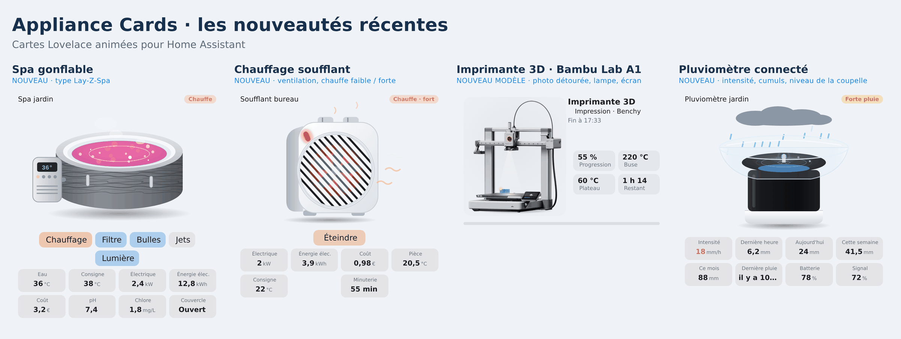</p>

<p align="center">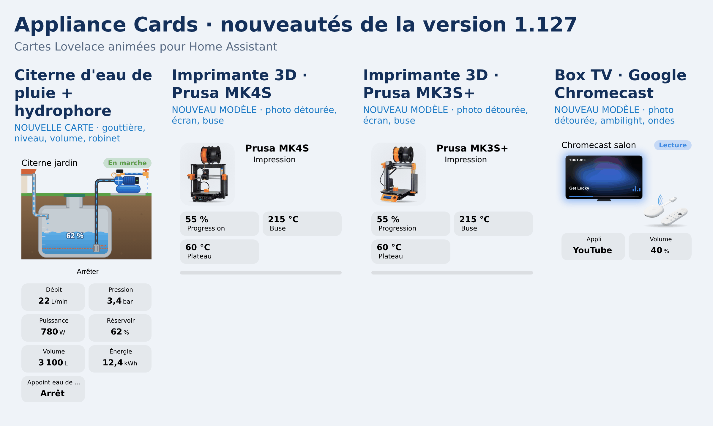</p>

<p align="center">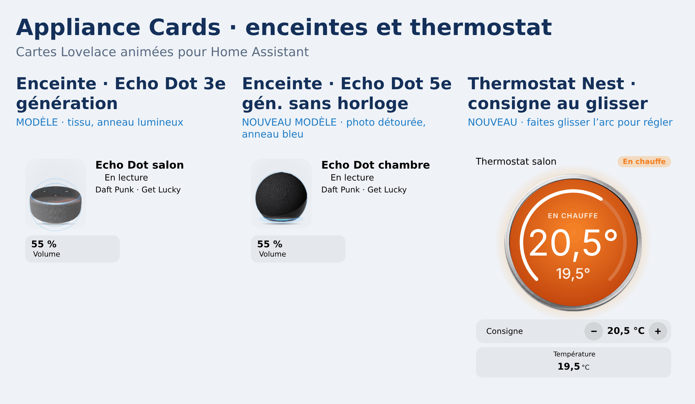</p>

<p align="center">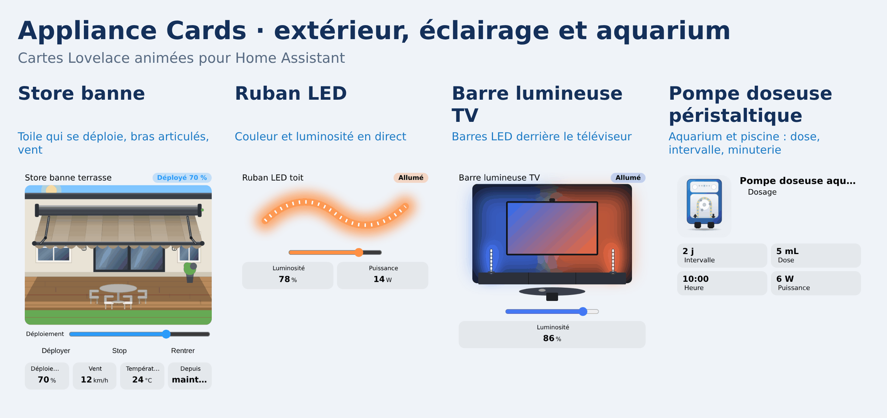</p>

<p align="center">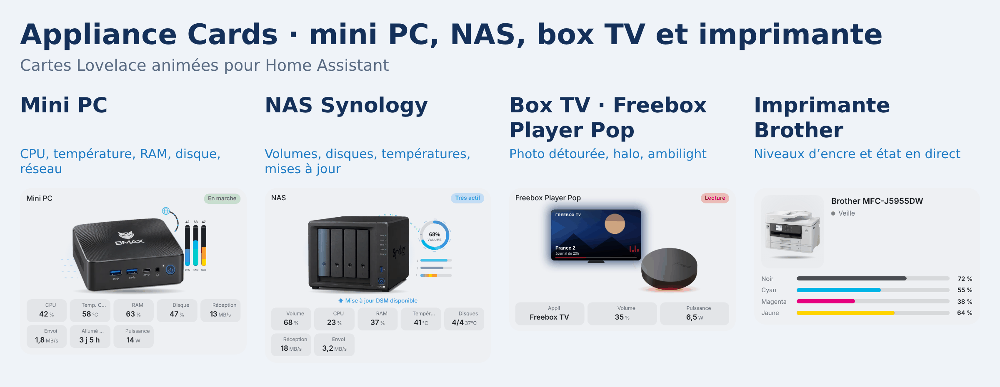</p>

<p align="center">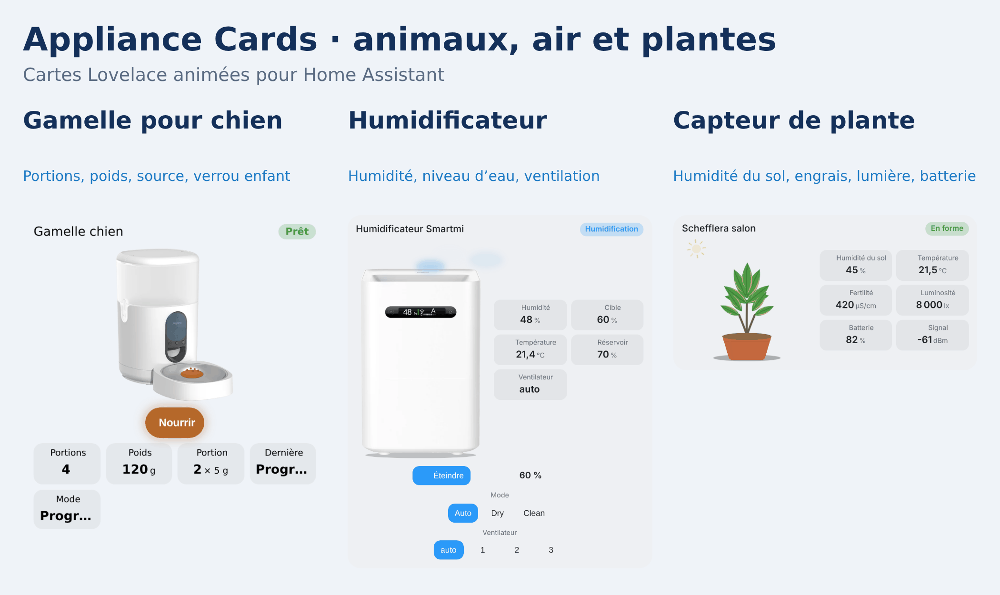</p>

<p align="center">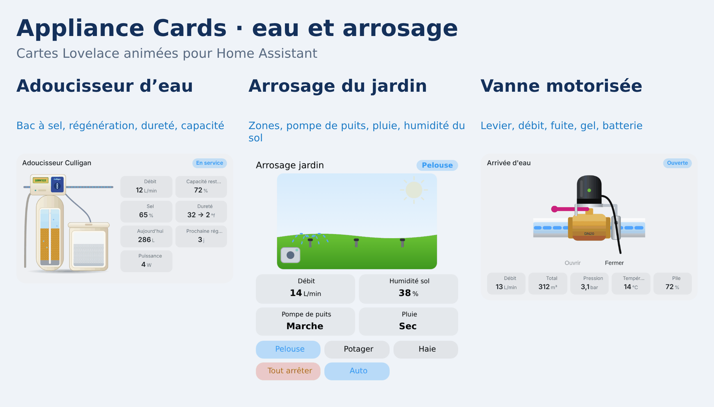</p>

<p align="center"></p>

<p align="center">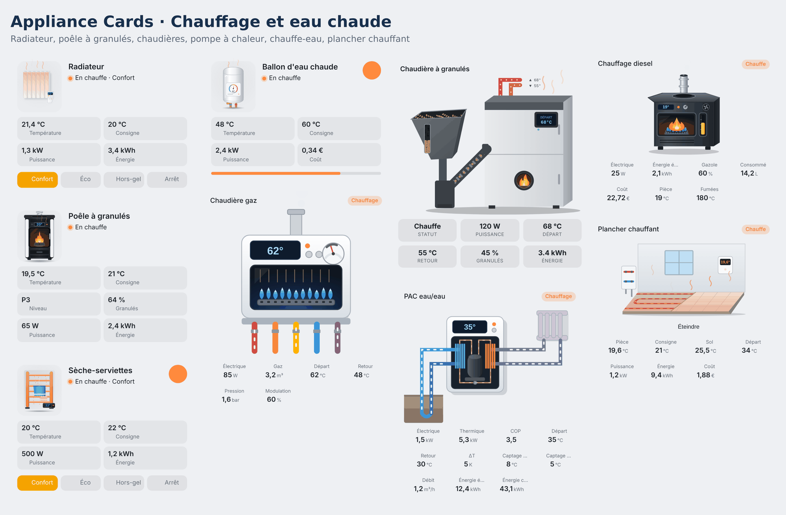</p>

<p align="center">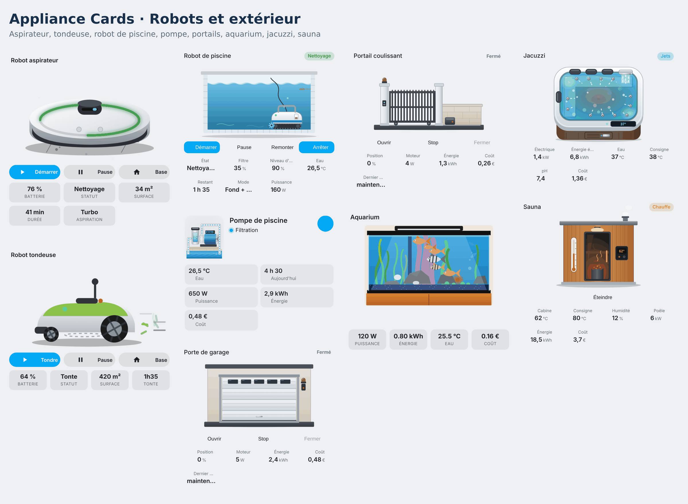</p>

<p align="center">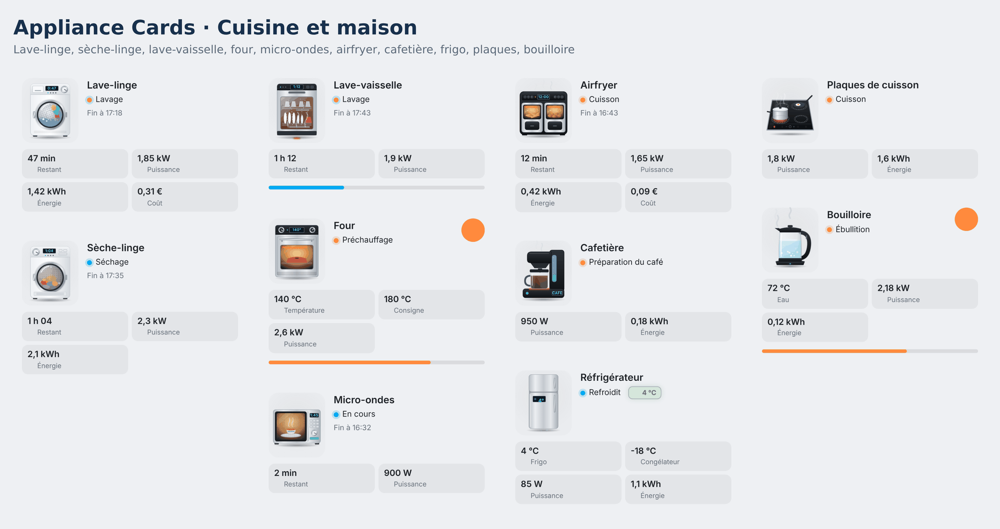</p>

## Installation

**HACS (recommended)**

Click this button to open the repository directly in HACS:

[](https://my.home-assistant.io/redirect/hacs_repository/?owner=skyrotter&repository=ha-appliance-electromenager-cards&category=dashboard)

**Manual Installation via HACS**

1. Open HACS → **Dashboard** (Frontend) and search for **Animated Appliance & Energy Cards**.
2. Click **Download**, then reload your browser (Ctrl+F5).

If the search does not find it yet: HACS → ⋮ → *Custom repositories* → add `https://github.com/skyrotter/ha-appliance-electromenager-cards` with the category **Dashboard**.

**Manual**

1. Copy `dist/ha-appliance-electromenager-cards.js` to `/config/www/`.
2. Settings → Dashboards → ⋮ → Resources → add `/local/ha-appliance-electromenager-cards.js` (JavaScript module).

## Quick start

Every card has a visual editor. When you add one from the card picker, entities are detected by name (`lave_linge`, `washer`, `fridge`, `ballon`…). In YAML:

```yaml
type: custom:appliance-washer-card
entity: input_boolean.washer_running   # optional status entity
power: sensor.washer_plug_power        # a smart plug is enough
energy: sensor.washer_plug_energy_today
cost: sensor.washer_cost_today
```

All options, how the status is computed, theming and the power-button safety are in **[docs/configuration.md](https://github.com/skyrotter/ha-appliance-electromenager-cards/blob/main/docs/configuration.md)**.

## The cards

Click a card for its options and examples.

### Kitchen and laundry

| Card | Type |
|---|---|
| [Washing machine](https://github.com/skyrotter/ha-appliance-electromenager-cards/blob/main/docs/cards/washer-dryer-dishwasher.md) | `custom:appliance-washer-card` |
| [Dryer](https://github.com/skyrotter/ha-appliance-electromenager-cards/blob/main/docs/cards/washer-dryer-dishwasher.md) | `custom:appliance-dryer-card` |
| [Dishwasher](https://github.com/skyrotter/ha-appliance-electromenager-cards/blob/main/docs/cards/washer-dryer-dishwasher.md) | `custom:appliance-dishwasher-card` |
| [Oven](https://github.com/skyrotter/ha-appliance-electromenager-cards/blob/main/docs/configuration.md#type-specific-options) | `custom:appliance-oven-card` |
| [Microwave](https://github.com/skyrotter/ha-appliance-electromenager-cards/blob/main/docs/configuration.md#type-specific-options) | `custom:appliance-microwave-card` |
| [Refrigerator (4 layouts)](https://github.com/skyrotter/ha-appliance-electromenager-cards/blob/main/docs/cards/wine-cooler-fridge.md) | `custom:appliance-fridge-card` |
| [Chest freezer](https://github.com/skyrotter/ha-appliance-electromenager-cards/blob/main/docs/cards/freezers.md) | `custom:appliance-chest-freezer-card` |
| [Upright drawer freezer](https://github.com/skyrotter/ha-appliance-electromenager-cards/blob/main/docs/cards/freezers.md) | `custom:appliance-drawer-freezer-card` |
| [Electric cooktop](https://github.com/skyrotter/ha-appliance-electromenager-cards/blob/main/docs/cards/hob.md) | `custom:appliance-hob-card` |
| [Air fryer (dual basket)](https://github.com/skyrotter/ha-appliance-electromenager-cards/blob/main/docs/cards/air-fryer.md) | `custom:appliance-air-fryer-card` |
| [Coffee maker (drip, pods, espresso)](https://github.com/skyrotter/ha-appliance-electromenager-cards/blob/main/docs/cards/coffee-maker.md) | `custom:appliance-coffee-maker-card` |
| [Kettle](https://github.com/skyrotter/ha-appliance-electromenager-cards/blob/main/docs/cards/kettle-toaster.md) | `custom:appliance-kettle-card` |
| [Toaster](https://github.com/skyrotter/ha-appliance-electromenager-cards/blob/main/docs/cards/kettle-toaster.md) | `custom:appliance-toaster-card` |
| [Range hood](https://github.com/skyrotter/ha-appliance-electromenager-cards/blob/main/docs/cards/tv-range-hood.md) | `custom:appliance-range-hood-card` |
| [Wine cooler (single or dual zone)](https://github.com/skyrotter/ha-appliance-electromenager-cards/blob/main/docs/cards/wine-cooler-fridge.md) | `custom:appliance-wine-cooler-card` |
| [Beer tap](https://github.com/skyrotter/ha-appliance-electromenager-cards/blob/main/docs/cards/beer-tap-av-receiver.md) | `custom:appliance-beer-tap-card` |

### Heating, hot water and air

| Card | Type |
|---|---|
| [Water heater (with solar router)](https://github.com/skyrotter/ha-appliance-electromenager-cards/blob/main/docs/cards/water-heater.md) | `custom:appliance-water-heater-card` |
| [Thermodynamic water heater](https://github.com/skyrotter/ha-appliance-electromenager-cards/blob/main/docs/cards/thermo-heater.md) | `custom:appliance-thermo-heater-card` |
| [Fan heater (small electric)](https://github.com/skyrotter/ha-appliance-electromenager-cards/blob/main/docs/cards/fan-heater.md) | `custom:appliance-fan-heater-card` |
| [Underfloor heating (water or electric)](https://github.com/skyrotter/ha-appliance-electromenager-cards/blob/main/docs/cards/underfloor-heating.md) | `custom:appliance-underfloor-heating-card` |
| [Electric radiator](https://github.com/skyrotter/ha-appliance-electromenager-cards/blob/main/docs/cards/radiator.md) | `custom:appliance-radiator-card` |
| [Heated towel rail](https://github.com/skyrotter/ha-appliance-electromenager-cards/blob/main/docs/cards/towel-rack-pc-laptop.md) | `custom:appliance-towel-dryer-card` |
| [Pellet stove](https://github.com/skyrotter/ha-appliance-electromenager-cards/blob/main/docs/cards/pellet-stove.md) | `custom:appliance-pellet-stove-card` |
| [Pellet boiler](https://github.com/skyrotter/ha-appliance-electromenager-cards/blob/main/docs/cards/pellet-boiler.md) | `custom:appliance-pellet-boiler-card` |
| [Gas boiler](https://github.com/skyrotter/ha-appliance-electromenager-cards/blob/main/docs/cards/gas-boiler.md) | `custom:appliance-gas-boiler-card` |
| [Diesel heater](https://github.com/skyrotter/ha-appliance-electromenager-cards/blob/main/docs/cards/diesel-heater.md) | `custom:appliance-diesel-heater-card` |
| [Water-to-water / ground source heat pump](https://github.com/skyrotter/ha-appliance-electromenager-cards/blob/main/docs/cards/water-heat-pump.md) | `custom:appliance-water-heat-pump-card` |
| [Air conditioner, indoor split](https://github.com/skyrotter/ha-appliance-electromenager-cards/blob/main/docs/cards/air-conditioning.md) | `custom:appliance-ac-split-card` |
| [Heat pump, outdoor unit](https://github.com/skyrotter/ha-appliance-electromenager-cards/blob/main/docs/cards/air-conditioning.md) | `custom:appliance-heat-pump-card` |
| [Bathroom extractor fan (VMC)](https://github.com/skyrotter/ha-appliance-electromenager-cards/blob/main/docs/cards/vmc.md) | `custom:appliance-vmc-card` |
| [Room climate (temperature, humidity, history, 12 styles)](https://github.com/skyrotter/ha-appliance-electromenager-cards/blob/main/docs/cards/room-climate.md) | `custom:appliance-room-climate-card` |
| [Dehumidifier](https://github.com/skyrotter/ha-appliance-electromenager-cards/blob/main/docs/cards/dehumidifier.md) | `custom:appliance-dehumidifier-card` |
| [Air purifier](https://github.com/skyrotter/ha-appliance-electromenager-cards/blob/main/docs/cards/air-purifier.md) | `custom:appliance-air-purifier-card` |

### Energy, pool, spa and aquarium

| Card | Type |
|---|---|
| [Solar panels](https://github.com/skyrotter/ha-appliance-electromenager-cards/blob/main/docs/cards/solar.md) | `custom:appliance-solar-card` |
| [Home battery](https://github.com/skyrotter/ha-appliance-electromenager-cards/blob/main/docs/cards/battery.md) | `custom:appliance-battery-card` |
| [EV charger (wallbox + car)](https://github.com/skyrotter/ha-appliance-electromenager-cards/blob/main/docs/cards/ev-charger.md) | `custom:appliance-ev-charger-card` |
| [Linky electricity meter](https://github.com/skyrotter/ha-appliance-electromenager-cards/blob/main/docs/cards/linky.md) | `custom:appliance-linky-card` |
| [Water meter](https://github.com/skyrotter/ha-appliance-electromenager-cards/blob/main/docs/cards/water-meter.md) | `custom:appliance-water-meter-card` |
| [Heat meter (district heating)](https://github.com/skyrotter/ha-appliance-electromenager-cards/blob/main/docs/cards/heat-meter.md) | `custom:appliance-heat-meter-card` |
| [Gas meter](https://github.com/skyrotter/ha-appliance-electromenager-cards/blob/main/docs/cards/gas-meter.md) | `custom:appliance-gas-meter-card` |
| [Electric meter (generic)](https://github.com/skyrotter/ha-appliance-electromenager-cards/blob/main/docs/cards/electric-meter.md) | `custom:appliance-electric-meter-card` |
| [Radiator valve (TRV)](https://github.com/skyrotter/ha-appliance-electromenager-cards/blob/main/docs/cards/trv.md) | `custom:appliance-trv-card` |
| [Pool pump](https://github.com/skyrotter/ha-appliance-electromenager-cards/blob/main/docs/cards/pool-pump.md) | `custom:appliance-pool-pump-card` |
| [Dosing pump (pH+ / pH-)](https://github.com/skyrotter/ha-appliance-electromenager-cards/blob/main/docs/cards/dosing-pump.md) | `custom:appliance-dosing-pump-card` |
| [Pool cleaning robot](https://github.com/skyrotter/ha-appliance-electromenager-cards/blob/main/docs/cards/pool-robot.md) | `custom:appliance-pool-robot-card` |
| [Water pump (garden, well, rainwater)](https://github.com/skyrotter/ha-appliance-electromenager-cards/blob/main/docs/cards/pumps.md) | `custom:appliance-water-pump-card` |
| [Industrial pump](https://github.com/skyrotter/ha-appliance-electromenager-cards/blob/main/docs/cards/pumps.md) | `custom:appliance-industrial-pump-card` |
| [Sump pump](https://github.com/skyrotter/ha-appliance-electromenager-cards/blob/main/docs/cards/pumps.md) | `custom:appliance-sump-pump-card` |
| [Rainwater tank + booster pump](https://github.com/skyrotter/ha-appliance-electromenager-cards/blob/main/docs/cards/pumps.md) | `custom:appliance-rainwater-tank-card` |
| [Hot tub (jacuzzi)](https://github.com/skyrotter/ha-appliance-electromenager-cards/blob/main/docs/cards/jacuzzi.md) | `custom:appliance-jacuzzi-card` |
| [Aquarium](https://github.com/skyrotter/ha-appliance-electromenager-cards/blob/main/docs/cards/aquarium.md) | `custom:appliance-aquarium-card` |
| [Reef aquarium (saltwater: LED fixtures, corals, water parameters)](https://github.com/skyrotter/ha-appliance-electromenager-cards/blob/main/docs/cards/reef-aquarium.md) | `custom:appliance-reef-aquarium-card` |

### Gates, garage and sauna

| Card | Type |
|---|---|
| [Barrier](https://github.com/skyrotter/ha-appliance-electromenager-cards/blob/main/docs/cards/access.md) | `custom:appliance-barrier-card` |
| [Sliding gate](https://github.com/skyrotter/ha-appliance-electromenager-cards/blob/main/docs/cards/access.md) | `custom:appliance-sliding-gate-card` |
| [Swing gate](https://github.com/skyrotter/ha-appliance-electromenager-cards/blob/main/docs/cards/access.md) | `custom:appliance-swing-gate-card` |
| [Garage door](https://github.com/skyrotter/ha-appliance-electromenager-cards/blob/main/docs/cards/access.md) | `custom:appliance-garage-door-card` |
| [Mailbox (mail and parcels)](https://github.com/skyrotter/ha-appliance-electromenager-cards/blob/main/docs/cards/mailbox.md) | `custom:appliance-mailbox-card` |
| [Smoke detector (smoke, CO, 2 models)](https://github.com/skyrotter/ha-appliance-electromenager-cards/blob/main/docs/cards/smoke-detector.md) | `custom:appliance-smoke-detector-card` |
| [Smart lock (Nuki, 2 models)](https://github.com/skyrotter/ha-appliance-electromenager-cards/blob/main/docs/cards/smart-lock.md) | `custom:appliance-smart-lock-card` |
| [Water leak detector](https://github.com/skyrotter/ha-appliance-electromenager-cards/blob/main/docs/cards/leak-detector.md) | `custom:appliance-leak-detector-card` |
| [Irrigation (zones, pump, rain)](https://github.com/skyrotter/ha-appliance-electromenager-cards/blob/main/docs/cards/irrigation.md) | `custom:appliance-irrigation-card` |
| [LED strip (colour, brightness, effect)](https://github.com/skyrotter/ha-appliance-electromenager-cards/blob/main/docs/cards/led-strip.md) | `custom:appliance-led-strip-card` |
| [Rain gauge (intensity, totals)](https://github.com/skyrotter/ha-appliance-electromenager-cards/blob/main/docs/cards/rain-gauge.md) | `custom:appliance-rain-gauge-card` |
| [Plant monitor (Mi Flora: moisture, light, fertility)](https://github.com/skyrotter/ha-appliance-electromenager-cards/blob/main/docs/cards/plant-monitor.md) | `custom:appliance-plant-monitor-card` |
| [Humidifier (Smartmi photo or drawing)](https://github.com/skyrotter/ha-appliance-electromenager-cards/blob/main/docs/cards/humidifier.md) | `custom:appliance-humidifier-card` |
| [Inflatable spa (Lay-Z-Spa style)](https://github.com/skyrotter/ha-appliance-electromenager-cards/blob/main/docs/cards/inflatable-spa.md) | `custom:appliance-inflatable-spa-card` |
| [Sauna](https://github.com/skyrotter/ha-appliance-electromenager-cards/blob/main/docs/cards/sauna.md) | `custom:appliance-sauna-card` |

### Lighting

| Card | Type |
|---|---|
| [Bulb](https://github.com/skyrotter/ha-appliance-electromenager-cards/blob/main/docs/cards/lights.md) | `custom:appliance-light-bulb-card` |
| [Colour bulb](https://github.com/skyrotter/ha-appliance-electromenager-cards/blob/main/docs/cards/lights.md) | `custom:appliance-color-bulb-card` |
| [Filament bulb](https://github.com/skyrotter/ha-appliance-electromenager-cards/blob/main/docs/cards/lights.md) | `custom:appliance-filament-bulb-card` |
| [Pendant light](https://github.com/skyrotter/ha-appliance-electromenager-cards/blob/main/docs/cards/lights.md) | `custom:appliance-pendant-light-card` |
| [Pendant cluster](https://github.com/skyrotter/ha-appliance-electromenager-cards/blob/main/docs/cards/lights.md) | `custom:appliance-pendant-cluster-card` |
| [Desk lamp](https://github.com/skyrotter/ha-appliance-electromenager-cards/blob/main/docs/cards/lights.md) | `custom:appliance-desk-lamp-card` |
| [Floor lamp](https://github.com/skyrotter/ha-appliance-electromenager-cards/blob/main/docs/cards/lights.md) | `custom:appliance-floor-lamp-card` |
| [Chandelier](https://github.com/skyrotter/ha-appliance-electromenager-cards/blob/main/docs/cards/lights.md) | `custom:appliance-chandelier-card` |
| [Garden spotlight](https://github.com/skyrotter/ha-appliance-electromenager-cards/blob/main/docs/cards/lights.md) | `custom:appliance-garden-spotlight-card` |
| [Recessed spotlights](https://github.com/skyrotter/ha-appliance-electromenager-cards/blob/main/docs/cards/lights.md) | `custom:appliance-ceiling-spot-card` |
| [Christmas tree](https://github.com/skyrotter/ha-appliance-electromenager-cards/blob/main/docs/cards/lights.md) | `custom:appliance-christmas-tree-card` |
| [LED string lights](https://github.com/skyrotter/ha-appliance-electromenager-cards/blob/main/docs/cards/plugs-piano-garland.md) | `custom:appliance-garland-card` |

### Shutters and blinds

| Card | Type |
|---|---|
| [Roller shutter](https://github.com/skyrotter/ha-appliance-electromenager-cards/blob/main/docs/cards/shutters.md) | `custom:appliance-roller-shutter-card` |
| [Sliding curtains](https://github.com/skyrotter/ha-appliance-electromenager-cards/blob/main/docs/cards/sliding-curtain.md) | `custom:appliance-sliding-curtain-card` |
| [Venetian blind](https://github.com/skyrotter/ha-appliance-electromenager-cards/blob/main/docs/cards/shutters.md) | `custom:appliance-venetian-blind-card` |
| [Swing shutters](https://github.com/skyrotter/ha-appliance-electromenager-cards/blob/main/docs/cards/shutters.md) | `custom:appliance-swing-shutter-card` |
| [Bioclimatic pergola](https://github.com/skyrotter/ha-appliance-electromenager-cards/blob/main/docs/cards/shutters.md) | `custom:appliance-pergola-card` |
| [Roof window (Velux)](https://github.com/skyrotter/ha-appliance-electromenager-cards/blob/main/docs/cards/shutters.md) | `custom:appliance-roof-window-card` |
| [Retractable awning](https://github.com/skyrotter/ha-appliance-electromenager-cards/blob/main/docs/cards/shutters.md) | `custom:appliance-awning-card` |

### Entertainment and IT

| Card | Type |
|---|---|
| [Flat TV](https://github.com/skyrotter/ha-appliance-electromenager-cards/blob/main/docs/cards/tv-range-hood.md) | `custom:appliance-tv-card` |
| [Home cinema amplifier (AV receiver)](https://github.com/skyrotter/ha-appliance-electromenager-cards/blob/main/docs/cards/beer-tap-av-receiver.md) | `custom:appliance-av-receiver-card` |
| [Smart speaker (Echo, Nest, Sonos, Devialet, HomePod)](https://github.com/skyrotter/ha-appliance-electromenager-cards/blob/main/docs/cards/smart-speaker.md) | `custom:appliance-smart-speaker-card` |
| [PlayStation 5](https://github.com/skyrotter/ha-appliance-electromenager-cards/blob/main/docs/cards/ps5.md) | `custom:appliance-ps5-card` |
| [Cross trainer (elliptical)](https://github.com/skyrotter/ha-appliance-electromenager-cards/blob/main/docs/cards/fitness.md) | `custom:appliance-elliptical-card` |
| [Exercise bike](https://github.com/skyrotter/ha-appliance-electromenager-cards/blob/main/docs/cards/fitness.md) | `custom:appliance-exercise-bike-card` |
| [Rowing machine](https://github.com/skyrotter/ha-appliance-electromenager-cards/blob/main/docs/cards/fitness.md) | `custom:appliance-rowing-machine-card` |
| [Thermomix (TM6 / TM7)](https://github.com/skyrotter/ha-appliance-electromenager-cards/blob/main/docs/cards/thermomix.md) | `custom:appliance-thermomix-card` |
| [Cookeo (multicooker)](https://github.com/skyrotter/ha-appliance-electromenager-cards/blob/main/docs/cards/cookeo.md) | `custom:appliance-cookeo-card` |
| [Server rack (homelab)](https://github.com/skyrotter/ha-appliance-electromenager-cards/blob/main/docs/cards/towel-rack-pc-laptop.md) | `custom:appliance-server-rack-card` |
| [UPS (NUT)](https://github.com/skyrotter/ha-appliance-electromenager-cards/blob/main/docs/cards/ups.md) | `custom:appliance-ups-card` |
| [Mini PC (BMAX B9 Max photo)](https://github.com/skyrotter/ha-appliance-electromenager-cards/blob/main/docs/cards/mini-pc.md) | `custom:appliance-mini-pc-card` |
| [NAS (Synology DS423+ photo)](https://github.com/skyrotter/ha-appliance-electromenager-cards/blob/main/docs/cards/nas.md) | `custom:appliance-nas-card` |
| [TV box (Freebox Player Pop, Xiaomi TV Box S, NVIDIA Shield)](https://github.com/skyrotter/ha-appliance-electromenager-cards/blob/main/docs/cards/tv-box.md) | `custom:appliance-tv-box-card` |
| [Internet box (Freebox Pop, SFR Box)](https://github.com/skyrotter/ha-appliance-electromenager-cards/blob/main/docs/cards/internet-box.md) | `custom:appliance-internet-box-card` |
| [Portable air conditioner](https://github.com/skyrotter/ha-appliance-electromenager-cards/blob/main/docs/cards/portable-ac.md) | `custom:appliance-portable-ac-card` |
| [Pet feeder (Aqara C1)](https://github.com/skyrotter/ha-appliance-electromenager-cards/blob/main/docs/cards/pet-feeder.md) | `custom:appliance-pet-feeder-card` |
| [Desktop PC](https://github.com/skyrotter/ha-appliance-electromenager-cards/blob/main/docs/cards/towel-rack-pc-laptop.md) | `custom:appliance-desktop-pc-card` |
| [Monitors (1 to 3)](https://github.com/skyrotter/ha-appliance-electromenager-cards/blob/main/docs/cards/towel-rack-pc-laptop.md) | `custom:appliance-monitor-card` |
| [Laptop](https://github.com/skyrotter/ha-appliance-electromenager-cards/blob/main/docs/cards/towel-rack-pc-laptop.md) | `custom:appliance-laptop-card` |
| [Power strip](https://github.com/skyrotter/ha-appliance-electromenager-cards/blob/main/docs/cards/plugs-piano-garland.md) | `custom:appliance-power-strip-card` |
| [Smart plug](https://github.com/skyrotter/ha-appliance-electromenager-cards/blob/main/docs/cards/plugs-piano-garland.md) | `custom:appliance-smart-plug-card` |
| [Printer / scanner](https://github.com/skyrotter/ha-appliance-electromenager-cards/blob/main/docs/cards/printer.md) | `custom:appliance-printer-card` |
| [Phone charger](https://github.com/skyrotter/ha-appliance-electromenager-cards/blob/main/docs/cards/plugs-piano-garland.md) | `custom:appliance-phone-charger-card` |
| [Digital piano](https://github.com/skyrotter/ha-appliance-electromenager-cards/blob/main/docs/cards/plugs-piano-garland.md) | `custom:appliance-piano-card` |
| [3D printer](https://github.com/skyrotter/ha-appliance-electromenager-cards/blob/main/docs/cards/printer-3d.md) | `custom:appliance-printer-3d-card` |

### Robots, fans and more

| Card | Type |
|---|---|
| [Robot vacuum](https://github.com/skyrotter/ha-appliance-electromenager-cards/blob/main/docs/cards/robots.md) | `custom:appliance-robot-vacuum-solo-card` |
| [Wet & dry vacuum](https://github.com/skyrotter/ha-appliance-electromenager-cards/blob/main/docs/cards/wet-vacuum.md) | `custom:appliance-wet-vacuum-card` |
| [Robot mower](https://github.com/skyrotter/ha-appliance-electromenager-cards/blob/main/docs/cards/robots.md) | `custom:appliance-robot-mower-solo-card` |
| [Fan](https://github.com/skyrotter/ha-appliance-electromenager-cards/blob/main/docs/cards/fan.md) | `custom:appliance-fan-card` |
| [Ceiling fan](https://github.com/skyrotter/ha-appliance-electromenager-cards/blob/main/docs/cards/ceiling-fan.md) | `custom:appliance-ceiling-fan-card` |
| [Tool battery charger](https://github.com/skyrotter/ha-appliance-electromenager-cards/blob/main/docs/cards/tool-charger.md) | `custom:appliance-tool-charger-card` |
| [Smart scale (Withings photo)](https://github.com/skyrotter/ha-appliance-electromenager-cards/blob/main/docs/cards/scale.md) | `custom:appliance-scale-card` |
| [Smart tap (Zigbee garden valve)](https://github.com/skyrotter/ha-appliance-electromenager-cards/blob/main/docs/cards/smart-tap.md) | `custom:appliance-smart-tap-card` |
| [Motorised water valve (ball valve actuator)](https://github.com/skyrotter/ha-appliance-electromenager-cards/blob/main/docs/cards/water-valve.md) | `custom:appliance-water-valve-card` |
| [Water softener (Culligan or generic: resin tank, brine tank)](https://github.com/skyrotter/ha-appliance-electromenager-cards/blob/main/docs/cards/water-softener.md) | `custom:appliance-water-softener-card` |
| [Surveillance camera (detections, night mode, your own photo)](https://github.com/skyrotter/ha-appliance-electromenager-cards/blob/main/docs/cards/camera.md) | `custom:appliance-camera-card` |
| [NVR recorder (animated LEDs, disk, CPU)](https://github.com/skyrotter/ha-appliance-electromenager-cards/blob/main/docs/cards/camera.md) | `custom:appliance-nvr-card` |
| [PoE switch (SSCPOE / Steamemo GPS208, GPS204V, GPS105S)](https://github.com/skyrotter/ha-appliance-electromenager-cards/blob/main/docs/cards/poe-switch.md) | `custom:appliance-poe-switch-card` |
| [Raspberry Pi 4 (CPU, temperature, RAM, disk, network, undervoltage)](https://github.com/skyrotter/ha-appliance-electromenager-cards/blob/main/docs/cards/raspberry-pi.md) | `custom:appliance-raspberry-pi-card` |
| [Water filter (under-sink, 1 to 3 cartridges)](https://github.com/skyrotter/ha-appliance-electromenager-cards/blob/main/docs/cards/water-filter.md) | `custom:appliance-water-filter-card` |
| [Zigbee coordinator (SMLIGHT SLZB-06, Zigbee2MQTT)](https://github.com/skyrotter/ha-appliance-electromenager-cards/blob/main/docs/cards/zigbee-coordinator.md) | `custom:appliance-zigbee-coordinator-card` |
| [Cat flap (microchip, pets in / out)](https://github.com/skyrotter/ha-appliance-electromenager-cards/blob/main/docs/cards/cat-flap.md) | `custom:appliance-cat-flap-card` |
| [Pet water fountain](https://github.com/skyrotter/ha-appliance-electromenager-cards/blob/main/docs/cards/pet-fountain.md) | `custom:appliance-pet-fountain-card` |
| [Generic appliance (your own image)](https://github.com/skyrotter/ha-appliance-electromenager-cards/blob/main/docs/cards/generic.md) | `custom:appliance-generic-card` |

## Documentation

- [Configuration](https://github.com/skyrotter/ha-appliance-electromenager-cards/blob/main/docs/configuration.md): common options, how the status is computed, modes, theming, power-button safety.
- [Cycle detection for washers, dryers and dishwashers](https://github.com/skyrotter/ha-appliance-electromenager-cards/blob/main/docs/cards/washer-dryer-dishwasher.md): the recommended automation with a smart plug.
- [Development and translations](https://github.com/skyrotter/ha-appliance-electromenager-cards/blob/main/docs/development.md): build, adding a card or a language.
- [Descriptions en français](https://github.com/skyrotter/ha-appliance-electromenager-cards/blob/main/docs/cards-fr.md)

## Contributing

See [CONTRIBUTING.md](https://github.com/skyrotter/ha-appliance-electromenager-cards/blob/main/CONTRIBUTING.md) for the full guide. Bug reports and card requests are welcome in the [issues](https://github.com/skyrotter/ha-appliance-electromenager-cards/issues). `dist/` is generated: edit `src/`, run `node build.js`, and commit both (see [development](https://github.com/skyrotter/ha-appliance-electromenager-cards/blob/main/docs/development.md)).

## License

[MIT](https://github.com/skyrotter/ha-appliance-electromenager-cards/blob/main/LICENSE)
