# Cartões Appliance Électroménager para o Home Assistant

<p align="center"><a href="https://github.com/sponsors/skyrotter">❤️ Apoiar no GitHub</a> · <a href="https://paypal.me/skyrotter">💙 Donativo pelo PayPal.me</a><br><a href="https://buymeacoffee.com/skyrotter"></a></p>

[](https://hacs.xyz)
[](https://github.com/asekijima/ha-appliance-electromenager-cards/actions/workflows/validate.yml)
[](LICENSE)

[🇬🇧 English](README.md) · [🇫🇷 Français](README.fr.md) · [🇮🇹 Italiano](README.it.md) · [🇩🇪 Deutsch](README.de.md) · [🇪🇸 Español](README.es.md) · 🇵🇹 Português (Portugal) · [🇧🇷 Português (Brasil)](README.pt-BR.md)

## ❤️ Apoiar o projeto

Este projeto é gratuito e de código aberto, desenvolvido nos tempos livres do seu autor. Se os cartões tornam o seu painel mais agradável, um pequeno donativo ajuda a acrescentar novos cartões e a manter os existentes atualizados. Falta algum aparelho? [Sugira-o nas issues](https://github.com/skyrotter/ha-appliance-electromenager-cards/issues): foi assim que surgiram o aquecedor a gasóleo e a banheira de hidromassagem.

<p align="center">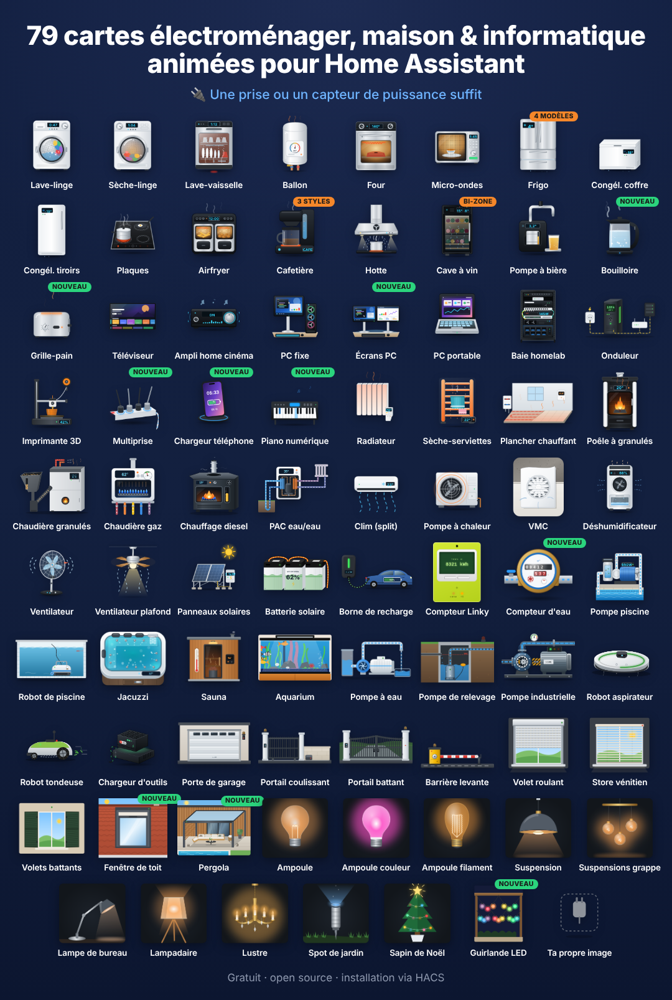</p>

**Cartões Lovelace para eletrodomésticos**, cada um com uma ilustração animada realista: o tambor de uma máquina de lavar roupa a rodar, a chama de uma salamandra a pellets, um aquecedor a gasóleo com a sua coroa azul, uma banheira de hidromassagem com jatos, um robô aspirador, um contador Linky, uma bateria doméstica… Mostram o estado em tempo real, a potência, a energia e o custo, acompanham o tema do Home Assistant (claro/escuro) e estão disponíveis em inglês, francês, alemão, norueguês, neerlandês, romeno, russo, sérvio, italiano, espanhol, checo, dinamarquês, húngaro, polaco e português (Portugal e Brasil).

Basta uma tomada inteligente com um sensor de potência. Os aparelhos conectados podem acrescentar programa, tempo restante, progresso, estado da porta, temperaturas…

**▶ [Experimentar online](https://skyrotter.github.io/ha-appliance-electromenager-cards/docs/demo.html)** (dados simulados, sem necessidade de Home Assistant) · [Ver o vídeo](docs/electromenager-51-cartes-facebook.mp4) · [Testes automáticos](https://skyrotter.github.io/ha-appliance-electromenager-cards/docs/tests.html)

## Galeria

Imagens dos cartões em funcionamento, agrupadas por tema (dados simulados).

<p align="center">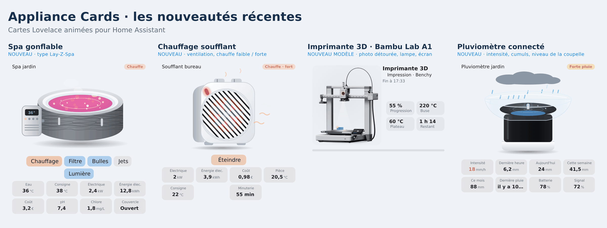</p>

<p align="center">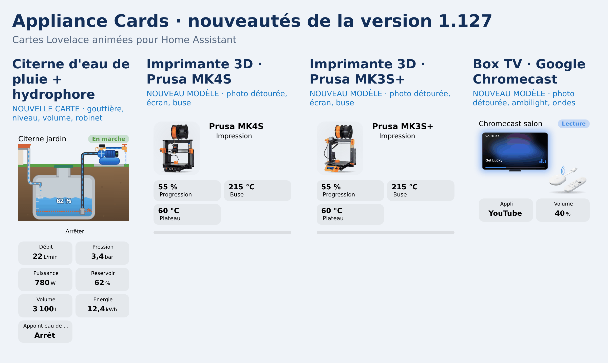</p>

<p align="center">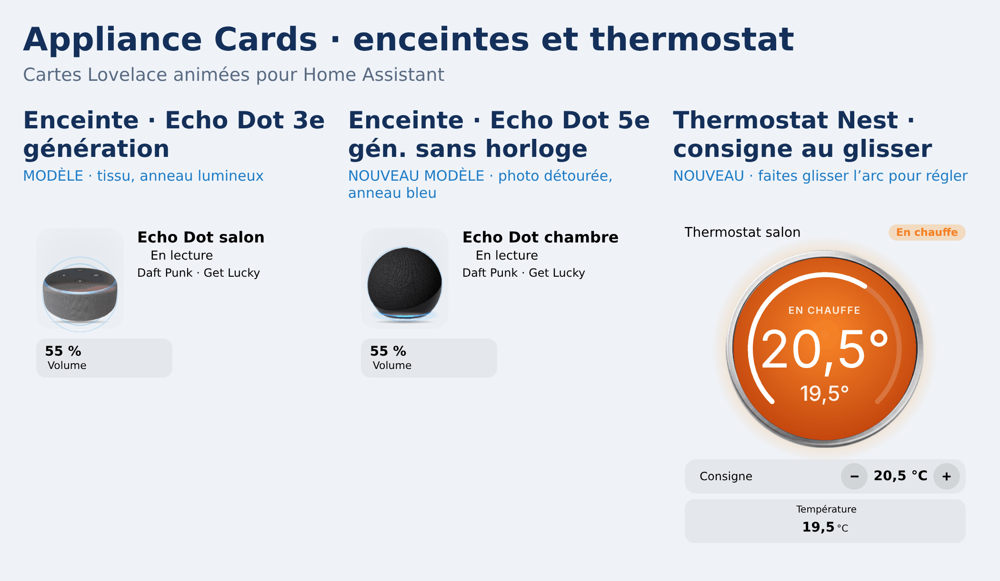</p>

<p align="center">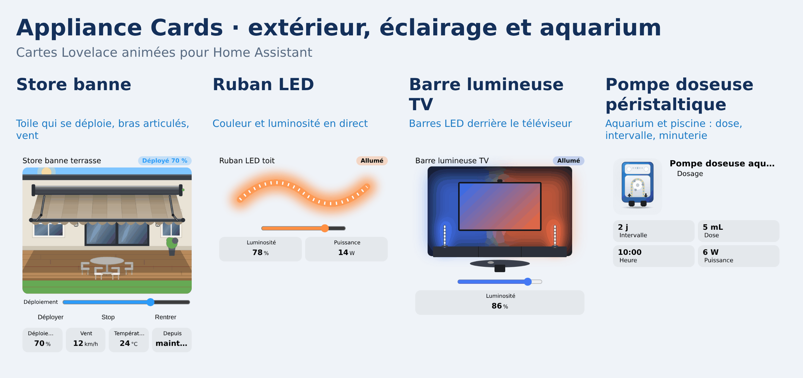</p>

<p align="center">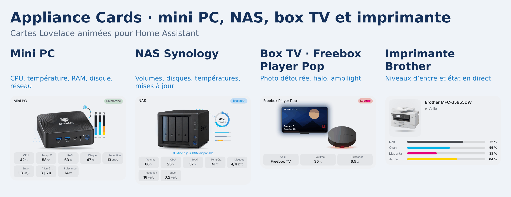</p>

<p align="center">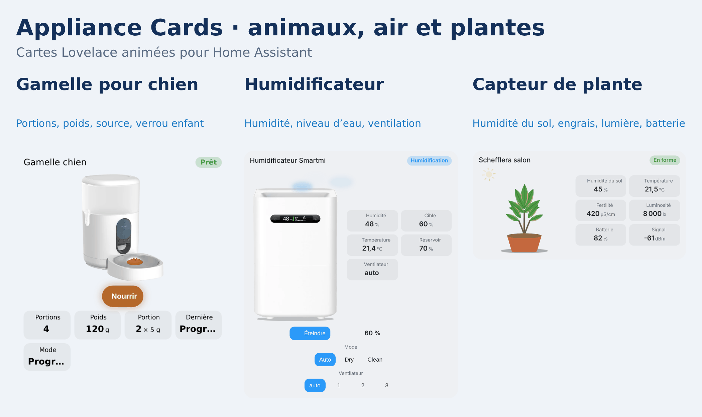</p>

<p align="center">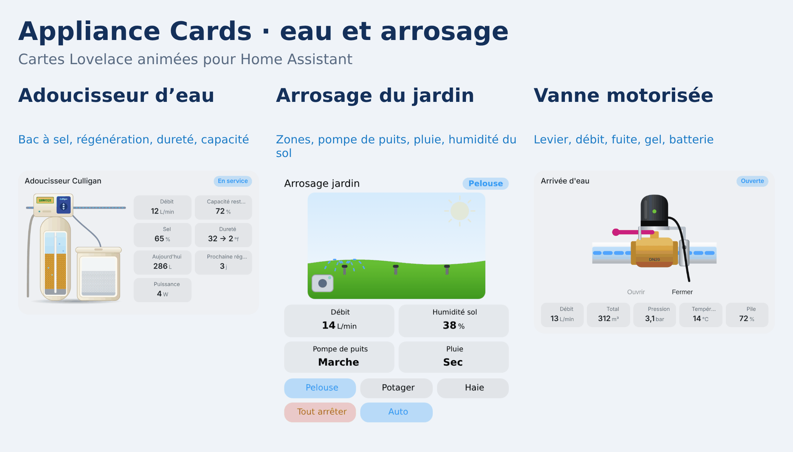</p>

<p align="center"></p>

<p align="center">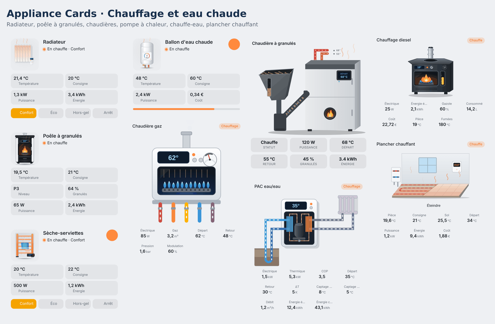</p>

<p align="center">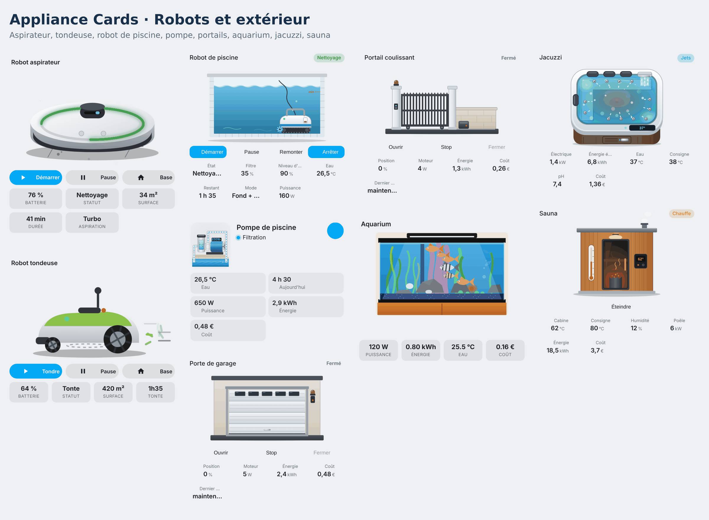</p>

<p align="center">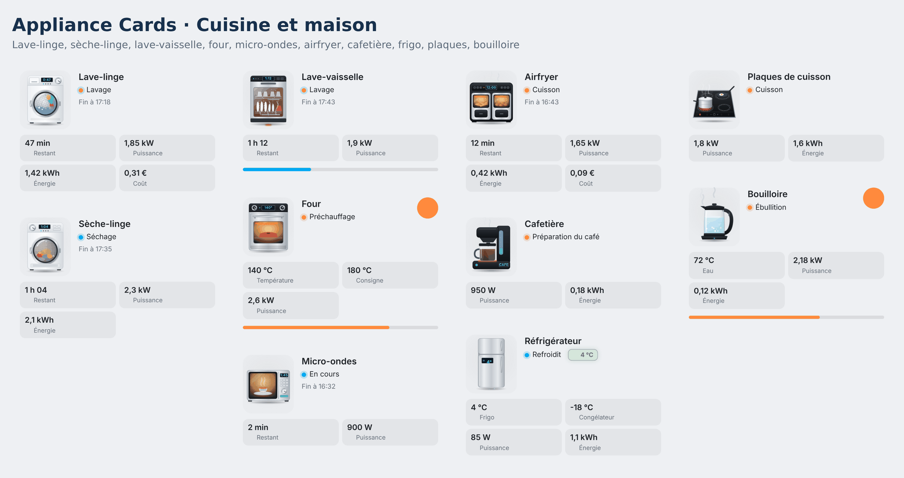</p>

## Instalação

**HACS (recomendado)**

Este fork inclui as traduções pt-PT e pt-BR. Use o botão abaixo para o abrir no HACS:

[](https://my.home-assistant.io/redirect/hacs_repository/?owner=asekijima&repository=ha-appliance-electromenager-cards&category=dashboard)

**Instalação deste fork pelo HACS**

1. Abra o HACS → ⋮ → **Custom repositories** e adicione `https://github.com/asekijima/ha-appliance-electromenager-cards` na categoria **Dashboard** (cartões da interface).
2. Abra a entrada deste fork, ative as versões beta/pré-lançamento no seletor de versões e escolha **v1.131.1-pt.1**. Se já tiver instalado o ramo `main`, use **Redownload** para selecionar essa versão.
3. Conclua a transferência e recarregue o navegador sem a cache (Ctrl+F5). Use apenas uma cópia do módulo para evitar duplicar o registo dos cartões.

A versão de teste está em [Releases](https://github.com/asekijima/ha-appliance-electromenager-cards/releases/tag/v1.131.1-pt.1). O [projeto original](https://github.com/skyrotter/ha-appliance-electromenager-cards) é mantido por skyrotter; as ligações para a demonstração e as imagens da galeria apontam para esse projeto e podem ainda não incluir as alterações deste fork.

**Instalação manual**

1. Copie `dist/ha-appliance-electromenager-cards.js` para `/config/www/`.
2. No Home Assistant, abra Definições → Painéis → ⋮ → Recursos e adicione `/local/ha-appliance-electromenager-cards.js` como **módulo JavaScript**.

## Início rápido

Todos os cartões têm um editor visual. Ao adicionar um cartão pelo seletor, as entidades são detetadas pelo nome (`lave_linge`, `washer`, `fridge`, `ballon`…). Também pode defini-las explicitamente em YAML:

```yaml
type: custom:appliance-washer-card
entity: input_boolean.washer_running   # entidade de estado opcional
power: sensor.washer_plug_power        # basta uma tomada inteligente
energy: sensor.washer_plug_energy_today
cost: sensor.washer_cost_today
```

Todas as opções, o cálculo do estado, os temas e a confirmação de segurança do botão de ligar/desligar estão em **[docs/configuration.md](docs/configuration.md)**.

### Português de Portugal e do Brasil

Os cartões seguem o idioma do perfil do Home Assistant: **Português** (`pt`) seleciona pt-PT; **Português (BR)** (`pt-BR`) seleciona pt-BR. Os cartões autónomos que disponibilizam a opção `language` permitem escolher uma variante explicitamente:

```yaml
type: custom:appliance-battery-card
entity_power: sensor.battery_power
language: pt-PT  # ou pt-BR
```

Os rótulos partilhados do editor seguem o idioma do Home Assistant; alguns rótulos específicos acompanham a opção do cartão. Os nomes personalizados e os textos provenientes dos sensores mantêm o seu conteúdo original. Consulte [Configuração](docs/configuration.md#portuguese-languages) para mais detalhes. Os guias de configuração e desenvolvimento continuam em inglês.

## Os cartões

Clique num cartão para consultar as opções e os exemplos.

### Cozinha e tratamento da roupa

| Cartão | Tipo |
|---|---|
| [Máquina de lavar roupa](docs/cards/washer-dryer-dishwasher.md) | `custom:appliance-washer-card` |
| [Máquina de secar roupa](docs/cards/washer-dryer-dishwasher.md) | `custom:appliance-dryer-card` |
| [Máquina de lavar loiça](docs/cards/washer-dryer-dishwasher.md) | `custom:appliance-dishwasher-card` |
| [Forno](docs/configuration.md#type-specific-options) | `custom:appliance-oven-card` |
| [Micro-ondas](docs/configuration.md#type-specific-options) | `custom:appliance-microwave-card` |
| [Frigorífico (4 disposições)](docs/cards/wine-cooler-fridge.md) | `custom:appliance-fridge-card` |
| [Arca congeladora](docs/cards/freezers.md) | `custom:appliance-chest-freezer-card` |
| [Congelador vertical de gavetas](docs/cards/freezers.md) | `custom:appliance-drawer-freezer-card` |
| [Placa elétrica](docs/cards/hob.md) | `custom:appliance-hob-card` |
| [Fritadeira a ar (dois cestos)](docs/cards/air-fryer.md) | `custom:appliance-air-fryer-card` |
| [Máquina de café (filtro, cápsulas, espresso)](docs/cards/coffee-maker.md) | `custom:appliance-coffee-maker-card` |
| [Chaleira](docs/cards/kettle-toaster.md) | `custom:appliance-kettle-card` |
| [Torradeira](docs/cards/kettle-toaster.md) | `custom:appliance-toaster-card` |
| [Exaustor](docs/cards/tv-range-hood.md) | `custom:appliance-range-hood-card` |
| [Frigorífico de vinhos (uma ou duas zonas)](docs/cards/wine-cooler-fridge.md) | `custom:appliance-wine-cooler-card` |
| [Torneira de cerveja](docs/cards/beer-tap-av-receiver.md) | `custom:appliance-beer-tap-card` |

### Aquecimento, água quente e ar

| Cartão | Tipo |
|---|---|
| [Termoacumulador (com gestão de excedentes solares)](docs/cards/water-heater.md) | `custom:appliance-water-heater-card` |
| [Aquecedor de água termodinâmico](docs/cards/thermo-heater.md) | `custom:appliance-thermo-heater-card` |
| [Termoventilador (elétrico compacto)](docs/cards/fan-heater.md) | `custom:appliance-fan-heater-card` |
| [Piso radiante (água ou elétrico)](docs/cards/underfloor-heating.md) | `custom:appliance-underfloor-heating-card` |
| [Radiador elétrico](docs/cards/radiator.md) | `custom:appliance-radiator-card` |
| [Toalheiro aquecido](docs/cards/towel-rack-pc-laptop.md) | `custom:appliance-towel-dryer-card` |
| [Salamandra a pellets](docs/cards/pellet-stove.md) | `custom:appliance-pellet-stove-card` |
| [Caldeira a pellets](docs/cards/pellet-boiler.md) | `custom:appliance-pellet-boiler-card` |
| [Caldeira a gás](docs/cards/gas-boiler.md) | `custom:appliance-gas-boiler-card` |
| [Aquecedor a gasóleo](docs/cards/diesel-heater.md) | `custom:appliance-diesel-heater-card` |
| [Bomba de calor água-água / geotérmica](docs/cards/water-heat-pump.md) | `custom:appliance-water-heat-pump-card` |
| [Ar condicionado, unidade interior split](docs/cards/air-conditioning.md) | `custom:appliance-ac-split-card` |
| [Bomba de calor, unidade exterior](docs/cards/air-conditioning.md) | `custom:appliance-heat-pump-card` |
| [Extrator de casa de banho (VMC)](docs/cards/vmc.md) | `custom:appliance-vmc-card` |
| [Clima da divisão (temperatura, humidade, histórico, 12 estilos)](docs/cards/room-climate.md) | `custom:appliance-room-climate-card` |
| [Desumidificador](docs/cards/dehumidifier.md) | `custom:appliance-dehumidifier-card` |
| [Purificador de ar](docs/cards/air-purifier.md) | `custom:appliance-air-purifier-card` |

### Energia, piscina, spa e aquário

| Cartão | Tipo |
|---|---|
| [Painéis solares](docs/cards/solar.md) | `custom:appliance-solar-card` |
| [Bateria doméstica](docs/cards/battery.md) | `custom:appliance-battery-card` |
| [Carregador de veículo elétrico (wallbox + carro)](docs/cards/ev-charger.md) | `custom:appliance-ev-charger-card` |
| [Contador de eletricidade Linky](docs/cards/linky.md) | `custom:appliance-linky-card` |
| [Contador de água](docs/cards/water-meter.md) | `custom:appliance-water-meter-card` |
| [Contador de energia térmica (aquecimento urbano)](docs/cards/heat-meter.md) | `custom:appliance-heat-meter-card` |
| [Contador de gás](docs/cards/gas-meter.md) | `custom:appliance-gas-meter-card` |
| [Contador elétrico (genérico)](docs/cards/electric-meter.md) | `custom:appliance-electric-meter-card` |
| [Válvula termostática de radiador (TRV)](docs/cards/trv.md) | `custom:appliance-trv-card` |
| [Bomba da piscina](docs/cards/pool-pump.md) | `custom:appliance-pool-pump-card` |
| [Bomba doseadora (pH+ / pH-)](docs/cards/dosing-pump.md) | `custom:appliance-dosing-pump-card` |
| [Robô de limpeza de piscina](docs/cards/pool-robot.md) | `custom:appliance-pool-robot-card` |
| [Bomba de água (jardim, poço, água da chuva)](docs/cards/pumps.md) | `custom:appliance-water-pump-card` |
| [Bomba industrial](docs/cards/pumps.md) | `custom:appliance-industrial-pump-card` |
| [Bomba de drenagem](docs/cards/pumps.md) | `custom:appliance-sump-pump-card` |
| [Depósito de água da chuva + grupo de pressurização](docs/cards/pumps.md) | `custom:appliance-rainwater-tank-card` |
| [Banheira de hidromassagem (jacuzzi)](docs/cards/jacuzzi.md) | `custom:appliance-jacuzzi-card` |
| [Aquário](docs/cards/aquarium.md) | `custom:appliance-aquarium-card` |
| [Aquário de recife (água salgada: luminárias LED, corais, parâmetros da água)](docs/cards/reef-aquarium.md) | `custom:appliance-reef-aquarium-card` |

### Portões, garagem e sauna

| Cartão | Tipo |
|---|---|
| [Barreira](docs/cards/access.md) | `custom:appliance-barrier-card` |
| [Portão de correr](docs/cards/access.md) | `custom:appliance-sliding-gate-card` |
| [Portão de batente](docs/cards/access.md) | `custom:appliance-swing-gate-card` |
| [Porta de garagem](docs/cards/access.md) | `custom:appliance-garage-door-card` |
| [Caixa de correio (cartas e encomendas)](docs/cards/mailbox.md) | `custom:appliance-mailbox-card` |
| [Detetor de fumo (fumo, CO, 2 modelos)](docs/cards/smoke-detector.md) | `custom:appliance-smoke-detector-card` |
| [Fechadura inteligente (Nuki, 2 modelos)](docs/cards/smart-lock.md) | `custom:appliance-smart-lock-card` |
| [Detetor de fugas de água](docs/cards/leak-detector.md) | `custom:appliance-leak-detector-card` |
| [Rega (zonas, bomba, chuva)](docs/cards/irrigation.md) | `custom:appliance-irrigation-card` |
| [Fita LED (cor, brilho, efeito)](docs/cards/led-strip.md) | `custom:appliance-led-strip-card` |
| [Pluviómetro (intensidade, totais)](docs/cards/rain-gauge.md) | `custom:appliance-rain-gauge-card` |
| [Monitor de plantas (Mi Flora: humidade, luz, fertilidade)](docs/cards/plant-monitor.md) | `custom:appliance-plant-monitor-card` |
| [Humidificador (fotografia Smartmi ou desenho)](docs/cards/humidifier.md) | `custom:appliance-humidifier-card` |
| [Spa insuflável (estilo Lay-Z-Spa)](docs/cards/inflatable-spa.md) | `custom:appliance-inflatable-spa-card` |
| [Sauna](docs/cards/sauna.md) | `custom:appliance-sauna-card` |

### Iluminação

| Cartão | Tipo |
|---|---|
| [Lâmpada](docs/cards/lights.md) | `custom:appliance-light-bulb-card` |
| [Lâmpada de cor](docs/cards/lights.md) | `custom:appliance-color-bulb-card` |
| [Lâmpada de filamento](docs/cards/lights.md) | `custom:appliance-filament-bulb-card` |
| [Candeeiro suspenso](docs/cards/lights.md) | `custom:appliance-pendant-light-card` |
| [Conjunto de candeeiros suspensos](docs/cards/lights.md) | `custom:appliance-pendant-cluster-card` |
| [Candeeiro de secretária](docs/cards/lights.md) | `custom:appliance-desk-lamp-card` |
| [Candeeiro de pé](docs/cards/lights.md) | `custom:appliance-floor-lamp-card` |
| [Lustre](docs/cards/lights.md) | `custom:appliance-chandelier-card` |
| [Foco de jardim](docs/cards/lights.md) | `custom:appliance-garden-spotlight-card` |
| [Focos embutidos](docs/cards/lights.md) | `custom:appliance-ceiling-spot-card` |
| [Árvore de Natal](docs/cards/lights.md) | `custom:appliance-christmas-tree-card` |
| [Grinalda de luzes LED](docs/cards/plugs-piano-garland.md) | `custom:appliance-garland-card` |

### Estores e persianas

| Cartão | Tipo |
|---|---|
| [Estore de enrolar](docs/cards/shutters.md) | `custom:appliance-roller-shutter-card` |
| [Cortinas deslizantes](docs/cards/sliding-curtain.md) | `custom:appliance-sliding-curtain-card` |
| [Persiana veneziana](docs/cards/shutters.md) | `custom:appliance-venetian-blind-card` |
| [Portadas](docs/cards/shutters.md) | `custom:appliance-swing-shutter-card` |
| [Pérgula bioclimática](docs/cards/shutters.md) | `custom:appliance-pergola-card` |
| [Janela de telhado (Velux)](docs/cards/shutters.md) | `custom:appliance-roof-window-card` |
| [Toldo retrátil](docs/cards/shutters.md) | `custom:appliance-awning-card` |

### Entretenimento e informática

| Cartão | Tipo |
|---|---|
| [TV de ecrã plano](docs/cards/tv-range-hood.md) | `custom:appliance-tv-card` |
| [Amplificador de cinema em casa (recetor AV)](docs/cards/beer-tap-av-receiver.md) | `custom:appliance-av-receiver-card` |
| [Coluna inteligente (Echo, Nest, Sonos, Devialet, HomePod)](docs/cards/smart-speaker.md) | `custom:appliance-smart-speaker-card` |
| [PlayStation 5](docs/cards/ps5.md) | `custom:appliance-ps5-card` |
| [Bicicleta elíptica](docs/cards/fitness.md) | `custom:appliance-elliptical-card` |
| [Bicicleta estática](docs/cards/fitness.md) | `custom:appliance-exercise-bike-card` |
| [Máquina de remo](docs/cards/fitness.md) | `custom:appliance-rowing-machine-card` |
| [Thermomix (TM6 / TM7)](docs/cards/thermomix.md) | `custom:appliance-thermomix-card` |
| [Cookeo (multicooker)](docs/cards/cookeo.md) | `custom:appliance-cookeo-card` |
| [Bastidor de servidores (homelab)](docs/cards/towel-rack-pc-laptop.md) | `custom:appliance-server-rack-card` |
| [UPS (NUT)](docs/cards/ups.md) | `custom:appliance-ups-card` |
| [Mini PC (fotografia BMAX B9 Max)](docs/cards/mini-pc.md) | `custom:appliance-mini-pc-card` |
| [NAS (fotografia Synology DS423+)](docs/cards/nas.md) | `custom:appliance-nas-card` |
| [Box de TV (Freebox Player Pop, Xiaomi TV Box S, NVIDIA Shield)](docs/cards/tv-box.md) | `custom:appliance-tv-box-card` |
| [Router de Internet (Freebox Pop, SFR Box)](docs/cards/internet-box.md) | `custom:appliance-internet-box-card` |
| [Ar condicionado portátil](docs/cards/portable-ac.md) | `custom:appliance-portable-ac-card` |
| [Alimentador de animais (Aqara C1)](docs/cards/pet-feeder.md) | `custom:appliance-pet-feeder-card` |
| [Computador de secretária](docs/cards/towel-rack-pc-laptop.md) | `custom:appliance-desktop-pc-card` |
| [Monitores (1 a 3)](docs/cards/towel-rack-pc-laptop.md) | `custom:appliance-monitor-card` |
| [Computador portátil](docs/cards/towel-rack-pc-laptop.md) | `custom:appliance-laptop-card` |
| [Extensão elétrica](docs/cards/plugs-piano-garland.md) | `custom:appliance-power-strip-card` |
| [Tomada inteligente](docs/cards/plugs-piano-garland.md) | `custom:appliance-smart-plug-card` |
| [Impressora / scanner](docs/cards/printer.md) | `custom:appliance-printer-card` |
| [Carregador de telemóvel](docs/cards/plugs-piano-garland.md) | `custom:appliance-phone-charger-card` |
| [Piano digital](docs/cards/plugs-piano-garland.md) | `custom:appliance-piano-card` |
| [Impressora 3D](docs/cards/printer-3d.md) | `custom:appliance-printer-3d-card` |

### Robôs, ventoinhas e outros aparelhos

| Cartão | Tipo |
|---|---|
| [Robô aspirador](docs/cards/robots.md) | `custom:appliance-robot-vacuum-solo-card` |
| [Aspirador de sólidos e líquidos](docs/cards/wet-vacuum.md) | `custom:appliance-wet-vacuum-card` |
| [Robô corta-relva](docs/cards/robots.md) | `custom:appliance-robot-mower-solo-card` |
| [Ventoinha](docs/cards/fan.md) | `custom:appliance-fan-card` |
| [Ventoinha de teto](docs/cards/ceiling-fan.md) | `custom:appliance-ceiling-fan-card` |
| [Carregador de baterias de ferramentas](docs/cards/tool-charger.md) | `custom:appliance-tool-charger-card` |
| [Balança inteligente (fotografia Withings)](docs/cards/scale.md) | `custom:appliance-scale-card` |
| [Torneira inteligente (válvula de jardim Zigbee)](docs/cards/smart-tap.md) | `custom:appliance-smart-tap-card` |
| [Válvula de água motorizada (atuador de válvula de esfera)](docs/cards/water-valve.md) | `custom:appliance-water-valve-card` |
| [Descalcificador de água (Culligan ou genérico: depósito de resina, depósito de salmoura)](docs/cards/water-softener.md) | `custom:appliance-water-softener-card` |
| [Câmara de vigilância (deteções, modo noturno, fotografia própria)](docs/cards/camera.md) | `custom:appliance-camera-card` |
| [Gravador NVR (LEDs animados, disco, CPU)](docs/cards/camera.md) | `custom:appliance-nvr-card` |
| [Switch PoE (SSCPOE / Steamemo GPS208, GPS204V, GPS105S)](docs/cards/poe-switch.md) | `custom:appliance-poe-switch-card` |
| [Raspberry Pi 4 (CPU, temperatura, RAM, disco, rede, subtensão)](docs/cards/raspberry-pi.md) | `custom:appliance-raspberry-pi-card` |
| [Coordenador Zigbee](docs/cards/zigbee-coordinator.md) | `custom:appliance-zigbee-coordinator-card` |
| [Filtro de água (sob o lava-loiça, 1 a 3 cartuchos)](docs/cards/water-filter.md) | `custom:appliance-water-filter-card` |
| [Portinhola para gatos (microchip, animais no interior / exterior)](docs/cards/cat-flap.md) | `custom:appliance-cat-flap-card` |
| [Fonte de água para animais](docs/cards/pet-fountain.md) | `custom:appliance-pet-fountain-card` |
| [Aparelho genérico (imagem própria)](docs/cards/generic.md) | `custom:appliance-generic-card` |

## Documentação

- [Configuração](docs/configuration.md): opções comuns, cálculo do estado, modos, temas e segurança do botão de ligar/desligar.
- [Deteção de ciclos de máquinas de lavar roupa, secar roupa e lavar loiça](docs/cards/washer-dryer-dishwasher.md): automação recomendada com uma tomada inteligente.
- [Desenvolvimento e traduções](docs/development.md): compilação e adição de cartões ou idiomas.
- [Descrições em francês](docs/cards-fr.md).

## Contribuir

Consulte o guia completo em [CONTRIBUTING.md](CONTRIBUTING.md). Os relatos de erros e os pedidos de novos cartões são bem-vindos nas [issues do projeto original](https://github.com/skyrotter/ha-appliance-electromenager-cards/issues). O conteúdo de `dist/` é gerado: altere `src/`, execute `node build.js` e inclua ambos no commit (consulte [Desenvolvimento](docs/development.md)).

## Licença

[MIT](LICENSE)
