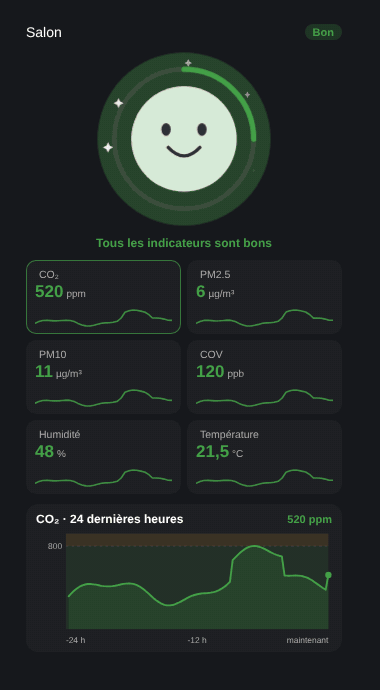

# Air quality

`custom:appliance-air-quality-card`

<p align="center"></p>

An air quality monitor in one card. Every sensor is optional: only the ones you configure are shown.

- **Central indicator**: a face in a ring that goes from **Good** to **Bad** following the worst pollutant (CO₂, PM0.3, PM1, PM2.5, PM4, PM10, VOC, NOx, formaldehyde, CO, NO₂, O₃, radon, propane, O₂). Humidity, temperature, atmospheric pressure and noise are coloured but do not count in the indicator. When the air degrades, dust particles float around the face; when it is good, sparkles twinkle.
- **One tile per measurement**: value coloured by thresholds and a mini 24 h curve.
- **24 h curve**: click a tile to show its curve, with the threshold bands in colour and a tooltip (value and time) when you hover or touch the curve. The history comes from the Home Assistant recorder, completed by the values seen live.

| Measurement | Config key | Good | Moderate | Poor | Bad |
|---|---|---|---|---|---|
| CO₂ (ppm) | `entity_co2` | < 800 | 800 – 1000 | 1000 – 1500 | ≥ 1500 |
| PM0.3 (#/cm³) | `entity_pm03` | < 500 | 500 – 1500 | 1500 – 3000 | ≥ 3000 |
| PM1 (µg/m³) | `entity_pm1` | < 10 | 10 – 25 | 25 – 40 | ≥ 40 |
| PM2.5 (µg/m³) | `entity_pm25` | < 12 | 12 – 35 | 35 – 55 | ≥ 55 |
| PM4 (µg/m³) | `entity_pm4` | < 15 | 15 – 40 | 40 – 75 | ≥ 75 |
| PM10 (µg/m³) | `entity_pm10` | < 20 | 20 – 50 | 50 – 100 | ≥ 100 |
| VOC (ppb) | `entity_voc` | < 220 | 220 – 660 | 660 – 2200 | ≥ 2200 |
| NOx (index) | `entity_nox` | < 20 | 20 – 150 | 150 – 300 | ≥ 300 |
| Formaldehyde (µg/m³) | `entity_hcho` | < 30 | 30 – 60 | 60 – 100 | ≥ 100 |
| CO (ppm) | `entity_co` | < 9 | 9 – 25 | 25 – 50 | ≥ 50 |
| NO₂ (µg/m³) | `entity_no2` | < 40 | 40 – 100 | 100 – 200 | ≥ 200 |
| Ozone O₃ (µg/m³) | `entity_o3` | < 60 | 60 – 100 | 100 – 180 | ≥ 180 |
| Radon (Bq/m³) | `entity_radon` | < 100 | 100 – 150 | 150 – 300 | ≥ 300 |
| Radon long-term (Bq/m³) | `entity_radon_long_term` | < 100 | 100 – 150 | 150 – 300 | ≥ 300 |
| Propane C₃H₈ (%LEL) | `entity_propane` | < 5 | 5 – 10 | 10 – 20 | ≥ 20 |
| Oxygen O₂ (%) | `entity_o2` | 19.5 – 23.5 | 18 – 25 | else | far out of range |
| Humidity (%) | `entity_humidity` | 40 – 60 | 30 – 70 | else | far out of range |
| Temperature (°C) | `entity_temperature` | 19 – 24 | 17 – 26 | else | far out of range |
| Atmospheric pressure (hPa) | `entity_pressure` | 1000 – 1026 | 985 – 1040 | else | far out of range |
| Noise (dB) | `entity_noise` | < 45 | 45 – 65 | 65 – 80 | ≥ 80 |

Thresholds automatically adapt to common entity units (e.g. VOC ppb / µg/m³ / mg/m³ / ppm / index, NOx index / ppb / ppm / µg/m³, HCHO µg/m³ / mg/m³ / ppb / ppm, Radon Bq/m³ / pCi/L, CO ppm / mg/m³, NO₂ & O₃ µg/m³ / ppb / ppm, pressure hPa / mmHg / kPa / inHg). Override any of them with `thresholds`.

```yaml
type: custom:appliance-air-quality-card
entity_co2: sensor.living_room_co2
entity_pm1: sensor.living_room_pm1
entity_pm25: sensor.living_room_pm25
entity_pm10: sensor.living_room_pm10
entity_voc: sensor.living_room_tvoc
entity_nox: sensor.living_room_nox_index           # optional
entity_hcho: sensor.living_room_formaldehyde      # optional
entity_pressure: sensor.living_room_pressure      # optional
entity_humidity: sensor.living_room_humidity
entity_temperature: sensor.living_room_temperature
thresholds:                                       # optional: [good→moderate, moderate→poor, poor→bad]
  co2: [700, 1000, 1400]
```

Options: `name`, `thresholds`, `labels`, `illustration_size`, `transparent`, `tap_action` / `hold_action`, `language`, `show_status`, `show_sparklines`, `show_chart`, `animations`.

[← All cards](../../README.md#the-cards)
