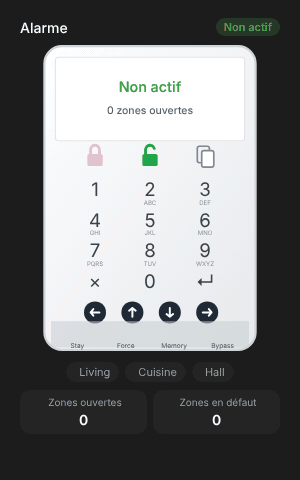

# Alarm keypad

`custom:appliance-alarm-keypad-card`

<p align="center"></p>

A white touch keypad (screen, padlocks, number pad, navigation and function keys) drawn in vector. Its screen shows the alarm status and the number of open zones; optional zone chips below it turn orange when a zone is open and red when it is in fault. Tap the keypad body to open the status entity; with an alarm panel the keys are live (see below).

```yaml
type: custom:appliance-alarm-keypad-card
entity: sensor.alarm_status
name: Alarm
entity_control: alarm_control_panel.house    # optional, makes the keys live
entity_zones_open: sensor.nb_zone_open      # optional
entity_zones_fault: sensor.nb_zone_default  # optional
zones:                                      # optional, up to 8
  - name: Living room
    entity: binary_sensor.detection_living
    entity_fault: binary_sensor.default_living
  - name: Kitchen
    entity: binary_sensor.detection_kitchen
```

## Options

| Option | Description |
|---|---|
| `entity` | Alarm status: a text `sensor` or an `alarm_control_panel`. |
| `entity_control` | `alarm_control_panel` to drive with the keys. Defaults to `entity` when that is already an `alarm_control_panel`; without a panel the keys do nothing. |
| `entity_zones_open`, `entity_zones_fault` | Counters of open / faulty zones. Without them, the count is taken from `zones`. |
| `zones` | Up to 8 zones: `name`, `entity` (open) and `entity_fault` (both optional `binary_sensor`). |
| `show_status`, `show_open`, `show_fault`, `show_zones` | Show the badge, the two counter tiles and the zone chips (default true). |
| `animations` | Set false to disable the blinking. |

## Keys

With an alarm panel, the keypad can be used directly:

- **Digits** type the code (shown as dots on the screen, up to 8 digits, cleared after 10 s or on send); **×** clears it.
- **Red padlock**: `alarm_arm_away`. **Green padlock**: `alarm_disarm`. **Stay**: `alarm_arm_home`. **↵**: disarms if the alarm is armed, arms (away) otherwise.
- The typed code is sent with the command (`code`) when there is one. A refused command shows a message on the screen.
- Force, Memory, Bypass and the arrows are decorative.

The code is only typed on the keypad and is never stored in the card configuration.

Recognised statuses (English or French text, or `alarm_control_panel` states): not armed / disarmed / non actif, ready / prêt, armed / actif, armed partially / armed_home / armed_night / actif partiel, entry delay / pending / tempo entrée, exit delay / arming / tempo sortie, intrusion / triggered. Override the displayed words with `labels` (keys `disarmed`, `ready`, `armed`, `armed_partial`, `entry_delay`, `exit_delay`, `intrusion`).

The shared options `language`, `illustration_size`, `transparent`, `tile_background`, `tile_order`, `labels`, `tap_action` and `hold_action` work too.

[← All cards](../../README.md#the-cards)
