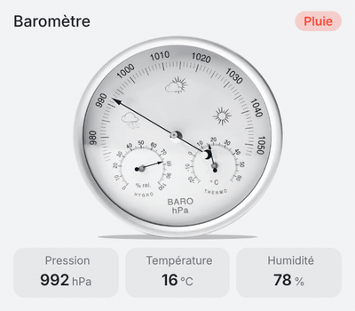

# Barometer

<p align="center"></p>

`custom:appliance-barometer-card`: an analogue barometer (silver dial with hygrometer and thermometer, cut-out photo). The needles are drawn live: the big one follows the **pressure**, the two small ones the **humidity** and the **temperature**.

- Weather zones in the badge: **Storm** (below 985 hPa), **Rain** (below 1000), **Changeable** (below 1020), **Fair weather**.
- The pressure is converted to hPa if your sensor is in kPa, Pa, inHg or mmHg.
- `reference_pressure` (optional): a thin reference hand, like the one you set by hand on a real barometer.
- The small needles are hidden when you do not give the humidity / temperature sensors.
- Tiles: pressure, temperature, humidity.
- Options: `entity_pressure`, `entity_temperature`, `entity_humidity`, `reference_pressure`, `show_pressure`, `show_temperature`, `show_humidity`.

```yaml
type: custom:appliance-barometer-card
name: Barometer
entity_pressure: sensor.home_pressure
entity_temperature: sensor.living_room_temperature   # optional
entity_humidity: sensor.living_room_humidity         # optional
reference_pressure: 1013                             # optional
```

[← All cards](../../README.md#the-cards)
