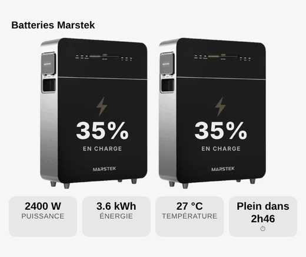
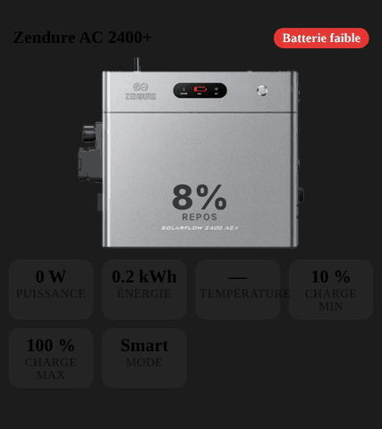
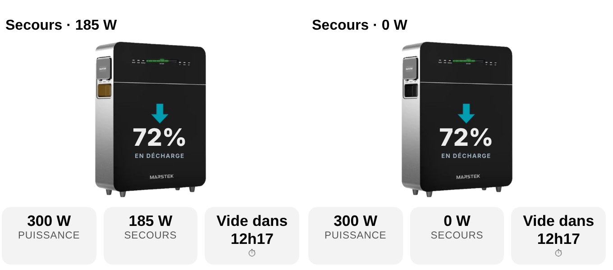
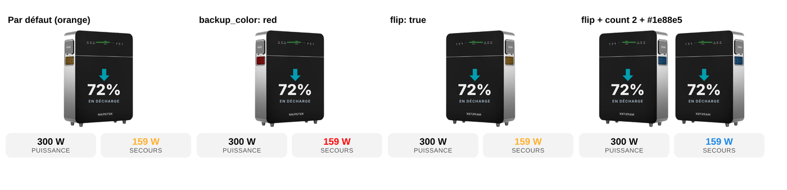

# Home battery

`custom:appliance-battery-card`

<p align="center"></p>

**Home battery**: three modules wired with orange cables, no background. The charge level rises in the modules (green → orange → red), energy flows along the cables in one direction when charging and the other when discharging, with time to full / empty.

## Marstek Venus E 3.0 (photo)

<p align="center"></p>

## Zendure SolarFlow 2400 AC+ (photo)

<p align="center"></p>

`model: zendure_ac2400`: cut-out photo of the **Zendure SolarFlow 2400 AC+**. The battery icon of its screen is redrawn with 4 segments that follow the state of charge (green / orange / red, the last lit segment blinks while charging), the charge in % and the flow arrow are drawn on the front. `count` places several units side by side.

```yaml
type: custom:appliance-battery-card
model: zendure_ac2400
entity_soc: sensor.solarflow_2400_ac_plus_electric_level
entity_power: sensor.solarflow_2400_ac_plus_power
entity_soc_min: number.solarflow_2400_ac_plus_min_soc
entity_soc_max: number.solarflow_2400_ac_plus_soc_set
entity_mode: select.zendure_manager_operation
capacity_kwh: 2.4
max_power: 2400
```

## Options

Every value tile can be hidden with its `show_…` option, and `language: fr|en|de|it|es|nb|nl|pl|ro|ru|sr|sr-Latn` forces the language. Temperatures follow `temperature_unit: C|F`, otherwise the unit of Home Assistant: each sensor is converted from its own unit, and temperature thresholds are entered in that unit (the defaults below are in °C and are converted, e.g. 40 °C → 104 °F).

- `model`: `default` (the three drawn modules), `zendure_ac2400` (Zendure SolarFlow 2400 AC+, see below) or `marstek_venus_e3` (cut-out photo of the **Marstek Venus E 3.0**: its light strip fills with the state of charge, in green / orange / red, and runs in the direction of the energy flow when charging or discharging; the percentage and state are shown on the black front)
- `count` (1 to 4, default 1): number of units drawn side by side with `model: marstek_venus_e3`, e.g. `2` for two batteries combined in a single charge sensor
<p align="center"></p>

- `entity_backup`: power of the **backup (off-grid) output** in W (e.g. Marstek Venus E 3.0 AC off-grid power), shown in a **Backup** tile; with `model: marstek_venus_e3` the backup socket of the unit lights up on the picture while it supplies 10 W or more
- `show_backup` (default true): hides the Backup tile
<p align="center"></p>

- `backup_color`: colour of the Backup tile value and of the backup socket on the picture: a CSS name (`orange`, `red`…), `#hex` or `rgb()` (default orange)
- `flip` (`true` / `false`, default false): mirrors the Marstek photo (the side panel with the backup socket is on the right by default, as on the real device; the MARSTEK logo and labels are mirrored too)
- `entity_soc` (%)
- `entity_power` (positive = charging, `invert_power: true` if yours is reversed)
- `entity_energy`
- `entity_temperature`
- `entity_soc_min` / `entity_soc_max`: minimum and maximum charge limits (a `number`, `input_number` or `sensor`, in %), shown in **Min charge** / **Max charge** tiles (`show_soc_min`, `show_soc_max`: default true)
- `entity_mode`: operating mode (a `select`, `input_select` or `sensor`), shown in a **Mode** tile (`show_mode`: default true)
- `entity_calibration`: date of the next calibration (e.g. Zendure batteries), from a `sensor` (date or timestamp) or an `input_datetime`; shown in a tile
- `show_calibration` (default true)
- `capacity_kwh` (default 10)
- `max_power`
- `low_threshold` (default 15 %)
- `show_power`
- `show_energy`
- `show_temperature`
- `show_time`
- `layout`: `default` or `split` (illustration on the left, name, status and values on the right; useful in narrow or 2-column grids)
- `status_position`: `auto` (default, status moves below the illustration on narrow cards), `inside` or `below`

```yaml
type: custom:appliance-battery-card
name: Marstek batteries
model: marstek_venus_e3
count: 2
entity_soc: sensor.soc_batteries
entity_power: sensor.batteries_power
capacity_kwh: 10.24
max_power: 5000
```

[← All cards](../../README.md#the-cards)
