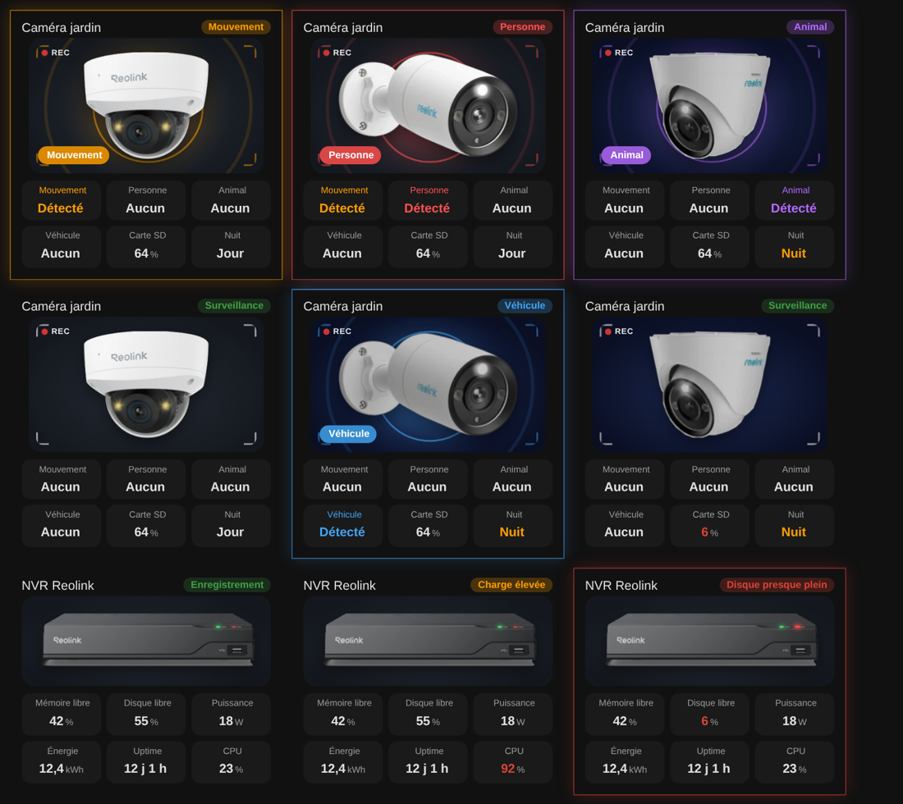

# Camera and NVR

`custom:appliance-camera-card` and `custom:appliance-nvr-card`

<p align="center"></p>

## Camera

A cut-out photo of the camera (models `dome`, `bullet`, `turret`, or **your own picture** in `image`) in a viewfinder frame with a blinking REC dot. A detection lights a halo and waves in the colour of its type (motion orange, person red, animal purple, vehicle blue) and shows a chip on the picture. Night mode turns the scene dark blue with a moon. **A click on the camera opens the live video** (the more-info dialog of `entity_camera`); `tap_action` / `hold_action` can replace it.

| Option | What it does |
|---|---|
| `model` | `dome` (default), `bullet` or `turret` |
| `image` | your own picture (cut-out PNG / WebP / SVG), replaces the model |
| `entity_camera` | the `camera.*` entity: video on click, and used to tell if the camera is offline |
| `entity_motion`, `entity_person`, `entity_animal`, `entity_vehicle` | detections (`binary_sensor`, on = detected). Priority: person > animal > vehicle > motion |
| `entity_sd` | free space of the SD card (red below `sd_low`, 10 %, when in %) |
| `entity_night` | night / day switch (`switch`, `input_boolean`, `binary_sensor`, `select`): **on = night**. A click on its tile toggles a `switch` |
| `show_motion`, `show_person`, `show_animal`, `show_vehicle`, `show_sd`, `show_night`, `show_status`, `compact`, `animations`, `labels`, `language`, `illustration_size`, `transparent`, `tap_action`, `hold_action` | |

```yaml
type: custom:appliance-camera-card
name: Garden
model: bullet
entity_camera: camera.garden
entity_motion: binary_sensor.garden_motion
entity_person: binary_sensor.garden_person
entity_animal: binary_sensor.garden_animal
entity_vehicle: binary_sensor.garden_vehicle
entity_sd: sensor.garden_sd_free
entity_night: switch.garden_ir
```

## NVR

The NVR recorder photo with its **PWR (green) and HDD (red) LEDs animated** (the HDD LED blinks faster when the CPU works). The card turns red when the disk is almost full, orange on a high CPU load.

| Option | What it does |
|---|---|
| `entity` | status of the NVR (`binary_sensor`, `switch`…): off greys the picture |
| `entity_memory_free` | free memory (%) |
| `entity_disk_free` | free disk space (%). Alert at or below `disk_low` (10 %) |
| `entity_power`, `entity_energy` | power (W, kW) and energy (kWh) |
| `entity_uptime` | uptime: a duration (s / min / h / d) or the last boot date, shown as `3 d 4 h` |
| `entity_cpu` | CPU load (%). High from `cpu_high` (85 %) |
| `image`, `show_memory`, `show_disk`, `show_power`, `show_energy`, `show_uptime`, `show_cpu`, `show_status`, `compact`, `animations`, `labels`, `language`, `illustration_size`, `transparent`, `tap_action`, `hold_action` | |

```yaml
type: custom:appliance-nvr-card
name: NVR
entity_memory_free: sensor.nvr_memory_free
entity_disk_free: sensor.nvr_disk_free
entity_power: sensor.nvr_power
entity_energy: sensor.nvr_energy
entity_uptime: sensor.nvr_uptime
entity_cpu: sensor.nvr_cpu
```

[← All cards](../../README.md#the-cards)
