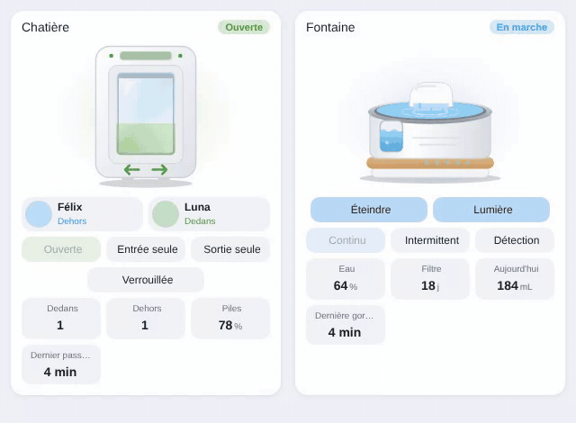

# Cat flap

`custom:appliance-cat-flap-card`



A connected microchip cat flap (SureFlap / Sure Petcare, Petlibro, Cat Mate…) seen from the front: white frame, transparent flap hinged at the top, the garden behind it.

Animations: when a pet goes through (one of the pets switches between inside and outside, or `entity_motion` turns on), the flap swings up, a cat's head passes through and the microchip reader sends waves from the antenna band. The **in** (→) and **out** (←) arrows are crossed out according to the locking mode, a red padlock covers the flap when it is fully locked. Curfew: a moon appears. Unknown animal (`entity_intruder`): the card glows red and a warning sign blinks. Low battery: a battery pictogram blinks.

Locking: a `lock` entity (locked / unlocked) and/or a `select` entity (`entity_mode`) with the flap's modes (`unlocked`, `locked_in`, `locked_out`, `locked_all`, `curfew`…). Each option of the select becomes a button; without a select, **Lock / Unlock** buttons drive the lock. The Sure Petcare integration creates three `lock` entities per flap (locked all, locked in, locked out): set them as `entity`, `entity_locked_in` and `entity_locked_out` to get the four modes (Open, In only, Out only, Locked).

When the card is added from the card picker, the entities are found automatically: the flap's locks / mode select / battery by name (`cat_flap`, `chatiere`, `sureflap`, `pet_door`…), the pets among presence sensors (Sure Petcare pets) and trackers named after a pet.

Pets: `pets` is a list of entities (Sure Petcare pet `binary_sensor`, `device_tracker`, `sensor`…). `on` / `home` / `inside` mean inside, `off` / `not_home` / `outside` mean outside. Each pet gets a chip with its picture (`picture`, or the entity's `entity_picture`), name and position. The last passage is written under the illustration for 10 minutes ("Felix came in").

Tiles: pets inside, pets outside, battery, curfew, last passage.

```yaml
type: custom:appliance-cat-flap-card
name: Cat flap
entity: lock.cat_flap_locked_all              # lock (locked / unlocked)
entity_locked_in: lock.cat_flap_locked_in     # optional (Sure Petcare)
entity_locked_out: lock.cat_flap_locked_out   # optional (Sure Petcare)
entity_mode: select.cat_flap_locking_mode     # optional, instead of the locks: in only / out only / locked / open
entity_battery: sensor.cat_flap_battery
entity_curfew: binary_sensor.cat_flap_curfew  # optional
entity_motion: binary_sensor.cat_flap_motion  # optional (flap movement)
entity_intruder: binary_sensor.cat_flap_unknown_pet  # optional
pets:
  - entity: binary_sensor.felix
    name: Felix
    picture: /local/felix.jpg                 # optional
  - entity: binary_sensor.luna
```

Options: `name`, `labels`, `illustration_size`, `transparent`, `battery_low` (20 %), `tap_action` / `hold_action`, `language`, `show_status`, `show_pets`, `show_buttons`, `show_inside`, `show_outside`, `show_battery`, `show_curfew`, `show_since`, `animations`.

[← All cards](../../README.md#the-cards)
