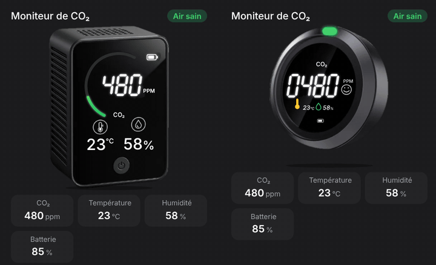

# CO₂ monitor

<p align="center"></p>

`custom:appliance-co2-monitor-card`: a desk / living-room CO₂ monitor as a cut-out photo, with its screen redrawn live: `model: rectangle` (arc gauge from green to red, big 7-segment digits, temperature, humidity, battery) or `model: round` (digits, smiley, light at the top that follows the air quality).

- **Good air** below `co2_good` (800 ppm by default), **poor air** above `co2_bad` (1 200 ppm), **moderate** in between. The gauge fills up to `co2_max` (2 000 ppm).
- The screen is off when the `entity_status` entity (switch, binary sensor…) is off.
- Tiles: CO₂, temperature, humidity, battery (each hidden with `show_co2`, `show_temperature`, `show_humidity`, `show_battery: false`); the battery turns orange below 20 %.
- Options: `entity_status`, `entity_co2`, `entity_temperature`, `entity_humidity`, `entity_battery`, `model`, `co2_good`, `co2_bad`, `co2_max`.

```yaml
type: custom:appliance-co2-monitor-card
name: CO₂
model: rectangle          # or round
entity_status: switch.co2_monitor
entity_co2: sensor.co2_monitor_co2
entity_temperature: sensor.co2_monitor_temperature
entity_humidity: sensor.co2_monitor_humidity
entity_battery: sensor.co2_monitor_battery
```

## Rotating values (one big display)

`rotate_seconds` (0 = off, 2 to 4 is nice): the big value on the screen **changes every N seconds** between the CO₂, the temperature, the humidity and the **pressure** (new optional `entity_pressure`, converted to hPa). The label on the screen and the card title follow (`rotate_title: false` keeps your own name), and the gauge is rescaled to the displayed value (0-40 °C, 0-100 %, 960-1060 hPa). The small temperature and humidity values stay under the big one. Works on both models.

```yaml
type: custom:appliance-co2-monitor-card
model: round
rotate_seconds: 3
entity_co2: sensor.co2
entity_temperature: sensor.temperature
entity_humidity: sensor.humidity
entity_pressure: sensor.pressure
```

[← All cards](../../README.md#the-cards)
