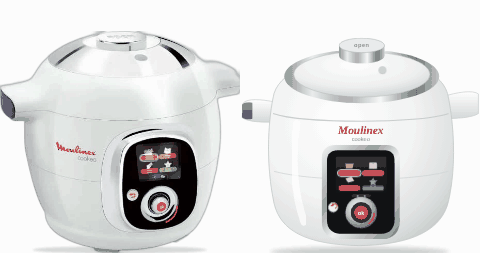

# Cookeo

`custom:appliance-cookeo-card`: the Moulinex Cookeo multicooker (also fine for other electric pressure cookers). Two looks, picked with `style` in the visual editor: **photo** (the real appliance with animated layers, default) or **drawing** (vector drawing).



States and animations (from the smart plug power):
- **Off**: the screen is a dark glass.
- **Standby**: screen on, the selection moves from one menu tile to the next.
- **Heating**: steam from the valve, red ring turning around the knob.
- **Cooking** (under pressure): steam, blinking pressure light, the appliance shakes slightly.
- **Keeping warm**: screen and red ring, no steam.

Moulinex has no Home Assistant integration that reports the appliance state, so the card reads the **plug power**: off below `standby_threshold` (**0.5 W**), standby up to `threshold` (**15 W**), keeping warm above, heating above `heat_threshold` (**600 W**). **Cooking** is detected when the heating element switches off and back on to hold the pressure (high and low power alternating within 2 minutes). If you have a status sensor instead (`entity`), `running` means cooking.

```yaml
type: custom:appliance-cookeo-card
style: photo                        # photo (default) or drawing
power: sensor.cookeo_plug_power
switch: switch.cookeo_plug          # optional: on/off button
energy: sensor.cookeo_plug_energy
temperature: sensor.cookeo_probe    # optional
remaining: sensor.cookeo_remaining  # optional: minutes left, "ends at" under the status
program: sensor.cookeo_program      # optional: shown next to the status
```

| Option | Description |
|---|---|
| `style` | `photo` (default) or `drawing`. |
| `power` | Plug power: off, standby, heating, cooking, keeping warm. |
| `entity` | Optional status sensor (`running`, `off`, `finished`…), used when there is no power sensor. |
| `switch` | Plug switch: on/off button. Cutting the plug while it heats or cooks needs two clicks (`confirm_off: false` to turn off). |
| `temperature` / `target_temperature` | Optional temperature tiles. |
| `program` | Optional program or recipe name, shown next to the status. |
| `remaining` / `progress` | Optional time left (tile and "ends at") and progress (bar). |
| `threshold` | Keeping warm above this power (W). Default 15. |
| `standby_threshold` | Standby (screen on) above this power (W). Default 0.5. |
| `heat_threshold` | Heating above this power (W). Default 600. |
| `show_power` / `show_energy` / `show_cost` / `show_toggle` | Checkboxes in the visual editor: show the power, energy and cost tiles and the on/off button (all on by default). |

Common options (`energy`, `cost`, `energy_period`, `price_per_kwh`, `display`, `tap_action`, `hold_action`, `labels`…): see [configuration.md](../configuration.md).
