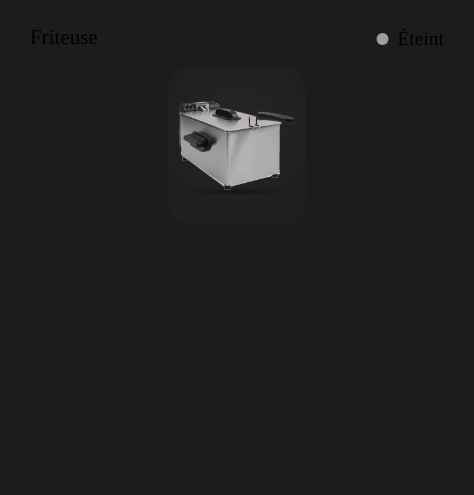

# Deep fryer

<p align="center"></p>

`custom:appliance-deep-fryer-card`: an oil deep fryer (e.g. Tristar PD-8950, 3 L) as a cut-out photo, or a vector drawing, on a smart plug with power metering. The fryer itself is "dumb": the card follows its two lights from the power drawn.

- **Heating** (power above `threshold`, 50 W by default): the red light is on and steam rises from the lid.
- **Oil ready** (after `preheat_minutes`, 8 by default, or when the thermostat cuts the heating after at least 2 minutes): the green light turns on as well. It stays on for `ready_minutes` (15 by default) after the power drops.
- **Off**: lights off, no steam.
- Options: `power`, `energy`, `cost`, `switch`, `entity`, `model` (empty = photo, `drawing` = vector drawing), `preheat_minutes`, `ready_minutes`.

```yaml
type: custom:appliance-deep-fryer-card
name: Deep fryer
power: sensor.deep_fryer_plug_power
energy: sensor.deep_fryer_plug_energy
switch: switch.deep_fryer_plug
# model: drawing   # vector drawing instead of the photo
```

[← All cards](../../README.md#the-cards)
