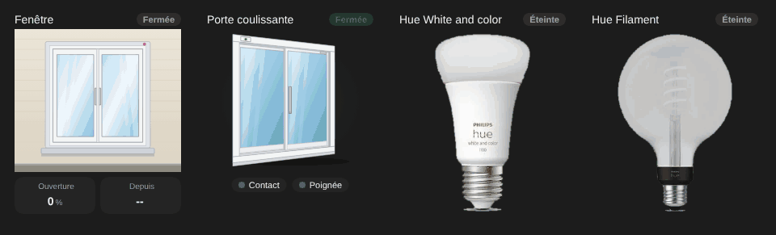

# Door and window sensor

`custom:appliance-door-sensor-card`

<p align="center"></p>

Four models (`model`), same white PVC style:

| `model` | Drawing |
|---|---|
| `front_door` (default) | Front door: glazing, moulded panel, stainless bar handle |
| `service_door` | Service door, glazed door style: glass all the way down, thin PVC rail at the bottom |
| `sliding_door` | Sliding door (patio door): a fixed leaf and a sliding leaf that slides in front of it, with a vertical handle |
| `window` | Window: four panes (white PVC cross bars) and window handle |

<p align="center"></p>

<p align="center"></p>


A white PVC front door, service door or window seen in 3/4 view, with the opening sensor on the frame and its magnet on the leaf. Works with any `binary_sensor` (door, opening, window, garage door contact).

- **Closed**: the leaf closes, green LED.
- **Open**: the leaf swings inward and the room lights up behind it, orange LED.
- **Left open**: after `open_alert_minutes` the LED blinks red, an alert outline pulses, waves leave the sensor and the line « Open for X min » appears.
- **Battery** (optional): a `sensor` in % or a low-battery `binary_sensor`. A battery pictogram blinks below `battery_low`.

**Several opening sensors**: `entities` adds extra opening sensors to the main `entity` (the handle, the second leaf of a sliding door, a shutter contact…). The door counts as **open as soon as one of them is open**; one chip per sensor (green closed, orange open, grey unavailable, click for its details) appears under the drawing. The "Open since" duration and the left-open alert follow the sensor that has been open the longest. Each extra sensor is an entity id or `{ entity, name }` to choose the chip label (otherwise its friendly name).

```yaml
type: custom:appliance-door-sensor-card
model: sliding_door
entity: binary_sensor.patio_door_contact
entities:
  - binary_sensor.patio_door_handle
  - entity: binary_sensor.patio_door_second_leaf
    name: Second leaf
```

```yaml
type: custom:appliance-door-sensor-card
model: front_door                                   # front_door (default), service_door or window
entity: binary_sensor.front_door_contact
entity_battery: sensor.front_door_contact_battery   # optional (% sensor or low-battery binary_sensor)
open_alert_minutes: 5                               # 0 turns the "left open" alert off
battery_low: 20                                     # %
```

Options: `model`, `name`, `entities`, `labels`, `illustration_size`, `transparent`, `tap_action` / `hold_action`, `language`, `show_status`, `show_battery`, `show_since`, `animations`.

[← All cards](../../README.md#the-cards)
