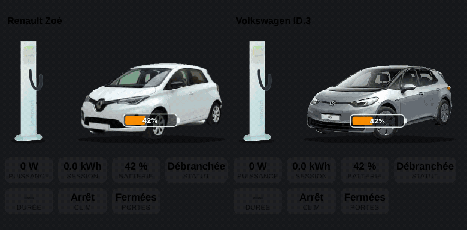
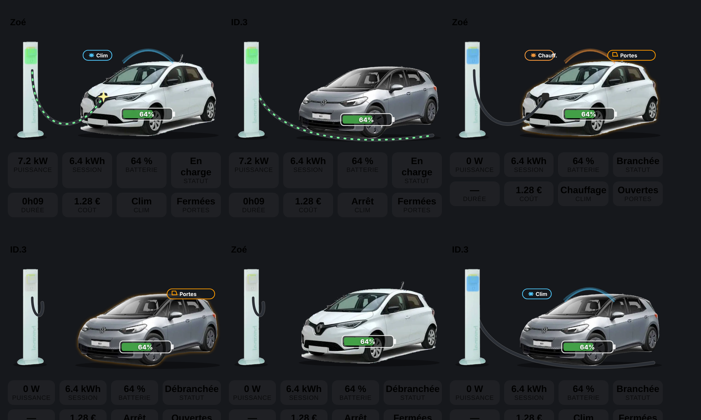

# EV charger

`custom:appliance-ev-charger-card`

**EV charger**: wall box with a status light (grey unplugged, blue plugged, pulsing green charging, steady green complete), energy flowing through the cable to the car and a battery gauge on the car door.

## Car and charger photos

Cut-out photos of real cars on a Legrand Green'up pedestal, with the same animations (`car_model`, `charger_model`):

- `car_model`: `generic` (default, drawn side-view car), `zoe` (white Renault Zoé) or `id3` (grey Volkswagen ID.3).
- `charger_model`: `green_up` (Legrand Green'up pedestal, default with a photo car) or `wallbox` (drawn wall box).
- The pedestal light follows the state (grey unplugged, blue plugged, pulsing green charging, steady green complete); the cable hangs on the pedestal when unplugged, and energy flows through it when charging. On the ID.3 the socket is at the rear: the cable goes behind the car.
- `entity_plugged`: a binary_sensor / switch for « plugged in » (takes priority over the status entity).
- `entity_climate`: a `climate`, binary_sensor, switch or sensor. When it is on, waves and an **A/C** badge appear above the roof (blue for cooling, orange for heating).
- `entity_doors`: one or several binary_sensors (or covers): when one is open the car glows orange with a **Doors** badge.
- `show_climate`, `show_doors`: tiles for these two states.

## Options

Every value tile can be hidden with its `show_…` option, and `language: fr|en|de|it|es|nb|nl|pl|ro|ru|sr|sr-Latn` forces the language.

- `entity_power`
- `entity_session_energy`
- `entity_car_soc`
- `entity_status` (charging / connected / complete…)
- `entity_cost` or `price_per_kwh`
- `max_power` (default 7400 W)
<<<<<<< HEAD
- `car_color` (drawn car only)
=======
- `car_color`
- `car_image`: your own picture of the vehicle (`/local/tesla.png` or a URL) shown **instead of the drawn car**: side view, front on the right, transparent background (PNG / WebP). One card per vehicle (car, scooter…); the charge gauge stays on top
>>>>>>> 39f66c1 (Borne : option car_image pour afficher l'image perso du véhicule)
- `show_power`
- `show_energy`
- `show_soc`
- `show_status`
- `show_duration`
- `show_cost`

[← All cards](../../README.md#the-cards)
