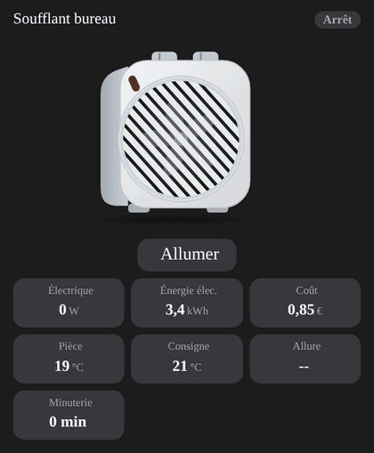

# Fan heater

`custom:appliance-fan-heater-card`: a small fan heater (white case, round diagonal grille, two knobs on top, red pilot light). When it runs the pilot lights up and the fan turns behind the grille; in heating mode the element glows and warm air waves leave the side, in fan-only mode the air is cool and blue. Three running states: **Fan only**, **Heating · low** (about 1000 W) and **Heating · high** (about 2000 W), the blades turning faster as the power rises.

| Option | What it does |
|---|---|
| `entity_status` | status: `switch` / `input_boolean` (on / off), `climate` (`hvac_action`: heating, idle, fan, off) or a text sensor. Used for the toggle button too, unless `entity_switch` is set |
| `entity_switch` | on/off entity for the **Turn on / off** button (`switch`, `input_boolean`, `fan`, `light`) |
| `entity_power`, `entity_energy`, `entity_cost` / `price_per_kwh` | power (W or kW), energy and cost tiles. **Without a status entity, the power gives the state** |
| `entity_temp`, `entity_target_temp` | room temperature and target (a `climate` target works) |
| `entity_mode` | setting: a `select` / text with `fan`, `low`, `high`… or a number; otherwise the power decides |
| `entity_timer` | remaining time (minutes, hours or `H:MM`) |
| `entity_alarm` | tip-over or overheat alarm (`binary_sensor`): red flashing pilot and a warning triangle |
| `heat_threshold` (300 W), `high_threshold` (1500 W), `power_max` (2000 W), `off_threshold` (0.5 W) | power thresholds for the states and the animation speed |
| `show_status`, `show_buttons`, `show_power`, `show_energy`, `show_cost`, `show_temp`, `show_target`, `show_mode`, `show_timer` | turn the badge, the button and each tile on or off (a tile without an entity is hidden anyway) |
| `compact`, `animations`, `labels`, `language`, `illustration_size`, `transparent`, `temperature_unit`, `tap_action`, `hold_action` | same as the other cards |



```yaml
type: custom:appliance-fan-heater-card
name: Office heater
entity_status: switch.office_heater
entity_power: sensor.office_heater_power
entity_energy: sensor.office_heater_energy
entity_temp: sensor.office_temperature
price_per_kwh: 0.25
```

[← All cards](../../README.md#the-cards)
