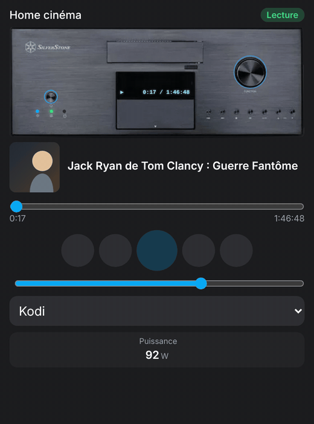

# Home theater PC (HTPC)

<p align="center"></p>

`custom:appliance-htpc-card`: a media player (Kodi, Plex, any `media_player`) on the cut-out photo of an HTPC case.

- **Front of the case**: the three lights follow the state (blue = on, green = playing, orange = paused / standby), the knob glows while playing, and the display of the case shows the title in progress (scrolling when it is long) with the elapsed / total time.
- **Below**: poster, title and subtitle (series · SxxExx, artist…), clickable progress bar to seek, previous / play-pause / next / shuffle, power, volume with mute, source list. Each control only shows if the player supports it (`supported_features`).
- Optional power sensor of the PC (smart plug) as a tile.
- Options: `entity` (the `media_player`), `entity_power`, `show_poster`, `show_seek`, `show_volume`, `show_source`, `show_status`.

```yaml
type: custom:appliance-htpc-card
name: Home theater
entity: media_player.htpc_kodi
entity_power: sensor.htpc_plug_power   # optional
```

[← All cards](../../README.md#the-cards)
