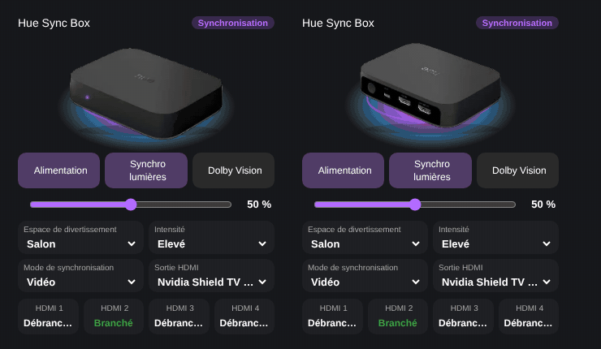

# Hue Sync Box

`custom:appliance-hue-sync-box-card`

<p align="center"></p>

Philips Hue Play HDMI Sync Box (Hue integration of Home Assistant): cut-out photos of the box on a colour halo that animates (with waves) while the lights are synced; the LED lights up when the box is on. Two views (`model`): `top` (default, top view with its LED) and `ports` (power, USB and HDMI side). Every entity is optional: only the controls you configure are shown.

Controls: **Power**, **Light sync**, **Dolby Vision** (switches), a **brightness** slider (`number`), and drop-downs for the entertainment area, intensity, sync mode, HDMI input and LED indicator (`select` entities, options read from the entity). Tiles: state of HDMI 1 to 4 (plugged / unplugged).

```yaml
type: custom:appliance-hue-sync-box-card
model: top                                                   # top (default) or ports
entity_power: switch.sync_box_power
entity_sync: switch.sync_box_light_sync
entity_dolby: switch.sync_box_dolby_vision_compatibility     # optional
entity_brightness: number.sync_box_brightness                # optional
entity_area: select.sync_box_entertainment_area              # optional
entity_intensity: select.sync_box_intensity                  # optional
entity_mode: select.sync_box_sync_mode                       # optional
entity_input: select.sync_box_hdmi_input                     # optional
entity_led: select.sync_box_led_mode                         # optional
entity_hdmi1: binary_sensor.sync_box_hdmi_input_1_status     # optional, same for 2, 3 and 4
```

Options: `model`, `name`, `labels`, `illustration_size`, `transparent`, `tap_action` / `hold_action`, `language`, `show_status`, `show_buttons`, `show_selects`, `show_brightness`, `show_hdmi`, `animations`.

[← All cards](../../README.md#the-cards)
