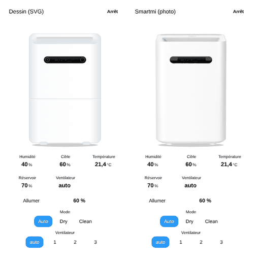

# Humidifier

`custom:appliance-humidifier-card`: an evaporative humidifier (Xiaomi Smartmi Evaporative Humidifier 2 and similar) with its LCD, the mist that rises from the top opening, the water tank level and its buttons: power, target humidity − / +, one button per mode (Auto, Dry, Clean…) and one per fan speed (auto, 1, 2, 3).



## Style

| `style` | Illustration |
|---|---|
| `svg` (default) | a generic white humidifier drawn in SVG |
| `smartmi` | cut-out photo of the Smartmi Evaporative Humidifier 2 |

Both share the same animated layers: the LCD is redrawn with the real values (humidity, fan speed letter `A` / 1 / 2 / 3, water level bar, `DRY` / `CLEAN`), mist rises from the top while it humidifies, and the Clean button glows during cleaning.

## States

- **Humidifying**: on, humidity below the target (or `action: humidifying`).
- **Target reached**: on, humidity at or above the target (or `action: idle`).
- **Dry mode**: the mode contains `dry`. The humidifier keeps running even when the tank is below its minimum.
- **Cleaning**: the mode contains `clean`. Only the drum turns, no mist.
- **Off**: the entity or `switch` is off.
- **Low water**: the `water_level` is at or below `water_low` (20 %), or the `low_water` sensor is on. The badge shows **Low water**, an alert line appears and the water bar blinks red. Not shown while it is off.

## Options

| Option | What it does |
|---|---|
| `entity` | the `humidifier` entity (or a `switch`, `fan`, `input_boolean`): on / off. With a `humidifier` entity, the current humidity, the target, the min / max, the mode and the available modes are read from it |
| `switch` | optional separate on / off entity (takes priority over the state of `entity`) |
| `humidity` | current humidity sensor (else `current_humidity` of the `humidifier` entity) |
| `target_humidity` | `number` / `input_number` (else `humidity` of the `humidifier` entity): the **+ / −** buttons set it, in steps of `target_step` (5 %) between its min and max |
| `temperature` | temperature sensor (the built-in sensor of the humidifier) |
| `fan_speed` | `select` / `input_select` / `fan`: one button per option, the active one is lit; also shown on the LCD (`auto` = `A`) |
| `mode` | `select` / `input_select` / `fan` / `humidifier`: one button per mode (Auto, Dry, Clean…). Without it, the modes of the `humidifier` entity are used |
| `water_level` | tank level in % (drives the bar of the LCD and the **Tank** tile) |
| `low_water` | optional `binary_sensor` of the "tank almost empty" alert |
| `water_low` | **Low water** at or below this level (default 20 %) |
| `style` | `svg` or `smartmi` |
| `show_status`, `show_controls`, `show_humidity`, `show_target`, `show_temperature`, `show_tank`, `show_fan` | turn the badge, the buttons and each tile on or off (a tile without data is hidden) |
| `compact`, `animations`, `labels`, `language`, `illustration_size`, `transparent`, `tap_action`, `hold_action` | same as the other cards |

```yaml
type: custom:appliance-humidifier-card
name: Humidifier
style: smartmi
entity: humidifier.smartmi_humidifier       # or switch.xxx
humidity: sensor.smartmi_humidity
target_humidity: number.smartmi_target_humidity
temperature: sensor.smartmi_temperature
fan_speed: select.smartmi_fan_level
mode: select.smartmi_mode
water_level: sensor.smartmi_water_level
water_low: 20
```

[← All cards](../../README.md#the-cards)
