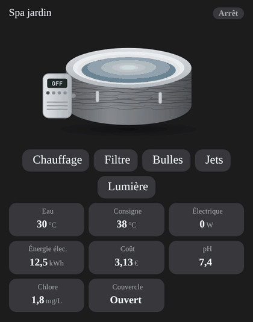

# Inflatable spa

`custom:appliance-inflatable-spa-card`: a round inflatable spa (Lay-Z-Spa style: grey wood-effect wall, light top ring, white inside, pump unit on the side with its temperature display and status LED). Each function acts on its own: **heater** (water glows warm, steam rises), **filter** (slow ripples), **bubbles** (bubbles rise), **jets** (water jets from the wall), **light** (the water is lit, in the `rgb_color` of the light when it has one) and **cover** (the spa disappears under its lid). The pump display shows the water temperature, `Err` on a fault.

| Option | What it does |
|---|---|
| `entity_status` | `climate` / `water_heater` (`hvac_action`), switch or text sensor (`heating`, `filtering`, `bubbles`, `jets`, `off`…) |
| `entity_heater`, `entity_filter`, `entity_bubbles`, `entity_jets` | one entity per function (`switch`, `input_boolean`, `binary_sensor`; the heater may be a `climate`). Each gives a **toggle button** (highlighted when active) |
| `entity_light` | LED light (`light` or `switch`), with a button |
| `entity_cover` | cover: `cover` (closed / open) or `binary_sensor` (**on = open**, off = closed) |
| `entity_temp`, `entity_target_temp` | water temperature and target (a `climate` target works) |
| `entity_power`, `entity_energy`, `entity_cost` / `price_per_kwh` | power, energy and cost tiles. **Without function entities, the power gives the state**: above `filter_threshold` (20 W) filtering, `bubbles_threshold` (300 W) bubbles, `heater_threshold` (1500 W) heating |
| `entity_ph`, `entity_chlorine` | water quality tiles. Alert when the pH leaves `ph_min`–`ph_max` (7–7.8) |
| `entity_timer` | remaining time (minutes, hours or `H:MM`) |
| `entity_error` | fault code (`sensor`, e.g. `E90`) or `binary_sensor`: **Fault** state, `Err` on the display, warning triangle |
| `temp_max` | alert when the water is above this temperature (default 40 °C) |
| `power_max` (2500 W), `off_threshold` (0.5 W) | animation speed and "off" threshold |
| `show_status`, `show_buttons`, `show_temp`, `show_target`, `show_power`, `show_energy`, `show_cost`, `show_ph`, `show_chlorine`, `show_timer`, `show_cover` | turn the badge, the buttons and each tile on or off (a tile without an entity is hidden anyway) |
| `compact`, `animations`, `labels`, `language`, `illustration_size`, `transparent`, `temperature_unit`, `tap_action`, `hold_action` | same as the other cards |

States, by priority: **Fault**, **Heating**, **Jets**, **Bubbles**, **Filtering**, **Standby**, **Off**, **Unavailable**.



```yaml
type: custom:appliance-inflatable-spa-card
name: Garden spa
entity_status: climate.spa
entity_heater: switch.spa_heater
entity_filter: switch.spa_filter
entity_bubbles: switch.spa_bubbles
entity_light: light.spa_led
entity_temp: sensor.spa_water_temperature
entity_power: sensor.spa_power
entity_ph: sensor.spa_ph
```

[← All cards](../../README.md#the-cards)
