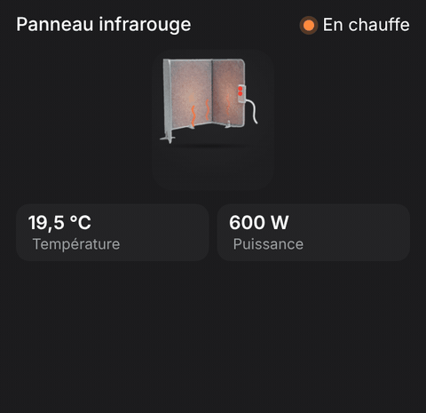

# Infrared heating panel

<p align="center"></p>

`custom:appliance-infrared-panel-card`: an infrared heating panel (felt panel with its remote) as a cut-out photo, on a smart plug with power metering. The panel itself is "dumb": the card follows it from the power drawn.

- **Heating** (power above `threshold`, 20 W by default): the red lights of the remote are on, the panels glow softly and waves of infrared heat rise in front of the panel.
- **Off**: lights off, cold panel.
- Tiles: power, energy, cost, and the room temperature if you give a `temperature` sensor.
- Options: `power`, `energy`, `cost`, `switch`, `entity`, `temperature`, `threshold`.

```yaml
type: custom:appliance-infrared-panel-card
name: Infrared panel
power: sensor.infrared_panel_plug_power
energy: sensor.infrared_panel_plug_energy
switch: switch.infrared_panel_plug
temperature: sensor.room_temperature   # optional
```

[← All cards](../../README.md#the-cards)
