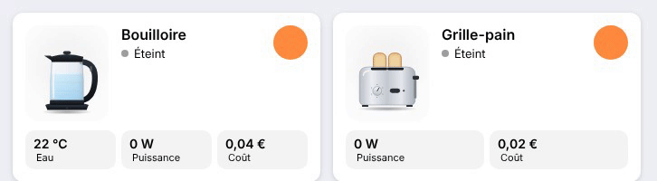

# Kettle and toaster

<p align="center"></p>

Two cards driven by a smart plug (`power`), with an optional `switch`.

- **Kettle** (`custom:appliance-kettle-card`): a glass kettle on its base. Above `threshold` (500 W): **Boiling**, the base glows blue, bubbles rise, the surface simmers and steam comes out of the spout. After it switches off: **Hot water** (orange LED, light steam) for `hot_minutes` (5 min). With a `temperature` sensor, the water temperature is shown in a tile and a bar, and the kettle stays "Hot water" while the water is above `hot_temperature` (60 °C).
- **Toaster** (`custom:appliance-toaster-card`): a stainless two-slot toaster. Above `threshold` (200 W): **Toasting**, the lever goes down, the slices sink in, the slots glow and heat waves rise. When it switches off, the toast pops up golden: **Toast ready!** for `ready_minutes` (2 min).

```yaml
type: custom:appliance-kettle-card
power: sensor.kettle_plug_power
energy: sensor.kettle_plug_energy_today
temperature: sensor.kettle_water_temperature   # optional
---
type: custom:appliance-toaster-card
power: sensor.toaster_plug_power
cost: sensor.toaster_cost_today
```


[← All cards](../../README.md#the-cards)
