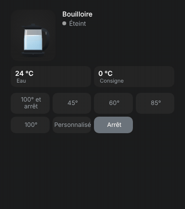

# Kettle and toaster

<p align="center"></p>

Two cards driven by a smart plug (`power`), with an optional `switch`.

- **Kettle** (`custom:appliance-kettle-card`): a glass kettle on its base. Above `threshold` (500 W): **Boiling**, the base glows blue, bubbles rise, the surface simmers and steam comes out of the spout. After it switches off: **Hot water** (orange LED, light steam) for `hot_minutes` (5 min). With a `temperature` sensor, the water temperature is shown in a tile and a bar, and the kettle stays "Hot water" while the water is above `hot_temperature` (60 °C).
- **Toaster** (`custom:appliance-toaster-card`): a stainless two-slot toaster. Above `threshold` (200 W): **Toasting**, the lever goes down, the slices sink in, the slots glow and heat waves rise. When it switches off, the toast pops up golden: **Toast ready!** for `ready_minutes` (2 min).

```yaml
type: custom:appliance-kettle-card
power: sensor.kettle_plug_power
energy: sensor.kettle_plug_energy_today
temperature: sensor.kettle_water_temperature   # optional
---
type: custom:appliance-toaster-card
power: sensor.toaster_plug_power
cost: sensor.toaster_cost_today
```

**Kettle without a smart plug** (ESPHome / Tuya kettle that exposes its own entities): use `entity` for the on/off `switch`, `temperature` for the water temperature, `target_temperature` (a `number`, `sensor` or `climate`) for the set temperature (extra "Target" tile) and `error` (a `binary_sensor`, or a text sensor that is not `ok` / `none`) to show a fault alert:

```yaml
type: custom:appliance-kettle-card
entity: switch.kettle
temperature: sensor.kettle_temperature
target_temperature: number.kettle_set_temperature
error: binary_sensor.kettle_error
```

<p align="center"></p>

**ProfiCook PC-WKS 1167G (photo)**: `model: proficook` shows the cut-out photo of this glass tea kettle (bubbles in the tea, glow on the base, lit keys and steam); without it, the drawing is used. It combines with any of the configurations below.

**Kettle driven by a `select`** (heating mode: `100° and off`, `45°`, `60°`, `85°`, `100°`, `Custom`, `Off`…): put the `select` in `mode`, and the kettle state in `entity`. One button per option of the `select` is shown (the active one is highlighted, a click selects it), and the other entities fill the tiles:

```yaml
type: custom:appliance-kettle-card
entity: sensor.kettle_state              # ready / heating / cooling
mode: select.kettle_heating_mode         # one button per option
temperature: sensor.kettle_water_temperature
target_temperature: number.kettle_set_temperature
remaining: sensor.kettle_remaining_time
error: sensor.kettle_error               # "OK" / "none" = no fault
```

With a text `entity`, `heating` shows **Boiling**, `cooling` shows **Hot water** and `ready` is idle. `show_modes: false` hides the buttons. A tap action `toggle` on an entity that cannot be toggled (`select`, `number`, sensors…) opens its details instead of failing.


[← All cards](../../README.md#the-cards)
