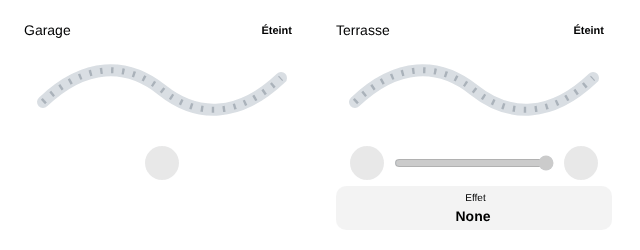
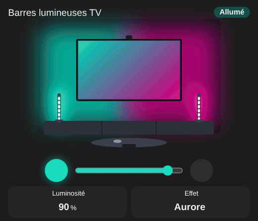

# LED strip

`custom:appliance-led-strip-card`

<p align="center"></p>

An LED strip with **generic entities** (no brand): a `light` (WLED, Hue, Zigbee, Tuya, Govee…) or a simple `switch` / `input_boolean` (on / off module). The glow takes the **real color** of the light (`rgb_color`, `hs_color` or `color_temp_kelvin`, warm white otherwise) and follows its **brightness**; the dots of the strip blink while an effect runs.

<p align="center"></p>

The drawing is just the **strip** (a flexible band with its LEDs) and its glow, with no room or decor around it.

- **Power button**, **brightness slider** (only when the light can dim) and **next effect** button (only when the light has an `effect_list`).
- A simple on / off module (`switch`) gives a warm white strip with the power button only.

| Option | What it does |
|---|---|
| `entity` | the strip: `light`, `switch` or `input_boolean` |
| `shape` | `strip` (default, flexible band) or `bars`: a night living room: two **TV light bars** (Govee DreamView, Envisual…) on each side of a TV, the wall lit in two colors (left / right), same `light` entity |
| `color2` | with `shape: bars`: color of the right half of the wall and the right bar (`"#00c8b4"`…). By default, the light's color with its hue shifted by 150°, like the teal / pink of the photo |
| `color` | forces the glow color (`"#ff6600"`, `orange`…), for strips that do not report their color |
| `entity_power`, `entity_energy` | power and energy tiles |
| `compact`, `show_status`, `show_controls`, `show_brightness`, `show_effect`, `show_power`, `show_energy`, `animations`, `labels`, `language`, `illustration_size`, `transparent`, `tap_action`, `hold_action` | |

```yaml
type: custom:appliance-led-strip-card
name: TV light bars
shape: bars
entity: light.tv_light_bars
---
type: custom:appliance-led-strip-card
name: Garage
entity: switch.garage_led_strips
---
type: custom:appliance-led-strip-card
name: Roof edge
entity: light.roof_led_strip
entity_power: sensor.roof_led_strip_power
```

[← All cards](../../README.md#the-cards)
