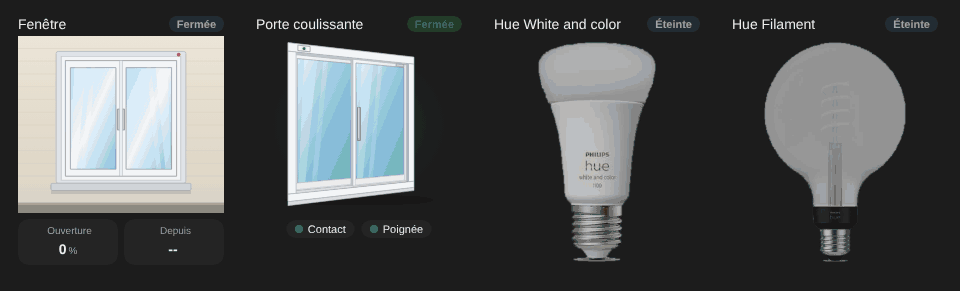

# Lights

`custom:appliance-light-bulb-card · custom:appliance-color-bulb-card · custom:appliance-filament-bulb-card · custom:appliance-pendant-light-card · custom:appliance-pendant-cluster-card · custom:appliance-desk-lamp-card · custom:appliance-floor-lamp-card · custom:appliance-chandelier-card · custom:appliance-garden-spotlight-card · custom:appliance-christmas-tree-card · custom:appliance-ceiling-spot-card · custom:appliance-ceiling-globe-card`

<p align="center"></p>

Eleven animated light fittings. Off, they show the bare fitting; on, they glow in the light colour, at the brightness of the bulb.

| Card | Animation |
|---|---|
| Bulb (`light-bulb`) | the glass fills with light, the filament glows, a halo breathes around it |
| Colour bulb (`color-bulb`) | frosted glass tinted with the colour; a **Colour** button cycles through presets; colour cycle with `color_cycle: true` or a colour-loop effect |
| Filament bulb (`filament-bulb`) | amber glass, coiled filaments that flicker |
| Pendant light (`pendant-light`) | dome shade, glowing inside, cone of light below |
| Pendant cluster (`pendant-cluster`) | three glass globes that glow and sway gently |
| Desk lamp (`desk-lamp`) | jointed lamp lighting up the desk |
| Floor lamp (`floor-lamp`) | tripod lamp, the fabric shade glows, light falls up and down |
| Chandelier (`chandelier`) | brass chandelier, flickering candle bulbs, sparkling crystals |
| Garden spotlight (`garden-spotlight`) | ground spike spotlight, beam rising with floating dust |
| Christmas tree (`christmas-tree`) | lights twinkling in sequence, glowing star; one colour with `multicolor: false` |
| Recessed spotlights (`ceiling-spot`) | ceiling spots seen from below: white bezel, the diffuser lights up evenly with a halo on the ceiling. `spot_count: 1` to `4` draws several spots driven by the same entity (one dimmer, several spots); they switch on in cascade |
| Ceiling globe light (`ceiling-globe`) | an opal globe under a brushed-steel canopy (cut-out photo, no drawing): it lights up in the colour and brightness of the bulb, with a glow around it. Same options as the custom `image` (`image_min`, `image_max`, `glow_max`) |

**Colour**: by default the card follows the bulb in Home Assistant (`rgb_color`, otherwise the white temperature in kelvins). Turn off `follow_light_color` to use the colour picked in the editor (`color`); the On button then also sends this colour to the bulb. **Brightness** drives the glow.

**Brightness slider** (`brightness_slider`): with a dimmable `light`, the **Brightness** tile becomes a full-width slider (sent when released, `0` turns the light off). It stays in place, greyed, while the light is off, so the layout does not move. On by default on the recessed spotlights, off on the other lights.

With a `light` entity the card shows **On / Off** (and **Colour** on the colour bulb); a `switch` or `input_boolean` works too, as does a power sensor alone (above `threshold`, default 1 W = on).

## Options

- `entity` (light, switch or input_boolean)
- `entity_power`, `entity_energy`
- `image` (URL of your own photo, e.g. `/local/my-lamp.png`, ideally a cut-out PNG with a transparent background): replaces the drawing. It is dimmed when off, lit according to the light brightness when on, with a glow in the bulb colour
- `image_off` / `image_on`: two distinct photos instead of one. The "on" photo fades in with the brightness over the "off" photo. In the visual editor they are an **upload picker** (from your phone or computer). If only one is set, `image` is used for the other
- `image_background` (default false): keeps the dark rounded background of the card behind your photo (same look as the drawn bulbs); the glow then stays inside it
- `image_min` (0-100, default 0): minimum lighting of the photo, **also when the light is off**, so a dark photo stays recognisable (0 = very dark when off, as before); when on, it is the floor at a very low dimmer
- `image_max` (0-100, default 100): caps how much the photo is lit, as a % of the light level (e.g. `60` = the photo never gets brighter than at 60 %)
- `glow_max` (0-100, default 100): same for the glow around the photo (`0` = no glow)
- `color` (RGB, e.g. `[255, 180, 90]`, or a CSS colour)
- `follow_light_color` (default true)
- `color_cycle` (colour bulb, default false)
- `presets` (list of RGB colours for the Colour button and the palette, e.g. `presets: [[255, 0, 0], [0, 255, 0], [0, 0, 255]]`)
- `color_palette` (default false): on any light card whose entity supports colour or colour temperature, the **Colour** button opens a **palette**: a warm / neutral / cold white (if the light has a colour temperature) and the RGB `presets` colours (if it supports colour). One tap turns the light on with that colour and closes the palette
- `multicolor` (Christmas tree, default true)
- `threshold` (W, without an entity)
- `tap_action` / `hold_action` (tap / hold 0.5 s on the illustration): `more-info`, `toggle`, `navigate`, `url`, `perform-action`, `none`. Default: tap opens the more-info of `entity`
- `compact` (default false): smaller paddings, title and buttons, and the illustration area fills the remaining height; `illustration_size` below 100 % shrinks the drawing inside it (the area keeps its place, so the layout does not move). For small fixed slots (e.g. Drag and Drop Card)
- `animations`, `show_status`, `show_controls`, `show_button_labels` (default true; false = icons only), `show_brightness`, `show_power`, `show_energy`
- `language: fr|en|de|it|es|nb|nl|pl|ro|ru|sr|sr-Latn`

## Philips Hue bulbs (photo)

<p align="center"></p>

On the **bulb** and **colour bulb** cards, `model` replaces the drawing with a cut-out photo of a Philips Hue bulb. Off, the bulb shows its frosted diffuser; on, the diffuser takes the colour of the light (warm white, colour temperature or colour) and lights up with the brightness, with a glow around the bulb.

| `model` | Bulb |
|---|---|
| `hue_white` | Hue White A60 (E27) |
| `hue_candle` | Hue White ambiance candle (E14) |
| `hue_color` | Hue White and color ambiance A60 (E27) |
| `hue_gu10` | Hue GU10 spot |
| `hue_filament` | Hue Filament globe G125 |

```yaml
type: custom:appliance-color-bulb-card
entity: light.living_room
model: hue_color
```

`image` (your own photo) wins over `model`. `image_min` / `image_max` / `glow_max` work the same way (with a model, `image_min` is 60 % by default so a bulb that is off stays recognisable).

## Example

```yaml
type: custom:appliance-pendant-cluster-card
name: Kitchen island
entity: light.kitchen_island
entity_power: sensor.kitchen_island_power
```

```yaml
type: custom:appliance-chandelier-card
entity: light.dining_room
follow_light_color: false
color: [255, 190, 110]
```

[← All cards](../../README.md#the-cards)
