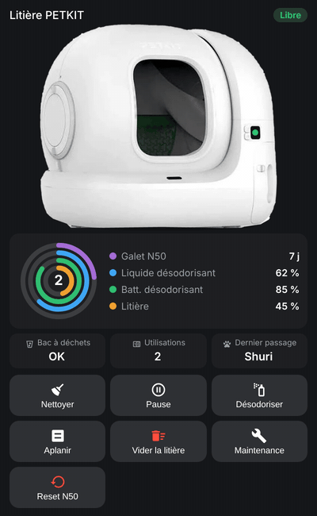

# Automatic litter box

<p align="center"></p>

`custom:appliance-litter-box-card`: an automatic self-cleaning litter box with a drum (PETKIT Pura Max…) on a cut-out photo, with live animations drawn on top. Every entity is optional.

- **Cleaning / emptying / levelling**: the drum turns in the entrance window (rings and falling litter) and the round hatch on the side moves.
- **Cat inside** (`entity_occupied`): a cat sits in the entrance, the badge shows "Occupied" and the status light turns orange.
- **Paused**, **maintenance**, **deodorising** (spray), **error** (red blinking light, with the error text) and **unavailable** have their own look.
- **Alerts**: waste bin full, litter missing, N50 odour eliminator to replace (below `odor_low` days, 3 by default) and spray liquid low (below `spray_low` %, 15 by default).
- **Tiles**: litter level, waste bin, N50 days left, number of uses, spray liquid, last cat. Each can be hidden (`show_litter`, `show_waste`, `show_odor`, `show_uses`, `show_spray`, `show_lastcat`).
- **Action buttons** (shown only for the entities you give): clean, pause / resume, deodorise, level, **empty the litter** and **reset N50** (both ask for a confirmation, `confirm_dangerous: false` to turn it off), maintenance start / end.
- The status sensor is read from its text: `idle`, `cleaning`, `paused`, `maintenance`, `emptying`, `leveling`, `deodorizing`, `error`…

```yaml
type: custom:appliance-litter-box-card
name: Litter box
entity_status: sensor.litiere_statu
entity_occupied: binary_sensor.litiere_toilet_occupied
entity_error: sensor.litiere_erreur
entity_waste_full: binary_sensor.litiere_wastebin
entity_no_litter: binary_sensor.litiere_manque_de_litiere
entity_litter_level: sensor.litiere_litter_level
entity_odor_days: sensor.litiere_n50_odor_eliminator
entity_times_used: sensor.litiere_times_used
entity_spray_liquid: sensor.litiere_pura_air_liquid
entity_last_cat: sensor.litiere_derniere_utilisation_par
button_clean: button.litiere_nettoyer
button_pause: button.litiere_action_pause
button_continue: button.litiere_action_continuer
button_deodorize: button.toilettes_litiere_desodoriser
button_level: button.litiere_level_litter
button_empty: button.litiere_vider_la_litiere
button_maintenance: button.litiere_maintenance_demarrer
button_maintenance_exit: button.litiere_maintenance_quitter
button_reset_n50: button.litiere_reset_n50_odor_eliminator_2
```

[← All cards](../../README.md#the-cards)
