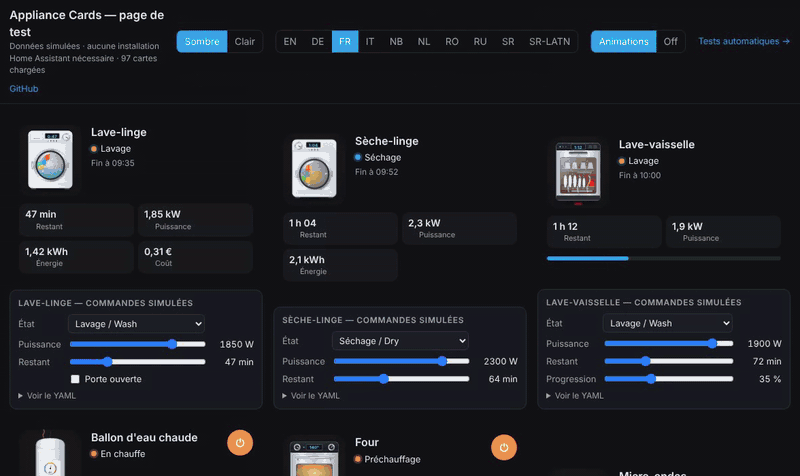

# Mini PC

`custom:appliance-mini-pc-card`

<p align="center"></p>

**Mini PC** (cut-out photo of the BMAX B9 Max): a home server running Home Assistant, Proxmox, Jellyfin… monitored with **Glances** or **System Monitor**. The power button breathes in blue, a light sweep runs across the case, warm air leaves the side vents (faster with the CPU load), heat rises above the lid when busy (red when overheating), network packets go up and down the cable to the globe (download in blue, upload in green, speed and brightness follow the throughput), and three neon gauges show CPU, RAM and disk.

States: off, idle (CPU below 8 %), running, busy (CPU above `cpu_busy`), overheating (CPU temperature above `temp_max`) and unavailable. `entity` is optional: a ping `binary_sensor`, a `switch` or a `device_tracker` gives on / off. Alerts: overheating, disk almost full (`disk_max`), memory saturated (`ram_max`).

## Options

Every value tile can be hidden with its `show_…` option, and `language: fr|en|de|it|nb|nl|pl|ro|ru|sr|sr-Latn` forces the language.

- `entity` (optional on / off: ping, switch, device_tracker)
- `entity_cpu` (%), `entity_cpu_temp`, `entity_ram` (%), `entity_disk` (%)
- `entity_net_down`, `entity_net_up` (any unit: B/s, kB/s, MiB/s, Mbit/s…, shown with an automatic prefix)
- `entity_uptime` (a "Last boot" timestamp or a duration in s, min, h or d)
- `entity_power` (W, smart plug)
- `cpu_busy` (default 70 %), `temp_max` (default 85 °), `ram_max` (default 90 %), `disk_max` (default 90 %), `temperature_unit`
- `animations` (default true)
- `compact: true` (small fixed slots: smaller title, tiles and buttons, the illustration takes the remaining height), `transparent: true` (no card background), `illustration_size` (%)
- One checkbox per tile in the visual editor: `show_status`, `show_cpu`, `show_temp`, `show_ram`, `show_disk`, `show_down`, `show_up`, `show_uptime`, `show_power` (`show_network: false` hides both network tiles)

## Example (System Monitor)

```yaml
type: custom:appliance-mini-pc-card
name: BMAX B9 Max
entity: binary_sensor.minipc_ping
entity_cpu: sensor.system_monitor_processor_use
entity_cpu_temp: sensor.system_monitor_processor_temperature
entity_ram: sensor.system_monitor_memory_usage
entity_disk: sensor.system_monitor_disk_usage
entity_net_down: sensor.system_monitor_network_throughput_in_eth0
entity_net_up: sensor.system_monitor_network_throughput_out_eth0
entity_uptime: sensor.system_monitor_last_boot
```

With **Glances**: `sensor.<host>_cpu_usage`, `sensor.<host>_cpu_thermal_0_temperature`, `sensor.<host>_memory_usage`, `sensor.<host>_disk_usage`, `sensor.<host>_eth0_rx`, `sensor.<host>_eth0_tx`, `sensor.<host>_uptime`.


[← All cards](../../README.md#the-cards)
