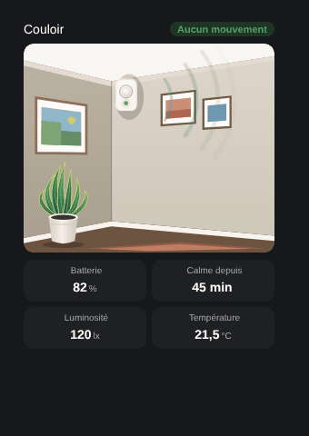

# Motion sensor

`custom:appliance-motion-sensor-card`

<p align="center"></p>

A flat-style room corner (greige walls, white ceiling, wooden floor, pictures and a plant) with a white detector fixed high on the wall. Works with any motion / occupancy / presence `binary_sensor`.

Five looks (`model`): `room` (default, the room scene above) and four cut-out detector photos on a plain wall, with detection waves from the lens and a walking shadow behind: `aqara` (stand sensor), `luminea` (flat sensor), `wall` (round wall sensor), `radar` (PIR + radar sensor).

- **No motion**: green LED, soft green arcs sweep the room.
- **Motion detected**: fast red arcs, the lens and the room glow red, a silhouette with a torch walks on the floor, its shadow on the wall, and « Motion detected for X ».
- **Recent motion**: calm room, blue LED, « Last motion X ago » during `recent_motion_minutes` (10 by default, 0 turns it off).
- **Battery** (optional): a `sensor` in % or a low-battery `binary_sensor`; a battery pictogram blinks below `battery_low`.
- **Light** and **temperature** (optional): extra tiles.

```yaml
type: custom:appliance-motion-sensor-card
model: room                                          # room (default), aqara, luminea, wall or radar
entity: binary_sensor.hallway_motion
entity_battery: sensor.hallway_motion_battery        # optional
entity_illuminance: sensor.hallway_motion_illuminance  # optional
entity_temperature: sensor.hallway_motion_temperature  # optional
recent_motion_minutes: 10
battery_low: 20
```

Options: `model`, `name`, `labels`, `illustration_size`, `transparent`, `tap_action` / `hold_action`, `language`, `show_status`, `show_battery`, `show_since`, `show_lux`, `show_temp`, `animations`.

[← All cards](../../README.md#the-cards)
