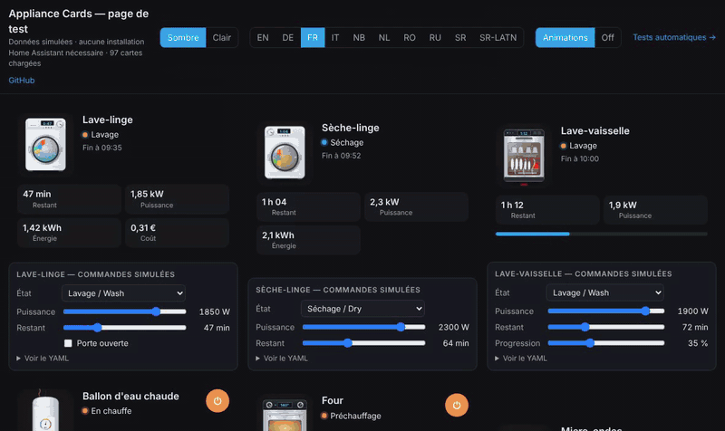
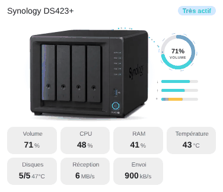

# NAS

`custom:appliance-nas-card`

<p align="center"></p>

<p align="center"></p>

**NAS** (cut-out photos, 4 or 6 bays), made for the **Synology DSM**, **TerraMaster TNAS (TOS)** and **Unraid** (UGREEN NASync) integrations. Six models with `model`: `synology_ds423` (default, DS423+), `synology_ds925` (DS925+), `terramaster_f4_423`, `terramaster_f4_425`, `ugreen_dxp4800_plus` (UGREEN DXP4800 Plus, 4 bays) and `ugreen_idx6011_pro` (UGREEN iDX6011 Pro, 6 bays, `entity_drive_5` and `entity_drive_6` available). On the UGREEN models the power button LED is the STATUS LED, and the white LED strip follows the disks. The STATUS and DISK LEDs of the photo come alive: the disk LEDs blink faster with the activity, a read beam sweeps across the bays, data packets fly to the volume ring (upload) or leave it (download), a failing disk blinks orange and its bay pulses red, the STATUS LED blinks orange on any alert, the power button breathes in blue and heat rises above the case when too hot. On the side: a volume ring (red above `volume_max`), download / upload bars and a temperature bar.

States: off, idle, running, very active (CPU above `cpu_busy` or high throughput), warning and unavailable. Alerts: volume degraded or crashed, disk N problem (DSM status or temperature above `disk_temp_max`), overheating, volume almost full, security warning. A "DSM update available" line shows when `entity_update` is on. Click a bay to open its disk.

## Options

Every value tile can be hidden with its `show_…` option, and `language: fr|en|de|it|nb|nl|pl|ro|ru|sr|sr-Latn` forces the language.

- `entity` (optional on / off: ping, switch)
- `entity_volume` (volume status), `entity_volume_used` (%). **Both accept a list for several volumes**: the ring and the alert follow the fullest one (`volume_max`)
- `entity_cpu` (%), `entity_ram` (%), `entity_temp` (system temperature)
- `entity_net_down`, `entity_net_up` (DSM gives kB/s, shown as kB/s or MB/s)
- `entity_drive_1` … `entity_drive_4` (`entity_drive_6` on the 6-bay iDX6011 Pro) (disk status: a text sensor for DSM, or the `binary_sensor` « problem » of TerraMaster, on = fault), `entity_drive_1_temp` … `entity_drive_4_temp` (up to `_6_temp`)
- `entity_nvme_1`, `entity_nvme_2` (SSD NVMe status or `binary_sensor` « problem »), `entity_nvme_1_temp`, `entity_nvme_2_temp`: counted in the disks tile and in the alerts (« SSD N: problem »), they have no bay on the photo
  All four disks, and each temperature, are optional: fill in only the entities your integration provides (DSM does not always report every disk temperature). The disks tile counts only the disks you set (`OK / known`) and shows the highest temperature among those that have one.
- `entity_parity` (binary_sensor, **off = invalid**: « Parity invalid » alert) and `entity_flash` (binary_sensor, on = problem: USB flash boot device alert), for Unraid. Each alert can be unchecked in the visual editor (`show_parity`, `show_flash`)
- `entity_security` (binary_sensor, on = problem), `entity_update` (update entity), `entity_power` (W)
- `cpu_busy` (default 60 %), `volume_max` (default 85 %), `temp_max` (default 60 °), `disk_temp_max` (default 50 °), `temperature_unit`
- `animations` (default true)
- `compact: true` (small fixed slots: smaller title, tiles and buttons, the illustration takes the remaining height), `transparent: true` (no card background), `illustration_size` (%)
- One checkbox per tile in the visual editor: `show_status`, `show_volume`, `show_cpu`, `show_ram`, `show_temp`, `show_disks`, `show_down`, `show_up`, `show_power` (`show_network: false` hides both network tiles)

## TerraMaster example (TNAS integration)

```yaml
type: custom:appliance-nas-card
model: terramaster_f4_423
entity_cpu: sensor.cpu_usage
entity_ram: sensor.memory_usage
entity_temp: sensor.system_temperature
entity_volume_used:            # one or several volumes
  - sensor.volume_1_usage
  - sensor.volume_2_usage
entity_drive_1: binary_sensor.hdd_1_problem
entity_drive_1_temp: sensor.hdd_1_temperature
entity_drive_2: binary_sensor.hdd_2_problem
entity_drive_2_temp: sensor.hdd_2_temperature
entity_nvme_1: binary_sensor.nvme_1_problem
entity_nvme_1_temp: sensor.nvme_1_temperature
```

## UGREEN example (Unraid integration)

Unraid names disks by pool, not by slot: map each bay to the pool it holds. The health `binary_sensor` is on when there is a problem.

```yaml
type: custom:appliance-nas-card
model: ugreen_idx6011_pro
entity_volume: sensor.controlroom_unraid_idx_array_state
entity_volume_used:              # the ring follows the fullest one
  - sensor.controlroom_unraid_idx_array_usage
  - sensor.controlroom_unraid_idx_disk_daten_usage
  - sensor.controlroom_unraid_idx_disk_sicherung_usage
entity_drive_1: binary_sensor.controlroom_unraid_idx_disk_daten_health
entity_drive_1_temp: sensor.unraid_disk_daten_temperature
entity_drive_2: binary_sensor.controlroom_unraid_idx_disk_daten2_health
entity_drive_2_temp: sensor.unraid_disk_daten2_temperature
entity_drive_3: binary_sensor.controlroom_unraid_idx_disk_daten3_health
entity_drive_3_temp: sensor.unraid_disk_daten3_temperature
entity_drive_4: binary_sensor.controlroom_unraid_idx_disk_sicherung_health
entity_drive_4_temp: sensor.unraid_disk_sicherung_temperature
entity_nvme_1: binary_sensor.controlroom_unraid_idx_disk_apps_health
entity_nvme_1_temp: sensor.unraid_disk_apps_temperature
entity_nvme_2: binary_sensor.controlroom_unraid_idx_disk_vms_health
entity_nvme_2_temp: sensor.unraid_disk_vms_temperature
entity_parity: binary_sensor.controlroom_unraid_idx_parity_valid
entity_flash: binary_sensor.controlroom_unraid_idx_disk_flash_health
```

## Synology example

```yaml
type: custom:appliance-nas-card
name: DS423+
entity_volume: sensor.ds423_volume_1_status
entity_volume_used: sensor.ds423_volume_1_volume_used
entity_cpu: sensor.ds423_cpu_utilization_total
entity_ram: sensor.ds423_memory_usage_real
entity_temp: sensor.ds423_temperature
entity_net_down: sensor.ds423_download_throughput
entity_net_up: sensor.ds423_upload_throughput
entity_drive_1: sensor.ds423_drive_1_status
entity_drive_1_temp: sensor.ds423_drive_1_temperature
entity_drive_2: sensor.ds423_drive_2_status
entity_drive_2_temp: sensor.ds423_drive_2_temperature
entity_drive_3: sensor.ds423_drive_3_status
entity_drive_3_temp: sensor.ds423_drive_3_temperature
entity_drive_4: sensor.ds423_drive_4_status
entity_drive_4_temp: sensor.ds423_drive_4_temperature
entity_security: binary_sensor.ds423_security_status
entity_update: update.ds423_dsm_update
```


[← All cards](../../README.md#the-cards)
