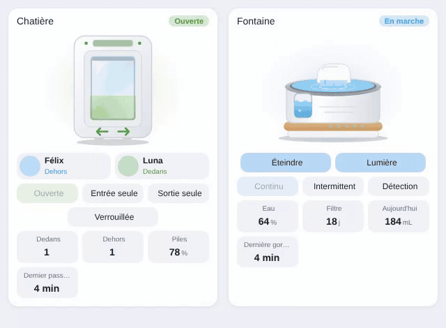

# Pet water fountain

`custom:appliance-pet-fountain-card`



A connected water fountain for cats and dogs (Petlibro Dockstream, Catit, Xiaomi, Petkit…): white body on a wooden base, stainless tray, cascade in the middle, water level window on the front.

Animations: the water sheet flows down the cascade and ripples spread in the tray, bubbles rise in the level window, whose water height follows the level. A pet drinking (`entity_drinking`): a cat leans over the tray, its head bobs and droplets splash. Low water: the window blinks orange; empty: red, the card glows red and the pump stops. Filter to replace / cleaning due: pictograms blink. Light on (`entity_light`): the LEDs of the base glow.

Status: flowing, drinking, low water, empty, off, unavailable. `entity` is the power or pump switch (without it, `entity_power` above 0.5 W means running; without both, the fountain is considered on).

Water level: a sensor in % (or in mL / L with `capacity`), or a text state (`low`, `ok`, `empty`); `entity_low_water` (binary sensor) also raises the alert. Filter: days left (unit `d`, `days`…), hours left, % left, or a binary sensor "replace filter".

Buttons: **Turn on / off**, **Light**, **Filter reset** and **Cleaned** (second click within 4 s to confirm), and one button per option of `entity_mode` (continuous, intermittent, sensor…).

When the card is added from the card picker, the entities are found automatically from the fountain's name prefix (`petlibro_dockstream_…`, `fountain_…`, `fontaine_…`, `petkit_…`, `catit_…`): pump switch, water level, low water, filter, water today, light, mode, reset buttons, power and battery.

Tiles: water level, filter, water drunk today, last drink, cleaning, power, battery.

```yaml
type: custom:appliance-pet-fountain-card
name: Fountain
entity: switch.fountain_pump                    # optional
entity_water_level: sensor.fountain_water_level # % (or capacity: 3000 for mL)
entity_low_water: binary_sensor.fountain_low_water   # optional
entity_filter: sensor.fountain_filter_remaining      # days, hours or %
entity_water_today: sensor.fountain_today_drinking_amount
entity_drinking: binary_sensor.fountain_pet_drinking # optional
entity_last_drink: sensor.fountain_last_drink_time   # optional (timestamp)
entity_clean: binary_sensor.fountain_cleaning_needed # optional
entity_light: switch.fountain_light                  # optional
entity_mode: select.fountain_mode                    # optional
entity_filter_reset: button.fountain_reset_filter    # optional
entity_clean_reset: button.fountain_reset_cleaning   # optional
entity_power: sensor.fountain_power                  # optional
```

Options: `name`, `labels`, `illustration_size`, `transparent`, `capacity`, `level_low` (20 %), `filter_low_days` (7), `filter_low` (10 %), `battery_low` (20 %), `tap_action` / `hold_action`, `language`, `show_status`, `show_buttons`, `show_level`, `show_filter`, `show_today`, `show_drink`, `show_clean`, `show_power`, `show_battery`, `animations`.

[← All cards](../../README.md#the-cards)
