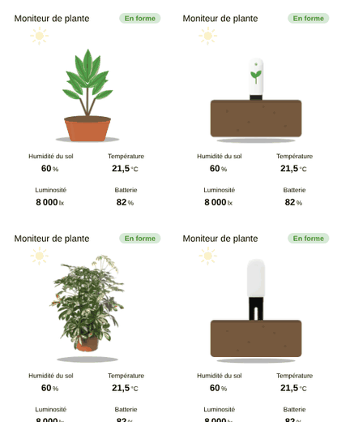

# Plant monitor

`custom:appliance-plant-monitor-card`: a card for a Bluetooth plant sensor (Xiaomi Mi Flora / HHCC, Parrot Flower Power…) read through Home Assistant (Xiaomi BLE, ESPHome, Mi Flora integration…). The soil darkens with its moisture, the leaves droop and a drop asks for water below `min_moisture`; every other threshold raises an alert on the badge and the tile.



## Style

| `style` | Illustration |
|---|---|
| `plant` (default) | a variegated schefflera in a terracotta pot, drawn in SVG; the leaves droop when the soil is dry |
| `sensor` | the sensor stuck in a cross-section of soil, drawn in SVG; its LED follows the state |
| `plant_photo` | cut-out photo of the plant (turns pale when the soil is dry) |
| `sensor_photo` | cut-out photo of the sensor stuck in the soil |

## Options

| Option | What it does |
|---|---|
| `entity_moisture` | soil moisture (%): darkens the soil, makes the leaves droop |
| `entity_temperature` | temperature |
| `entity_conductivity` | conductivity (µS/cm), the fertility of the soil |
| `entity_brightness` | light (lx): the sun in the corner grows with it (full at 20 000 lx) |
| `entity_battery` | battery (%) |
| `entity_rssi` | signal strength (dBm) |
| `min_moisture` | **Needs water** below this value (default 20 %) |
| `min_temperature` | **Too cold** below this value (unit of the sensor; no alert if empty) |
| `min_brightness` | **Not enough light** below this value (no alert if empty) |
| `min_conductivity` | **Needs fertiliser** below this value (no alert if empty) |
| `min_battery` | **Low battery** below this value (default 15 %) |
| `style` | `plant`, `sensor`, `plant_photo` or `sensor_photo` |
| `show_status`, `show_moisture`, `show_temperature`, `show_conductivity`, `show_brightness`, `show_battery`, `show_rssi` | turn the badge and each tile on or off (a tile without an entity is hidden) |
| `compact`, `animations`, `labels`, `language`, `illustration_size`, `transparent`, `tap_action`, `hold_action` | same as the other cards |

The badge shows the first threshold crossed, by priority: moisture, temperature, light, conductivity, battery. States: Healthy, Needs water, Too cold, Not enough light, Needs fertiliser, Low battery, Unavailable.

```yaml
type: custom:appliance-plant-monitor-card
name: Schefflera
style: plant
entity_moisture: sensor.ble_moisture
entity_temperature: sensor.ble_temperature
entity_conductivity: sensor.ble_conductivity
entity_brightness: sensor.ble_illuminance
entity_battery: sensor.ble_battery
entity_rssi: sensor.ble_rssi
min_moisture: 20
min_temperature: 12
```

[← All cards](../../README.md#the-cards)
