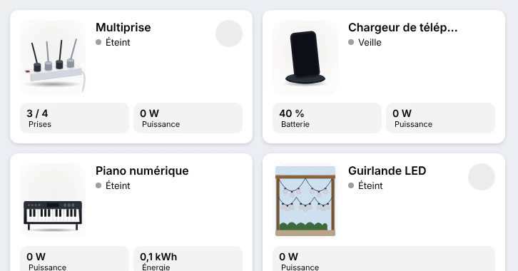

# Power strip, phone charger, digital piano and LED string lights

<p align="center"></p>

Four cards driven by a smart plug (`power`), with an optional `switch`.

- **Power strip** (`custom:appliance-power-strip-card`): a 3/4 view of a French power strip. When it is on (power above `threshold`, 1 W, `switch` on, or one of the outlets on) the switch glows red and current flows in the cord. `outlets`: one `switch` entity per socket; each one draws a plug, with a blue LED ring when that outlet is on, and gets a numbered button under the card that toggles it (entity name as tooltip). Without `outlets`, all sockets but one have a plug. `sockets` (2 to 6) sets the number of sockets.
- **Phone charger** (`custom:appliance-phone-charger-card`): a smartphone on a wireless charging stand. Above `threshold` (2 W): **Charging**, the ring pulses blue, the screen shows the time and the battery filling up (`battery_level`, else a looping gauge). Between `standby_threshold` (0.3 W) and the threshold, or at `full_level` (100 %): **Charged**, green ring.
- **Digital piano** (`custom:appliance-piano-card`): above `threshold` (3 W) the screen lights up, keys are played and notes float up. Between `standby_threshold` (0.3 W) and the threshold: standby.
- **LED string lights** (`custom:appliance-garland-card`): festoon globes under a terrace beam. With a `light` entity (or a plug above 1 W) the scene turns to night and the globes glow in a rainbow loop. A colour picked on the light (other than warm white) without an effect lights them in that colour; `brightness` dims the glow; the current `effect` is shown in a tile. `multicolor: false` always uses the light colour. The power button toggles the light.

```yaml
type: custom:appliance-power-strip-card
switch: switch.power_strip
power: sensor.power_strip_power
outlets: [switch.strip_1, switch.strip_2, switch.strip_3, switch.strip_4]
---
type: custom:appliance-phone-charger-card
power: sensor.phone_charger_power
battery_level: sensor.phone_battery_level
---
type: custom:appliance-piano-card
power: sensor.piano_plug_power
---
type: custom:appliance-garland-card
entity: light.terrace_string_lights
power: sensor.string_lights_power
```


[← All cards](../../README.md#the-cards)
