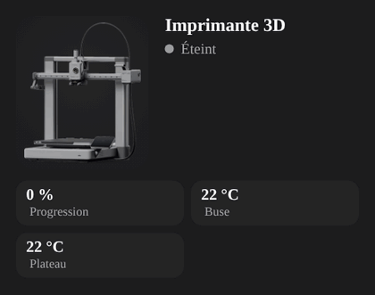

# 3D printer

An open-frame, bed-slinger style printer (Bambu Lab A1, Prusa MK, Ender…). The print head sweeps left and right, the gantry rises layer by layer and the part grows with `progress`. The spool turns while printing. While heating, the nozzle glows and heat rises from the bed. The display shows the progress, the nozzle temperature, PAUSE, DONE or ERROR.

- **With a printer integration** (Bambu Lab, OctoPrint, Moonraker/Klipper, PrusaLink…): use its status entity as `entity`. States such as `prepare`, `running`, `pause`, `finish`, `failed`, `idle`, `offline` or `Printing` are recognised. Add `progress`, `remaining`, nozzle and bed temperatures and the job name (`program`).
- **With a smart plug only**: above `threshold` (40 W) = Printing. The part then grows in a loop, since the real progress is unknown.
- **Multi-nozzle printers** (e.g. Snapmaker U1): list one sensor per nozzle in `nozzle_temperatures`; the card shows one chip per nozzle (T0, T1, T2, T3) instead of the single nozzle chip, and the display uses the hottest one. `temperature` is still used for single-nozzle printers.
- Set `filament_color` to match your spool (default orange).
- **Printer photo** (`model`, "Printer" in the visual editor): `neptune4pro` (Elegoo Neptune 4 Pro), `kobrax` (Anycubic Kobra X) or `a1` (Bambu Lab A1) shows a photo of that printer instead of the drawing, with the same states: the nozzle glows (red while heating, yellow while printing), heat rises from the bed, the part grows on the bed with `progress` and a bright dot sweeps its top layer, the screen goes dark when off and flashes red on error. Leave empty for the drawing.
- **Bambu Lab A1 photo** extras: the toolhead ring spins while printing and glows by state (yellow, orange heating, green done, red error), the hotend block glows while heating, the screen shows a progress bar, and the toolhead light casts a beam on the bed. Set `light` to your light entity (e.g. `light.a1_chamber_light`); without it the light is on while heating and printing.



- If you set `switch:`, cutting power while printing or paused needs a second click.

```yaml
type: custom:appliance-printer-3d-card
entity: sensor.a1_print_status
progress: sensor.a1_print_progress
remaining: sensor.a1_remaining_time
temperature: sensor.a1_nozzle_temperature
bed_temperature: sensor.a1_bed_temperature
program: sensor.a1_task_name
power: sensor.printer_plug_power
filament_color: "#ff8a1f"
model: a1                   # optional: a1 / neptune4pro / kobrax (photo)
light: light.a1_chamber_light  # optional: toolhead light (A1 photo)
```

Multi-nozzle printer:

```yaml
type: custom:appliance-printer-3d-card
entity: sensor.u1_print_status
nozzle_temperatures:
  - sensor.u1_nozzle_0_temperature
  - sensor.u1_nozzle_1_temperature
  - sensor.u1_nozzle_2_temperature
  - sensor.u1_nozzle_3_temperature
```


[← All cards](../../README.md#the-cards)
