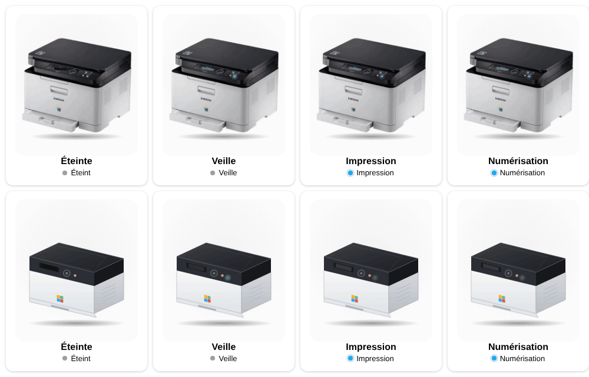
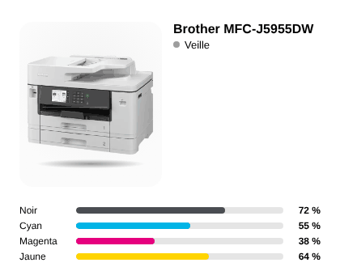

# Printer / scanner

<p align="center"></p>

**Printer / scanner** (`custom:appliance-printer-card`): an office laser printer or multifunction printer (e.g. Samsung Xpress C480W) on a smart plug. No printer integration is needed: the state comes from the plug's `power`.

- **Printing**: power above `threshold` (100 W). A sheet slides out, the screen glows and the blue LED blinks.
- **Scanning**: power above `scan_threshold` (45 W). A beam of light sweeps along the scanner lid.
- **Standby**: power above `standby_threshold` (1 W), screen and LED on.
- **Off**: plug off or power below `standby_threshold`, the screen is dark.
- Without a power sensor, `switch` on means standby. An `entity` whose state contains `print`, `scan` or `error` (e.g. an IPP printer sensor) takes priority over the power.
- `model`: empty for the SVG drawing, `samsung_c480` for the photo of the Samsung Xpress C480W, `brother_hl3270cdw` for the photo of the Brother HL-L3270CDW (laser colour printer, touchscreen, no scanner). The same animated layers are used for all.
- The power button toggles the plug; `power`, `energy` and `cost` give the usual tiles.

```yaml
type: custom:appliance-printer-card
switch: switch.printer_plug
power: sensor.printer_plug_power
model: samsung_c480   # remove for the SVG drawing
threshold: 100        # printing (W)
scan_threshold: 45    # scanning (W)
```


## Brother MFC-J5955DW: ink levels, status and message

`model: brother_mfcj5955dw` shows a cut-out photo of the Brother MFC-J5955DW (A3 inkjet multifunction) with the same animated layers (screen, green LED, scanner beam, sheet in the output tray) and, **for this model only**, four coloured ink bars (black, cyan, magenta, yellow).



| Option | What it does |
|---|---|
| `entity` | printer **status** sensor (`idle`, `waiting`, `sleep`, `printing`, `scanning`, `paper jam`…). It drives the animation without any smart plug |
| `ink_black`, `ink_cyan`, `ink_magenta`, `ink_yellow` | remaining ink in %, one bar per colour (tap a bar for the history) |
| `ink_low` | a bar turns red and blinks, and the card shows **Low ink**, below this level (default 15 %) |
| `status_message` | the printer message (e.g. `Paper tray1 low`), shown as an alert line. Neutral values (`Ready`, `OK`, `Idle`…) are ignored |

Status mapping: `idle`, `ready`, `waiting`, `sleep`, `standby`, `warming up`, `cooling` = standby; `deep sleep`, `power off` = off; `print…` = printing; `scan…` = scanning; `error`, `jam`, `fault` = failed. The `power` and `switch` options still work and take priority over the text when present.

```yaml
type: custom:appliance-printer-card
name: Brother MFC-J5955DW
model: brother_mfcj5955dw
entity: sensor.office_mfc_j5955dw_printer_status
status_message: sensor.mfc_j5955dw_status
ink_black: sensor.mfc_j5955dw_black_ink_remaining
ink_cyan: sensor.mfc_j5955dw_cyan_ink_remaining
ink_magenta: sensor.mfc_j5955dw_magenta_ink_remaining
ink_yellow: sensor.mfc_j5955dw_yellow_ink_remaining
ink_low: 15
```

[← All cards](../../README.md#the-cards)
