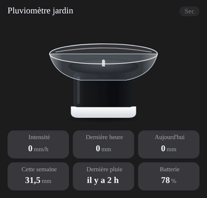

# Rain gauge

`custom:appliance-rain-gauge-card`: a tipping-bucket rain gauge (glass dish, black collector, white base; inspired by the Netatmo, Ecowitt or Davis style). When it rains a cloud appears, drops fall into the dish (5, 9 or 14 depending on the intensity), ripples spread on the water, the bucket "ticks" at each tip and the water level follows today's total. Violent rain adds lightning.



| Option | What it does |
|---|---|
| `entity` | rain **intensity** (`sensor` in mm/h or in/h) or a "raining" `binary_sensor` / text sensor (`rain`, `pluie`, `dry`, `sec`…). Drives the animation |
| `entity_hour` | rain over the last hour |
| `entity_day` | rain today (or the last 24 h). Also sets the water level in the dish |
| `entity_week`, `entity_month`, `entity_year` | longer totals |
| `entity_last` | date of the last rain (timestamp sensor, shown as "3 h ago") |
| `entity_battery` | battery in %; **Low battery** below `battery_low` (20 %) |
| `entity_signal` | signal strength (number or text) |
| `heavy_rate` | **Heavy rain** from this intensity, in mm/h (default 7.6) |
| `gauge_max` | daily total that fills the dish, in mm (default 50) |
| `show_status`, `show_rate`, `show_hour`, `show_day`, `show_week`, `show_month`, `show_year`, `show_last`, `show_battery`, `show_signal` | turn the badge and each tile on or off (all on by default; a tile without an entity is hidden anyway) |
| `compact`, `animations`, `labels`, `language`, `illustration_size`, `transparent`, `tap_action`, `hold_action` | same as the other cards |

Intensity levels (mm/h): **Light** below 2.5, **Rain** below `heavy_rate`, **Heavy rain** below 50, **Violent rain** from 50. Inches are converted to mm. States: Dry, Light rain, Rain, Heavy rain, Violent rain, Low battery (when dry), Unavailable.

```yaml
type: custom:appliance-rain-gauge-card
name: Rain gauge
entity: sensor.rain_gauge_rain
entity_hour: sensor.rain_gauge_sum_rain_1
entity_day: sensor.rain_gauge_sum_rain_24
entity_battery: sensor.rain_gauge_battery
transparent: true
```

[← All cards](../../README.md#the-cards)
