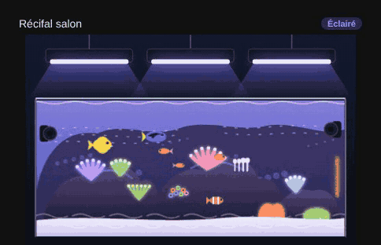

# Reef aquarium (saltwater)

`custom:appliance-reef-aquarium-card`

<p align="center"></p>

A rimless reef tank under **1 to 3 hanging LED fixtures** (`lights`): live rock, corals (acropora, brain, zoanthids, xenia, euphyllia), white sand, fish (yellow tang, clownfish, blue tang, anthias) and wavemakers on the glass. Drawn in SVG, it follows the [freshwater aquarium](aquarium.md).

- **Lights**: blue beams from the fixtures and caustics on the sand follow the brightness, the colour comes from the light (`rgb_color`) or `color` (actinic blue by default). Corals glow under the light.
- **Night** (lights off): moonlight, the fish and corals move slower.
- **Wavemakers**: the current flows while they run. **Feeding mode**: food flakes fall and the current stops.
- **Heater**: the heater glows while it heats.
- **Water parameters**: each value outside its range turns red, the card gets a red outline, the badge says « Check water (n) » and a red triangle blinks.

| Option | What it does |
|---|---|
| `lights` | number of LED fixtures drawn: 1, 2 or 3 (default 3) |
| `entity_light` | LED fixtures (`light`, `switch`, `input_boolean`), one or a list; **Lights** button toggles them |
| `color` | light colour when the fixtures do not give one |
| `entity_feed` | feeding mode (`switch`, `input_boolean`, `script`, `button`): **Feeding** button |
| `entity_temperature` | temperature, range `temp_min` / `temp_max` (24–27 °C, converted to °F) |
| `entity_salinity` | salinity in ppt (33–36) or specific gravity (1.023–1.027, detected when the value is below 2) |
| `entity_ph` | pH (7.8–8.5) |
| `entity_orp` | ORP in mV (250–450) |
| `entity_alkalinity` | KH in dKH (7–11) |
| `entity_calcium` | calcium in ppm (380–460) |
| `entity_magnesium` | magnesium in ppm (1250–1450) |
| `entity_nitrate` | nitrate NO3 in ppm (1–15) |
| `entity_phosphate` | phosphate PO4 in ppm (0.02–0.1) |
| `entity_ato_level` | top-off reservoir level in %, red at or below `ato_low` (20 %) |
| `entity_power`, `entity_energy` | power and energy tiles |
| `entity_return`, `entity_wavemaker`, `entity_skimmer`, `entity_heater`, `entity_ato` | equipment shown as chips (green when on); `entity_wavemaker` takes a list |
| `<param>_min`, `<param>_max` | your own range for `temp`, `salinity`, `ph`, `orp`, `alk`, `ca`, `mg`, `no3`, `po4` |
| `show_<param>` (`show_temp`, `show_ph`…), `show_gear`, `show_buttons`, `show_status`, `compact`, `animations`, `labels`, `language`, `illustration_size`, `transparent`, `temperature_unit`, `tap_action`, `hold_action` | |

```yaml
type: custom:appliance-reef-aquarium-card
name: Reef tank
lights: 3
entity_light: [light.reef_led_1, light.reef_led_2, light.reef_led_3]
entity_feed: input_boolean.reef_feeding
entity_temperature: sensor.reef_temperature
entity_salinity: sensor.reef_salinity
entity_ph: sensor.reef_ph
entity_alkalinity: sensor.reef_kh
entity_calcium: sensor.reef_calcium
entity_magnesium: sensor.reef_magnesium
entity_nitrate: sensor.reef_no3
entity_phosphate: sensor.reef_po4
entity_ato_level: sensor.reef_ato_reservoir
entity_return: switch.reef_return_pump
entity_wavemaker: [switch.reef_wave_left, switch.reef_wave_right]
entity_skimmer: switch.reef_skimmer
entity_heater: switch.reef_heater
```

[← All cards](../../README.md#the-cards)
