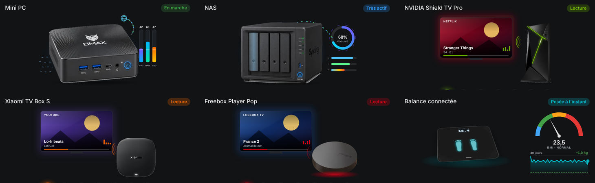

# Smart scale

`custom:appliance-scale-card`

<p align="center"></p>

**Smart scale** (cut-out photo of the Withings WS-30, laid on the floor in 3D perspective), made for the **Withings** integration. On each new weigh-in, and when the card opens: two glowing footprints appear, the plate sinks, the digits roll up to the weight with a small wobble and blink once settled, impedance waves and a light scan cross the plate and a halo lights the floor. While the weigh-in is recent (`recent_minutes`), the display cycles weight → body fat → BMI. Click the scale to replay the weigh-in.

On the side: a BMI gauge with a needle (WHO zones: under, normal, over, obese) and the curve of the last `trend_days` days (one point per day) with the goal as a dashed line and the change over the period. A "Goal reached" line shows within 0.5 of the goal. The badge shows when the last weigh-in happened.

BMI comes from `entity_bmi`, or is computed from the weight and `height` (cm). The curve needs the recorder (history).

## Options

- `entity_weight` (kg or lb)
- `entity_fat_ratio` (%), `entity_fat_mass`, `entity_muscle_mass`, `entity_bone_mass`, `entity_hydration`, `entity_visceral_fat`, `entity_heart_pulse`
- `entity_weight_goal`, `entity_bmi`, `height` (cm)
- `recent_minutes` (default 5), `trend_days` (default 30)
- `animations` (default true)
- `show_status`, `show_bmi`, `show_trend`, `show_composition`
- `language: fr|en|de|it|nb|nl|ro|ru|sr|sr-Latn`

## Example

```yaml
type: custom:appliance-scale-card
entity_weight: sensor.withings_weight
entity_fat_ratio: sensor.withings_fat_ratio
entity_fat_mass: sensor.withings_fat_mass
entity_muscle_mass: sensor.withings_muscle_mass
entity_bone_mass: sensor.withings_bone_mass
entity_hydration: sensor.withings_hydration
entity_heart_pulse: sensor.withings_heart_pulse
entity_weight_goal: sensor.withings_weight_goal
height: 178
```


[← All cards](../../README.md#the-cards)
