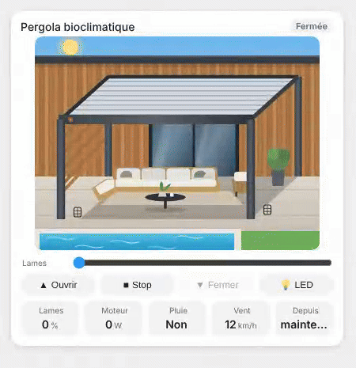
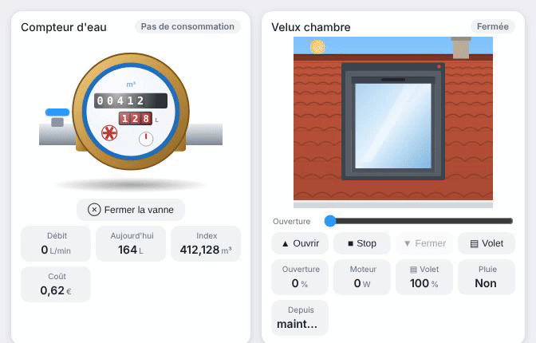

# Shutters and blinds

`custom:appliance-roller-shutter-card · custom:appliance-venetian-blind-card · custom:appliance-swing-shutter-card · custom:appliance-pergola-card · custom:appliance-roof-window-card`

<p align="center"></p>

Three window coverings, a bioclimatic pergola and a roof window driven by a `cover` entity. The view through the window follows the sun: day sky with the sun, or night sky with the moon and stars when `sun.sun` is below the horizon.

| Card | Animation |
|---|---|
| Roller shutter (`roller-shutter`) | the aluminium slats roll up into the box at `current_position`; light slits between the slats by day, a beam of light into the room when open |
| Venetian blind (`venetian-blind`) | the slats stack under the head rail as the blind goes up, and turn with `current_tilt_position` (flat = see through, closed = full slats); a **Tilt** slider |
| Swing shutters (`swing-shutter`) | two louvred leaves swing open in 3D on their hinges and fold back against the wall |
| Bioclimatic pergola (`pergola`) | the louvres of an aluminium pergola, in front of a modern house with a pool, turn with `current_tilt_position` (or `current_position` when the cover has no tilt); sun rays and striped shadows on the terrace, LED strip and lit house at night |

The badge shows **Open**, **Closed**, **Open 40 %** or **Closing… 65 %**; while moving, the box LED blinks and an arrow follows the shutter. Buttons **Open / Stop / Close** (Stop hidden if the cover cannot stop), a **Position** slider when the cover supports it, and tiles for position, tilt, motor power and last change. Without `current_position`, open = 100 % and closed = 0 %.

## Bioclimatic pergola

<p align="center"></p>

Same states, buttons and options as the shutters. The badge reads **Open 40 %** / **Closing… 30 %**, the slider and the **Louvres** tile show the louvre angle (the slider sets the tilt when the cover reports one, the position otherwise). Extra options:

- `entity_rain` (binary_sensor `on`, or a sensor above 0): grey sky, rain drops, water running down the post, **Rain** tile
- `entity_light` (light or switch of the LED strip): **LED** button, glowing strip and light on the terrace at night
- `entity_wind` (wind speed sensor): **Wind** tile
- `show_rain`, `show_wind`

```yaml
type: custom:appliance-pergola-card
entity: cover.pergola
entity_power: sensor.pergola_motor_power
entity_rain: binary_sensor.rain
entity_light: light.pergola_led
entity_wind: sensor.wind_speed
travel_time: 25
```

## Roof window

<p align="center"></p>

`custom:appliance-roof-window-card`: a centre-pivot roof window (Velux, Fakro…) on a tiled roof. The sash pivots with `current_position` and shows the room inside (lit at night). Same states, buttons and options as the shutters; badge **Open 60 %** / **Closing… 20 %**. Extra options:

- `entity_blind` (cover of the exterior roller blind): the blind rolls down over the glass, **Blind** button (raise / lower) and tile, "Blind down" in the badge
- `entity_rain` (binary_sensor `on`, or a sensor above 0): grey sky and rain, **Rain** tile
- `show_blind`, `show_rain`

```yaml
type: custom:appliance-roof-window-card
name: Bedroom Velux
entity: cover.velux_bedroom
entity_blind: cover.velux_bedroom_blind
entity_rain: binary_sensor.velux_rain_sensor
```

## Options

- `entity` (cover)
- `entity_power` (motor power sensor)
- `sun_entity` (default `sun.sun`; day view if missing)
- `color` (CSS colour of the slats or leaves; defaults: aluminium, beige, green)
- `travel_time` (s, full travel: the drawing moves at the speed of the motor; default 1.2 s per change)
- `invert` (`true` for a cover that reports its position upside down, 0 = open and 100 = closed, as some Tuya shutters do: the drawing, badge, tiles and slider are flipped; the Open / Close buttons are unchanged)
- `animations`, `show_status`, `show_controls`, `show_slider`, `show_position`, `show_tilt`, `show_power`, `show_since`
- `labels` (tile keys: `position`, `tilt`, `power`, `since`)
- `language: fr|en|de|nb|nl|ro|ru`

## Example

```yaml
type: custom:appliance-roller-shutter-card
name: Living room
entity: cover.living_room_shutter
entity_power: sensor.living_room_shutter_power
travel_time: 20
```

```yaml
type: custom:appliance-swing-shutter-card
entity: cover.kitchen_shutters
color: "#3f6f9a"
```

[← All cards](../../README.md#the-cards)
