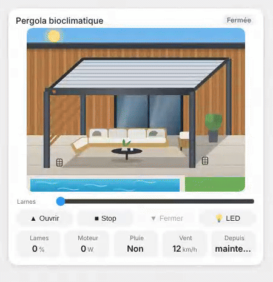
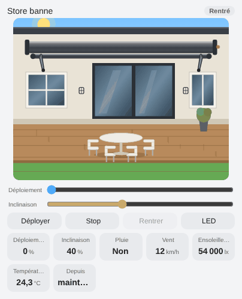
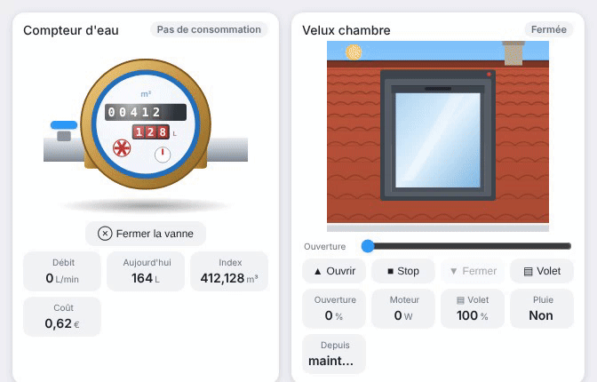

# Shutters and blinds

`custom:appliance-roller-shutter-card · custom:appliance-venetian-blind-card · custom:appliance-swing-shutter-card · custom:appliance-sliding-curtain-card · custom:appliance-pergola-card · custom:appliance-roof-window-card · custom:appliance-awning-card`

<p align="center"></p>

Shutters, blinds, sliding curtains, a bioclimatic pergola, a roof window and a retractable awning driven by a `cover` entity. The view through the window follows the sun: day sky with the sun, or night sky with the moon and stars when `sun.sun` is below the horizon.

| Card | Animation |
|---|---|
| Roller shutter (`roller-shutter`) | the aluminium slats roll up into the box at `current_position`; light slits between the slats by day, a beam of light into the room when open |
| Venetian blind (`venetian-blind`) | the slats stack under the head rail as the blind goes up, and turn with `current_tilt_position` (flat = see through, closed = full slats); a **Tilt** slider |
| Swing shutters (`swing-shutter`) | two louvred leaves swing open in 3D on their hinges and fold back against the wall |
| [Sliding curtains](sliding-curtain.md) (`sliding-curtain`) | two fabric panels gather sideways from the centre, following `current_position`; `color` sets the fabric colour |
| Bioclimatic pergola (`pergola`) | the louvres of an aluminium pergola, in front of a modern house with a pool, turn with `current_tilt_position` (or `current_position` when the cover has no tilt); sun rays and striped shadows on the terrace, LED strip and lit house at night |

**Tilt only (venetian blind)**: `tilt_only: true` hides Open / Stop / Close and the position slider and keeps only the slat angle: the **Tilt** slider and preset buttons **0 / 25 / 50 / 75 / 100 %** (0 % = slats closed, 50 % = half open, 100 % = closed again, tilted the other way). Each button calls `cover.set_cover_tilt_position`; the one matching the current angle is highlighted. Change the buttons with `tilt_presets`; the cover must support tilt.

```yaml
type: custom:appliance-venetian-blind-card
entity: cover.living_room_blind
tilt_only: true
tilt_presets: [0, 50, 100]   # optional, default [0, 25, 50, 75, 100]
```

**Motor on the tilt cord (venetian blind)**: some blinds are tilted by an ordinary roller-blind motor (Aqara E1…) fixed on the tilt cord. Home Assistant sees a plain cover (open / close / stop / position) without any tilt feature. With `tilt_from_position: true`, the cover position is used as the slat angle: the card works like `tilt_only`, the slider and preset buttons send `cover.set_cover_position`, and the slats follow the position. If the angle runs the wrong way, add `invert: true`. Without `set_cover_position`, the card shows Open / Stop / Close buttons for the cover instead.

```yaml
type: custom:appliance-venetian-blind-card
entity: cover.rolgordijn_voorraam
tilt_from_position: true
```

The badge shows **Open**, **Closed**, **Open 40 %** or **Closing… 65 %**; while moving, the box LED blinks and an arrow follows the shutter. Buttons **Open / Stop / Close** (Stop hidden if the cover cannot stop), a **Position** slider when the cover supports it, and tiles for position, tilt, motor power and last change. Without `current_position`, open = 100 % and closed = 0 %.

## Bioclimatic pergola

<p align="center"></p>

Same states, buttons and options as the shutters. The badge reads **Open 40 %** / **Closing… 30 %**, the slider and the **Louvres** tile show the louvre angle (the slider sets the tilt when the cover reports one, the position otherwise). Extra options:

- `entity_rain` (binary_sensor `on`, or a sensor above 0): grey sky, rain drops, water running down the post, **Rain** tile
- `entity_light` (light or switch of the LED strip): **LED** button, glowing strip and light on the terrace at night
- `entity_wind` (wind speed sensor): **Wind** tile
- `show_rain`, `show_wind`

```yaml
type: custom:appliance-pergola-card
entity: cover.pergola
entity_power: sensor.pergola_motor_power
entity_rain: binary_sensor.rain
entity_light: light.pergola_led
entity_wind: sensor.wind_speed
travel_time: 25
```

## Retractable awning

<p align="center"></p>

`custom:appliance-awning-card`: a retractable (folding-arm) awning on the front of a house, above a wooden terrace with garden furniture. The fabric unrolls with `current_position` (0 = retracted in its box, 100 = fully extended), the articulated arms follow, and the shade on the terrace grows with it. If the cover reports `current_tilt_position`, it sets the pitch of the fabric (a **Tilt** slider and tile). Buttons **Extend / Stop / Retract**. By default `open` means extended; if your motor reports the opposite, use `invert: true`.

| Option | Effect |
|---|---|
| `entity_wind` + `wind_max` (km/h, default 40) | **Wind** tile; above the threshold the badge shows **Strong wind**, the fabric flutters and the tile turns orange. Sensors in m/s, mph or knots are converted |
| `entity_rain` | rain, grey sky, wet fabric, **Rain** tile |
| `entity_light` | **LED** button, light strip under the front bar and a pool of light on the terrace at night |
| `entity_lux` | **Sunlight** tile (lux sensor) |
| `entity_temperature` | outdoor **Temperature** tile |
| `entity_power` | **Motor** tile (W) |
| `color` | fabric colour (default sand taupe `#b3a086`) |
| `show_tilt`, `show_rain`, `show_wind`, `show_lux`, `show_temperature`, `show_power`, `show_since` | hide a tile |

Like every card: `name`, `illustration_size`, `transparent`, `travel_time`, `invert`, `labels`, `language`, `animations: false`, tap actions.

```yaml
type: custom:appliance-awning-card
entity: cover.terrace_awning
entity_wind: sensor.wind_speed
wind_max: 35
entity_rain: binary_sensor.rain
entity_light: light.awning_led
entity_lux: sensor.sunlight
entity_temperature: sensor.outdoor_temperature
entity_power: sensor.awning_motor_power
color: "#a88f6a"
transparent: true
illustration_size: 80
```

## Roof window

<p align="center"></p>

`custom:appliance-roof-window-card`: a centre-pivot roof window (Velux, Fakro…) on a tiled roof. The sash pivots with `current_position` and shows the room inside (lit at night). Same states, buttons and options as the shutters; badge **Open 60 %** / **Closing… 20 %**. Extra options:

- `entity` is the **window opening** (the sash). When it opens, the room inside shows through: a dark ceiling with a hanging lamp.
- `entity_blind` (cover of the exterior roller blind): grey slats roll down over the glass, **Blind** button (raise / lower) and tile, "Blind down" in the badge. If it is the same cover as `entity`, it is ignored.
- **Blind only** (a Velux with a motorised roller blind but a manual window): set `entity_blind` without `entity`. The window stays closed, the badge, buttons and slider control the blind.
- `entity_rain` (binary_sensor `on`, or a sensor above 0): grey sky and rain, **Rain** tile
- `show_blind`, `show_rain`

```yaml
type: custom:appliance-roof-window-card
name: Bedroom Velux
entity: cover.velux_bedroom
entity_blind: cover.velux_bedroom_blind
entity_rain: binary_sensor.velux_rain_sensor
```

Blind only:

```yaml
type: custom:appliance-roof-window-card
name: Bedroom Velux
entity_blind: cover.velux_bedroom_blind
```

## Options

- `entity` (cover)
- `entity_state` (own open/closed sensor for a cover without state feedback: a `binary_sensor` contact, `on` = open and `off` = closed, or any entity with an `open` / `closed` state; replaces the cover state, `invert` applies)
- `entity_position` (own position sensor, 0-100, replaces `current_position`; the position wins if both sensors disagree; a movement reported by the cover is kept)
- `entity_power` (motor power sensor)
- `sun_entity` (default `sun.sun`; day view if missing)
- `color` (CSS colour of the slats or leaves; defaults: aluminium, beige, green)
- `travel_time` (s, full travel: the drawing moves at the speed of the motor; default 1.2 s per change)
- `invert` (`true` for a cover that reports its position upside down, 0 = open and 100 = closed, as some Tuya shutters do: the drawing, badge, tiles and slider are flipped; the Open / Close buttons are unchanged)
- `invert_buttons` (`true` when the motor is wired the other way round and the **Open / Extend** button actually closes the cover: the buttons then send the opposite command, `close_cover` for Open and `open_cover` for Close, and are greyed accordingly (with an external `entity_state` / `entity_position` sensor, the buttons are greyed from the real state it reports instead). The drawing, position and slider are unchanged, use `invert` for those)
- `animations`, `show_status`, `show_controls`, `show_slider`, `show_position`, `show_tilt`, `show_power`, `show_since`
- `labels` (tile keys: `position`, `tilt`, `power`, `since`)
- `language: fr|en|de|it|es|nb|nl|pl|ro|ru|sr|sr-Latn`

## Example

```yaml
type: custom:appliance-roller-shutter-card
name: Living room
entity: cover.living_room_shutter
entity_power: sensor.living_room_shutter_power
travel_time: 20
```

```yaml
type: custom:appliance-swing-shutter-card
entity: cover.kitchen_shutters
color: "#3f6f9a"
```

[← All cards](../../README.md#the-cards)

```yaml
# Roller shutter without state feedback, with its own contact sensor
type: custom:appliance-roller-shutter-card
entity: cover.living_room_shutter
entity_state: binary_sensor.shutter_contact
entity_position: sensor.shutter_position   # optional
```
