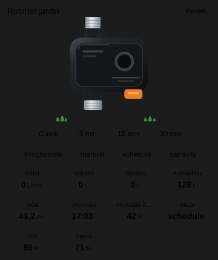

# Smart tap

`custom:appliance-smart-tap-card`

<p align="center"></p>

A Zigbee / Wi-Fi garden tap valve (Sonoff SWV type): black box with a glowing ring between the tap and the hose. Open: the ring pulses green, water runs out of the hose connector and ripples spread on the grass (faster with the flow). Closed: ring dark. Rain pause: blue ring and cloud. Fault / leak: red ring and triangle. Low battery: orange ring and battery icon. Freezing risk: snowflake.

Every entity is optional. Without `entity`, the tap counts as open when `entity_flow` is above `flow_threshold` (0.05 L/min).

| Option | What it does |
|---|---|
| `entity` | the valve: `valve`, `switch`, `input_boolean`, `cover`, `light`. **Open / Close** button |
| `entity_flow` | flow: L/min, L/h, m³/h, gal/min converted; sets the animation speed |
| `entity_volume`, `entity_today`, `entity_total` | volume of the current run, today, lifetime (L, mL, m³, gal converted) |
| `entity_remaining` | time left on the timer (s / min / h, `H:MM:SS` or a timestamp) |
| `entity_duration` | `number` / `input_number` of the run time; with it, **quick-time buttons** (`quick_times`, default `[5, 15, 30]` minutes) set it then open the tap |
| `entity_schedule` | schedule on / off (`switch`, `input_boolean`, `binary_sensor`, `button`): **Schedule** button |
| `entity_next` | next run (timestamp) |
| `entity_mode` | `select` with the modes (schedule, capacity…): one button per option (`mode_labels` renames them) |
| `entity_rain` | rain sensor (or list): the closed tap shows **Paused (rain)** |
| `entity_moisture` | soil moisture; orange below `moisture_low` (25 %) |
| `entity_leak`, `entity_fault` | binary sensors (or lists): leak / fault, the card glows red |
| `entity_battery` | % or battery binary sensor (list: the lowest); low below `battery_low` (20 %) |
| `entity_signal` | link quality (0–255 LQI, % or dBm) shown in % |
| `entity_temperature` | temperature; freezing alert below `freeze_temp` (3 °C) |
| `entity_pressure`, `entity_cost` | extra tiles |
| `compact`, `quick_times`, `moisture_low`, `show_status`, `show_buttons`, `show_flow`, `show_volume`, `show_remaining`, `show_today`, `show_total`, `show_next`, `show_moisture`, `show_mode`, `show_battery`, `show_signal`, `show_temperature`, `show_pressure`, `show_cost`, `animations`, `labels`, `language`, `illustration_size`, `transparent`, `tap_action`, `hold_action`, `temperature_unit` | |

`compact: true` is for small fixed slots (smaller title, buttons and tiles, the illustration takes the remaining height); `transparent: true` removes the card background; `illustration_size` scales the drawing (%).

```yaml
type: custom:appliance-smart-tap-card
name: Garden tap
entity: valve.garden_tap
entity_flow: sensor.garden_tap_flow
entity_today: sensor.garden_tap_water_today
entity_total: sensor.garden_tap_water_total
entity_remaining: sensor.garden_tap_time_left
entity_duration: number.garden_tap_run_time   # enables the 5 / 15 / 30 min buttons
entity_schedule: switch.garden_tap_schedule
entity_mode: select.garden_tap_mode
entity_rain: binary_sensor.rain
entity_battery: sensor.garden_tap_battery
entity_signal: sensor.garden_tap_linkquality
```

[← All cards](../../README.md#the-cards)
