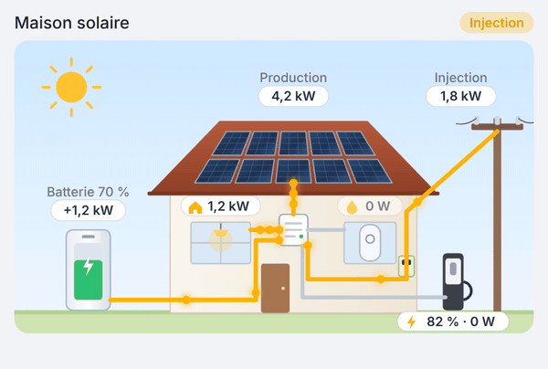
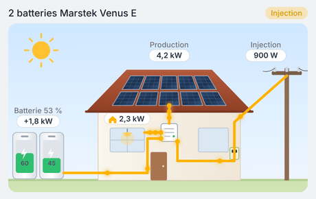

# Solar house (energy flow)

<p align="center"></p>

`custom:appliance-solar-house-card`: an animated diagram of a photovoltaic installation: solar panels on the roof, the electrical panel / inverter in the house, a home battery, the grid (electricity poles) and, optionally, an EV charger and a water heater (solar diverter).

- **Animated energy flows**: glowing dots move along the cables in the real direction of the energy, faster when the power is higher (`max_power`, 6000 W by default, is full speed). Colour = source of the energy: yellow (sun), green (battery), purple (grid).
  - panels → house; house → battery (charging) or battery → house (discharging); house → grid (export) or grid → house (import); house → EV charger; house → water heater.
- **Live legends** on each element (production, battery level and power, import / export, house, EV, water heater) and **tiles** below.
- **Day / night** from `sun.sun` (or from the production): blue sky with sun, or night sky with moon and lit windows. The panels shine while producing, the battery level fills up (orange below 30 %, red below 15 %).
- Status badge: **Self-powered**, **Exporting** or **Drawing from grid**.
- Updates automatically whenever one of the entities changes.

| Option | Description |
| --- | --- |
| `entity_solar` | Solar production (W or kW) |
| `entity_home` | House consumption (optional: otherwise computed = production + import + discharge − export − charge − EV − water heater). A negative value (for example a current clamp that swings around 0) is shown as 0, unless `show_negative: true` |
| `entity_battery_power` | Battery power, + = charging, − = discharging (`battery_invert: true` if your sensor is the other way round) |
| `entity_battery_soc` | Battery level (%) |
| `entity_grid` | Grid power, + = import, − = export (`grid_invert: true` to invert); or `entity_grid_import` + `entity_grid_export` (two positive sensors) |
| `entity_ev`, `entity_water_heater` | Optional: EV charger and water heater power (shown only if set) |
| `entity_car_soc` | Optional: the car's battery level (%), shown with the EV charger power in the legend (`74 % · 7.4 kW`) and in the EV tile; orange below 20 %, red below 10 % |
| `show_negative` | `true` shows negative values with their sign: the house consumption as it is (for example `-8 W`) and the grid with `+` import / `-` export (instead of the value without sign and the Import / Export label). Default `false` |
| `max_power` | Power at which the dots reach full speed (W, default 6000) |
| `show_tiles`, `show_status`, `animations`, `labels`, `illustration_size`, `transparent`, `language` | Usual options |

```yaml
type: custom:appliance-solar-house-card
name: Solar house
entity_solar: sensor.solar_power
entity_battery_power: sensor.battery_power      # + = charging
entity_battery_soc: sensor.battery_level
entity_grid: sensor.grid_power                  # + = import, − = export
entity_ev: sensor.wallbox_power                 # optional
entity_car_soc: sensor.car_battery_level        # optional: car level next to the charger
entity_water_heater: sensor.water_heater_power  # optional
```

**Add it to a dashboard**: edit the dashboard → *Add card* → search for "Solar house" (or *Appliance – Single card* then pick the type), choose the entities in the visual editor. In YAML: *Add card* → *Manual*, paste the example above and replace the entity ids with yours.

## Several batteries

<p align="center"></p>

Up to **3 batteries** are drawn side by side:

- `battery_count` (1 to 3): with the combined sensors of `entity_battery_power` / `entity_battery_soc` (total power, average charge), every battery shows the same level.
- **One entity per battery** (optional): `entity_battery_2_power`, `entity_battery_2_soc`, and `entity_battery_3_power`, `entity_battery_3_soc`. `entity_battery_power` and `entity_battery_soc` are then battery 1. Each battery shows its own charge level (and its percentage) and its own charging bolt; the legend and the flow use the **sum of the powers** and the **average level**.

```yaml
type: custom:appliance-solar-house-card
entity_solar: sensor.pv_power
entity_battery_power: sensor.venus_1_battery_power
entity_battery_soc: sensor.venus_1_battery_soc
entity_battery_2_power: sensor.venus_2_battery_power
entity_battery_2_soc: sensor.venus_2_battery_soc
```

[← All cards](../../README.md#the-cards)
