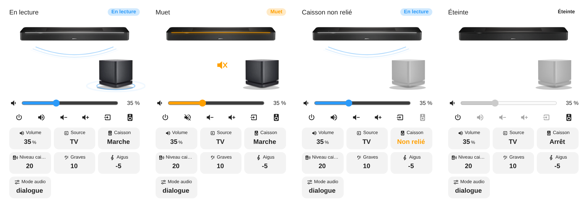

# Soundbar and subwoofer

`custom:appliance-soundbar-card`

An animated soundbar with its subwoofer, drawn from photos: **Bose Smart Soundbar 900** and **Bose Bass Module 500** (black), for any soundbar exposed as a `media_player`.

<p align="center"></p>

- **Playing**: the light bar on top of the soundbar glows white and sound waves come out of it; **muted**: the bar turns orange with a mute icon; **standby / off**: everything is dark; **unavailable**: greyed out.
- **Subwoofer** (`entity_subwoofer`, a `switch`): it pulses with low-frequency rings while the soundbar plays; it is greyed out when it is off, and shown as **not linked** when its switch is `unavailable`.
- **Buttons** (only those the `media_player` supports): on / off, mute, volume − / +, next source and subwoofer on / off. A **volume slider** moves in `volume_step` steps (1 % if not set).
- **Tiles** (all optional): volume, source, subwoofer, subwoofer level, bass, treble, center voice, height speakers, rear speakers (`number` entities) and the audio mode (`select`). Tap a tile for its history.

```yaml
type: custom:appliance-soundbar-card
entity: media_player.bose_smart_soundbar_900
entity_subwoofer: switch.bose_bass_module_500
entity_subwoofer_gain: number.bose_subwoofer_level
entity_bass: number.bose_bass
entity_treble: number.bose_treble
entity_center: number.bose_center
entity_height: number.bose_height
entity_rear: number.bose_rear
entity_sound_mode: select.bose_audio_mode
volume_step: 0.02        # optional
```

| Option | What it does |
|---|---|
| `entity` | the soundbar `media_player`: state, `volume_level`, `is_volume_muted`, `source` and `source_list` |
| `entity_subwoofer` | subwoofer switch (`on` / `off`; `unavailable` = not linked) |
| `entity_subwoofer_gain`, `entity_bass`, `entity_treble`, `entity_center`, `entity_height`, `entity_rear` | `number` entities shown as tiles |
| `entity_sound_mode` | `select` of the audio mode, shown as a tile |
| `volume_step` | step of the volume buttons and of the slider (0.05 = 5 %; the slider uses 1 % without it) |
| `show_status`, `show_controls`, `show_slider`, `show_volume`, `show_source`, `show_subwoofer`, `show_sub_gain`, `show_bass`, `show_treble`, `show_center`, `show_height`, `show_rear`, `show_sound_mode`, `animations`, `labels`, `language`, `illustration_size`, `transparent`, `tap_action` / `hold_action` | |

[← All cards](../../README.md#the-cards)
