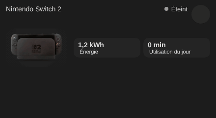

# Nintendo Switch 2

<p align="center"></p>

`custom:appliance-switch2-card`: cut-out photo of the console on its dock (seen from the front, Joy-Con 2 on each side), animated on top: screen, stick rings (blue on the left, orange on the right), dock LED, buttons, warm air and glow.

There is no Home Assistant integration for the Switch 2: the card relies on a **smart plug** (power, energy and switch).

States and animations:
- **Off**: dark screen, unlit dock LED.
- **Sleep mode**: the dock LED breathes in orange.
- **On**: the screen lights up, the rings turn blue and orange, a little warm air comes out of the top.
- **Gaming**: bright screen with a blue glow around the console, more warm air, the Joy-Con buttons light up one after the other.

The plug gives the state: on above `threshold` (**6 W**), gaming above `gaming_threshold` (**18 W**), sleep mode between `standby_threshold` (**0.5 W**) and `threshold`, off below. The thresholds are estimates: check the power your console draws (docked, handheld charging, in game) and adjust them.

```yaml
type: custom:appliance-switch2-card
name: Switch 2
power: sensor.switch2_plug_power
switch: switch.switch2_plug      # power button
energy: sensor.switch2_plug_energy
```

| Option | Description |
|---|---|
| `power` | Plug power: off, sleep mode, on, gaming. |
| `switch` | Plug switch: power button. Cutting the plug while the console is on or asleep (downloads, updates) needs two clicks. |
| `energy` | Plug energy meter: consumption tile (period with `energy_period`). |
| `threshold` | On above this power (W). Default 6. |
| `gaming_threshold` | Gaming above this power (W). Default 18. |
| `standby_threshold` | Sleep mode above this power (W). Default 0.5. |
| `confirm_off` | `false` to cut the plug in one click. Default `true`. |

Common options (`cost`, `energy_period`, `price_per_kwh`, `usage_time`, `display`, `tap_action`, `hold_action`, `labels`…): see [configuration.md](../configuration.md).

[← All cards](../../README.md#the-cards)
