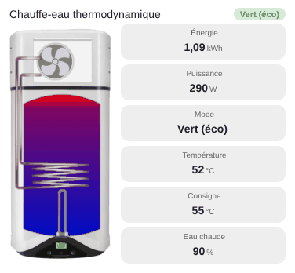

# Thermodynamic water heater

`custom:appliance-thermo-heater-card`

<p align="center"></p>

Heat-pump water heater (Ariston Nuos type): cut-out photo with a cut-away of the tank. The tank goes from blue (cold) to red (hot) with the hot water reserve, the **fan spins** in Green and Boost modes (faster in Boost) and the **electric element turns red** in Boost. Drawing by Ppatou.

Every entity is optional. **Modes**: `off`, `pause` (on but not heating), `green` (heat pump) and `boost` (electric element). The mode is read from the entity (`water_heater` operation mode, `select`…): `eco`, `heat_pump`, `green`, `auto`… count as Green; `performance`, `electric`, `boost`, `turbo`… as Boost. Without a recognised mode it is **deduced from the power**: above `boost_above` (1000 W) it is Boost, above `green_above` (150 W) Green, below that Pause. A Green mode drawing more than `boost_above` switches to Boost (the element is on).

| Option | What it does |
|---|---|
| `entity` | `water_heater`, `climate` or `switch`: state, operation mode, current and target temperature |
| `entity_mode` | optional `select` / `input_select` / `sensor` giving the mode |
| `entity_power` | power (W) |
| `entity_energy` | energy (kWh, for instance today) |
| `entity_temp` | tank temperature (otherwise the `current_temperature` of `entity`) |
| `entity_target` | target temperature (otherwise the `temperature` of `entity`) |
| `entity_temp_bottom` | bottom-of-tank temperature (extra tile, `show_bottom`) |
| `entity_reserve` | hot water reserve in %: fills the tank. Without it, estimated from the temperature and the target |
| `hot_water_level` | remaining hot water in % (used when `entity_reserve` is not set): fills the tank |
| `hot_water_volume` | remaining hot water in L: extra **Volume** tile, and fills the tank when `tank_volume` is set |
| `tank_volume` | tank capacity in L (number or entity), links `hot_water_volume` and `hot_water_level` |
| `last_cycle` | `true` shows the **last heating cycle** when idle (start → end, duration, energy), read from the Home Assistant history (4 days) of `entity_power`. A cycle is power above `green_above`. Default `false` |
| `cycle_gap` | pause (min) kept inside the same cycle (15) |
| `green_above` | below this power, the heater is in Pause; above it, Green (150 W). `running_above` still works as an alias |
| `boost_above` | above this power, Boost (1000 W) |
| `lcd_big` | `true` puts a **large readable value** on the tank (icon + temperature), since the small display is easy to miss on a small card. Default `false` |
| `lcd_value` | with `lcd_big`: `current` (default, tank temperature, thermometer icon) or `target` (setpoint, target icon) |
| `show_status`, `show_energy`, `show_power`, `show_mode`, `show_temp`, `show_bottom`, `show_target`, `show_reserve`, `show_volume`, `show_cycle`, `animations`, `labels`, `language`, `illustration_size`, `transparent`, `tap_action`, `hold_action` | |

```yaml
type: custom:appliance-thermo-heater-card
name: Boiler
entity: water_heater.nuos
entity_power: sensor.boiler_power
entity_energy: sensor.boiler_energy_today
entity_reserve: sensor.boiler_hot_water_reserve   # optional, %
```

[← All cards](../../README.md#the-cards)
