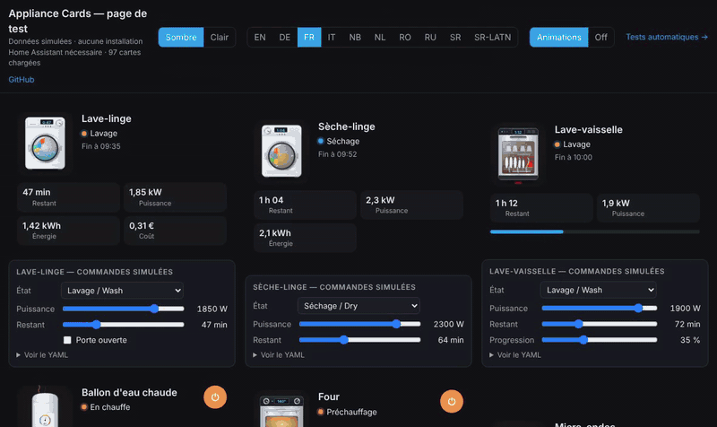

# TV box

`custom:appliance-tv-box-card`

<p align="center"></p>

**TV box** with a cut-out photo of your model (`model`): `freebox_pop` (Freebox Player Pop), `xiaomi_tv_box_s` (Xiaomi TV Box S) or `shield_tv_pro` (NVIDIA Shield TV Pro, default). It reads a `media_player` (Android TV Remote, Google Cast, Freebox…).

A floating screen sits next to the box: the artwork of what is playing with a slow Ken Burns zoom, an ambilight glow in the main colour of the artwork, the app, title and episode / artist, a running equaliser and the progress bar. Paused: the artwork dims and a pause icon pulses. Loading: a spinner. Home screen: an animated aurora in the colour of the box. Off or in standby: the screen goes dark with its red standby LED. The box answers too: the green stripe of the Shield lights up with a running light, the white LED of the Xiaomi turns on, the Player Pop glows on the table, and signal waves go from the box to the screen while playing. When the volume changes, a volume bar shows on screen.

Remote buttons (only those the entity supports): power, home (with `entity_remote`), previous, play / pause, next, volume −, mute, volume +. With **Android TV Remote**, set `entity_remote`: turning on goes through the remote entity, which is more reliable.

## Options

- `entity` (media_player), `model`, `entity_remote` (remote entity), `entity_power` (W)
- `volume_step` (default 0.05)
- `animations` (default true)
- `compact: true` (small fixed slots: smaller title, tiles and buttons, the illustration takes the remaining height), `transparent: true` (no card background), `illustration_size` (%)
- `show_status`, `show_controls`, `show_artwork`, `show_app`, `show_volume`, `show_power`
- One checkbox per remote button: `show_btn_power`, `show_btn_home`, `show_btn_prev`, `show_btn_play_pause`, `show_btn_next`, `show_btn_vol_down`, `show_btn_mute`, `show_btn_vol_up`
- `language: fr|en|de|it|nb|nl|pl|ro|ru|sr|sr-Latn`

## Examples

```yaml
type: custom:appliance-tv-box-card
model: shield_tv_pro
entity: media_player.shield
entity_remote: remote.shield
```

```yaml
type: custom:appliance-tv-box-card
model: freebox_pop
entity: media_player.freebox_player_pop
```

```yaml
type: custom:appliance-tv-box-card
model: xiaomi_tv_box_s
entity: media_player.xiaomi_tv_box_s
entity_remote: remote.xiaomi_tv_box_s
```


[← All cards](../../README.md#the-cards)
