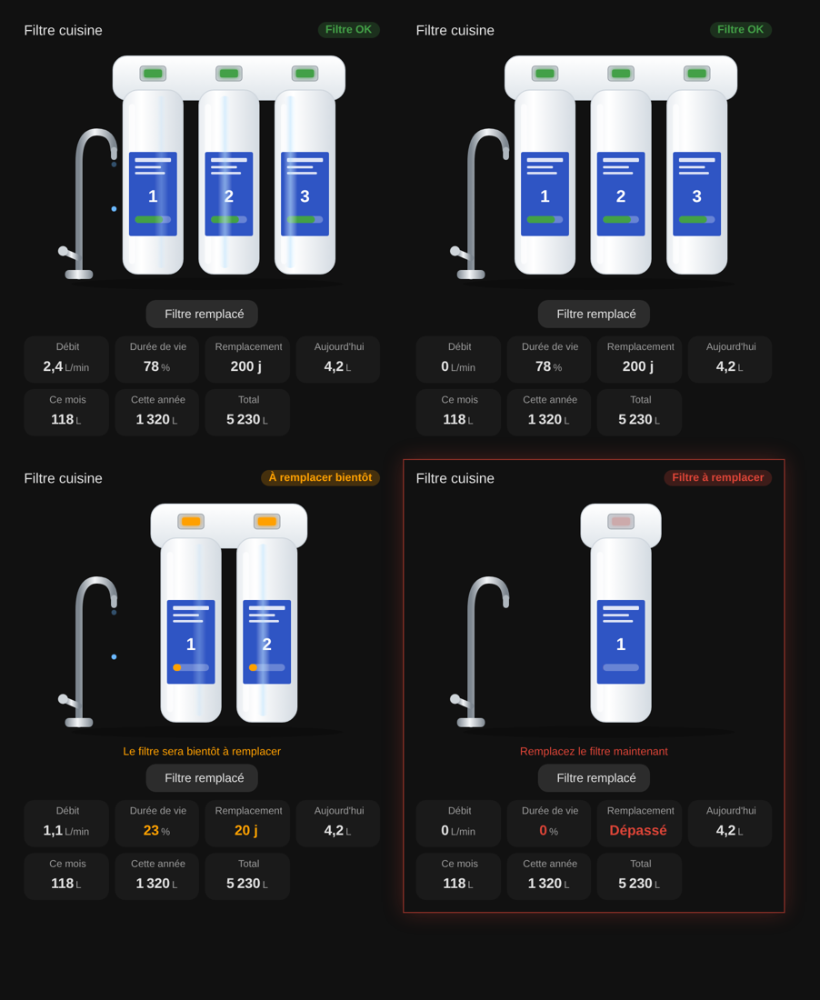

# Water filter

`custom:appliance-water-filter-card`

<p align="center"></p>

An under-sink drinking water filter with **1, 2 or 3 cartridges** (`stages`) and its tap. Each cartridge shows its remaining life on its label, and a window on the support turns **green / orange / red** with the wear. When water flows (flow above 0.05), drops fall from the tap and a shine sweeps the cartridges; **with no flow, nothing moves**. The card turns red when the filter must be replaced.

| Option | What it does |
|---|---|
| `stages` | number of cartridges drawn: 1, 2 or 3 (default 3) |
| `entity_filter` | filter counter: litres (needs `filter_capacity`) or a percentage |
| `filter_mode` | `used` (default): the counter is the litres already filtered, it grows until the replacement. `remaining`: the counter is the litres left |
| `filter_capacity` | litres a cartridge can filter (e.g. `4000`) |
| `entity_filter_2`, `entity_filter_3`, `filter_capacity_2`, `filter_capacity_3` | optional separate counters and capacities for the other cartridges (by default they share the first one) |
| `entity_date` | date of the filter replacement (`sensor` with a date / timestamp, or `input_datetime`) |
| `date_mode` | `last` (default): the date is the **last replacement**, the tile shows the filter age in days. `next`: the date is the **next replacement**, the tile shows the days left |
| `replace_after_days` | with `date_mode: last`, the filter lifetime in days (e.g. `365`): the tile then counts the days left, orange from `warn_days` (30), red once past. With `date_mode: next`, same colours on the days left |
| `soon_pct`, `replace_pct` | remaining life under which the filter is « Replace soon » (25 %) and « Replace filter » (5 %) |
| `entity_reset` | script / button / switch run by the **Filter replaced** button (asks to tap a second time to confirm) |
| `entity_flow` | flow (L/min) |
| `entity_today`, `entity_month`, `entity_year`, `entity_total` | water consumption tiles |
| `show_flow`, `show_left`, `show_date`, `show_today`, `show_month`, `show_year`, `show_total`, `show_status`, `show_buttons`, `compact`, `animations`, `labels`, `language`, `illustration_size`, `transparent`, `tap_action`, `hold_action` | |

```yaml
type: custom:appliance-water-filter-card
name: Kitchen filter
stages: 3
entity_filter: sensor.kitchen_drink_water_filter
filter_mode: used
filter_capacity: 10000
entity_date: sensor.time_reset_filter   # date of the last replacement
date_mode: last
# replace_after_days: 365
entity_reset: script.replace_filter
entity_flow: sensor.kitchen_l_min
entity_today: sensor.drinking_water_consumption_per_day
entity_month: sensor.drinking_water_consumption_per_month
entity_year: sensor.drinking_water_consumption_per_year
entity_total: sensor.total_drinking_water_consumption
```

[← All cards](../../README.md#the-cards)
