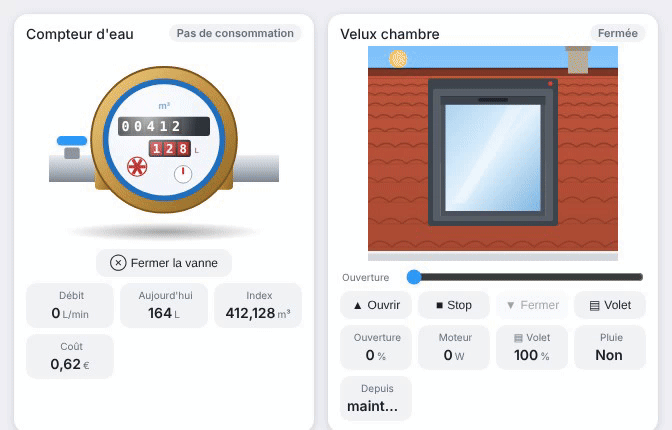

# Water meter

<p align="center"></p>

`custom:appliance-water-meter-card`: a brass water meter with a blue dial. The odometer shows the index (black m³ wheels, red litre wheels), the red flow star spins with the flow and water runs in the pipes.

Every sensor is optional, so it works with whatever your meter integration provides (Linky-like water meters, pulse counters, ESPHome, Zigbee/Z-Wave meters, Suez / Veolia / Eau de Paris integrations…):

| Option | What it does |
|---|---|
| `entity_index` | total index; `m³`, `L`, `gal`, `ft³`, `CCF` are converted |
| `entity_flow` | flow rate; `L/min`, `L/h`, `L/s`, `m³/h`, `gal/min` are converted to L/min. **Without it, the flow is derived from the index changes** |
| `entity_today` | today's consumption (any volume unit) |
| `entity_cost` | cost sensor (any currency) |
| `hot_water` | `true` for a **hot water** meter: the blue dial ring, the flow dashes, the flow badge and the valve turn red / orange |
| `labels` | `unit_m3` and `unit_l` change the two texts printed on the dial (default `m³` and `L`), e.g. `labels: {unit_m3: Today, unit_l: Shower}`; the tile names (`flow`, `today`, `index`…) are also renamed there |
| `dial_decimals` | `0` (default), `1` or `2`: adds 1 or 2 **decimal wheels** (after a dot) to the litre wheels of the dial, so the counter moves while the water runs (needs an index sensor with that precision) |
| `today_decimals`, `index_decimals` | decimals of the Today tile (automatic by default) and of the Index tile in m³ (3 by default), from 0 to 3 |
| `entity_leak` | leak sensor (`binary_sensor` / `input_boolean`, on = leak). **One entity or a list**: the alert banner names the wet sensors |
| `entity_temperature` | water temperature sensor (1 decimal, unit read from the sensor) |
| `entity_pressure` | water pressure sensor (unit read from the sensor, no conversion, no alert) |
| `entity_valve` | shut-off valve (`valve`, `switch` or `input_boolean`): **Close / Open valve** button, the valve handle on the pipe turns red |
| `leak_minutes` | without a leak sensor: "Possible leak" when water runs non-stop for longer than this (60 min; `0` turns it off) |
| `freeze_threshold` | frost alert below this temperature, in °C (3; `0` or empty turns it off). Works with a sensor in °F or K |
| `flow_threshold` | flow below this counts as zero (0.05 L/min) |
| `show_status`, `show_flow`, `show_today`, `show_index`, `show_cost`, `show_temperature`, `show_pressure`, `animations`, `labels`, `language` | |

States: **No flow**, flowing (the badge shows the flow), **Possible leak** (red alert), **Freezing risk** (blue alert, cold temperature tile), **Valve closed**. Priority: leak > freezing risk > valve closed > flowing > no flow.

```yaml
type: custom:appliance-water-meter-card
entity_index: sensor.water_meter_index      # the only sensor many meters provide
entity_today: sensor.water_today            # optional
entity_leak:                                # optional, one sensor or a list
  - binary_sensor.kitchen_leak
  - binary_sensor.cellar_leak
entity_temperature: sensor.water_temperature  # optional
entity_pressure: sensor.water_pressure        # optional
entity_valve: valve.main_water              # optional
```


[← All cards](../../README.md#the-cards)
