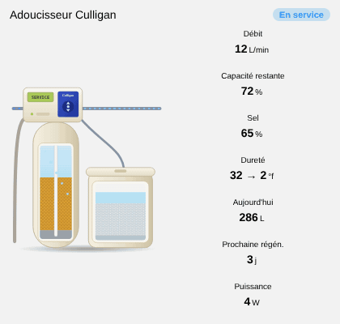

# Water softener

`custom:appliance-water-softener-card`

<p align="center"></p>

A resin water softener (Culligan type): cut-away resin tank with its control head (LCD screen) and a cut-away brine tank with salt. The pipes are animated according to the phase:

- **Service**: hard water comes in, softened water goes out (faster with the flow).
- **Backwash**: the resin bed is lifted and the water turns muddy.
- **Brine draw**: the brine goes from the salt tank to the resin, which glows.
- **Rinse**: fast rinse to the drain.
- **Low salt**: red alert, the lid of the brine tank blinks.

The phase comes from the state of `entity` (a sensor, select, switch or binary sensor: `backwash`, `contre-lavage`, `brine`, `saumure`, `regeneration`, `rinse`, `rinçage`, `off`…). Without it, the card is in service when `entity_flow` is above 0.05 and in standby otherwise.

| Option | What it does |
|---|---|
| `entity` | state of the softener (text of the current phase, or on / off) |
| `entity_flow` | flow (L/min) |
| `entity_capacity` | remaining capacity (%) |
| `entity_salt` | salt level (%); alert at or below `salt_low` (20 %) |
| `entity_hardness_in`, `entity_hardness_out` | hardness before and after, shown as `32 → 2 °f` |
| `entity_today` | water softened today |
| `entity_regen_days` | days before the next regeneration |
| `entity_power` | power (W) |
| `salt_low`, `compact`, `show_flow`, `show_capacity`, `show_salt`, `show_hardness`, `show_today`, `show_regen`, `show_power`, `animations`, `labels`, `language`, `illustration_size`, `transparent`, `tap_action`, `hold_action` | |

`compact: true` is for small fixed slots (smaller title and tiles, the illustration takes the remaining height); `transparent: true` removes the card background.

```yaml
type: custom:appliance-water-softener-card
name: Water softener
entity: sensor.softener_status
entity_flow: sensor.softener_flow
entity_capacity: sensor.softener_capacity_left
entity_salt: sensor.softener_salt_level
entity_hardness_in: sensor.water_hardness_in
entity_hardness_out: sensor.water_hardness_out
entity_regen_days: sensor.softener_days_to_regen
```

[← All cards](../../README.md#the-cards)
