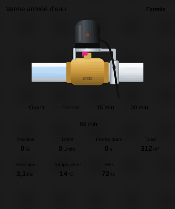

# Motorised water valve

`custom:appliance-water-valve-card`

<p align="center"></p>

A motorised ball-valve actuator (Tuya / Zigbee / Wi-Fi) clamped on a brass valve in a white pipe. The pink lever turns a quarter turn with the valve (it follows the position in %), water flows through the pipe (faster with the flow) and downstream of the valve the pipe is empty when closed. The actuator LED is green open, red closed, orange blinking while moving, red fast on leak.

Every entity is optional. Without `entity`, the valve counts as open when `entity_flow` is above `flow_threshold`.

| Option | What it does |
|---|---|
| `entity` | the valve: `valve`, `switch`, `input_boolean`, `cover`, `light`. **Open** and **Close** buttons; `opening` / `closing` states are shown. A `current_position` attribute drives the lever |
| `entity_position` | position sensor / number in % (overrides the attribute) |
| `entity_flow` | flow (L/min, L/h, m³/h, gal/min converted) |
| `entity_volume`, `entity_today`, `entity_total` | volumes (L, mL, m³, gal converted) |
| `entity_remaining` | auto-close timer left (s / min / h, `H:MM:SS` or timestamp) |
| `entity_duration` | `number` of the auto-close delay: **quick-time buttons** (`quick_times`, default `[15, 30, 60]` min) set it then open |
| `entity_schedule`, `entity_next`, `entity_mode` | schedule button, next run, mode buttons |
| `entity_leak` | leak sensor (or list): red alert, drops under the valve, close button highlighted |
| `entity_fault` | fault binary sensor (or list) |
| `entity_battery` | % or battery binary sensor (list: the lowest), low below `battery_low` (20 %) |
| `entity_signal`, `entity_pressure`, `entity_power`, `entity_cost` | extra tiles |
| `entity_temperature` | freezing alert below `freeze_temp` (3 °C) |
| `compact`, `show_status`, `show_buttons`, `show_position`, `show_flow`, `show_volume`, `show_remaining`, `show_today`, `show_total`, `show_next`, `show_mode`, `show_pressure`, `show_temperature`, `show_power`, `show_battery`, `show_signal`, `show_cost`, `animations`, `labels`, `language`, `illustration_size`, `transparent`, `tap_action`, `hold_action`, `temperature_unit` | |

Alerts by priority: **Unavailable**, **Leak!**, **Fault**, **Freezing risk**, **Low battery**; the open / closed state stays drawn underneath.

`compact: true` is for small fixed slots (smaller title, buttons and tiles, the illustration takes the remaining height); `transparent: true` removes the card background; `illustration_size` scales the drawing (%).

```yaml
type: custom:appliance-water-valve-card
name: Main water
entity: valve.main_water
entity_flow: sensor.main_water_flow
entity_total: sensor.main_water_total
entity_leak:
  - binary_sensor.sink_leak
  - binary_sensor.washer_leak
entity_battery: sensor.main_valve_battery
entity_temperature: sensor.cellar_temperature
```

[← All cards](../../README.md#the-cards)
